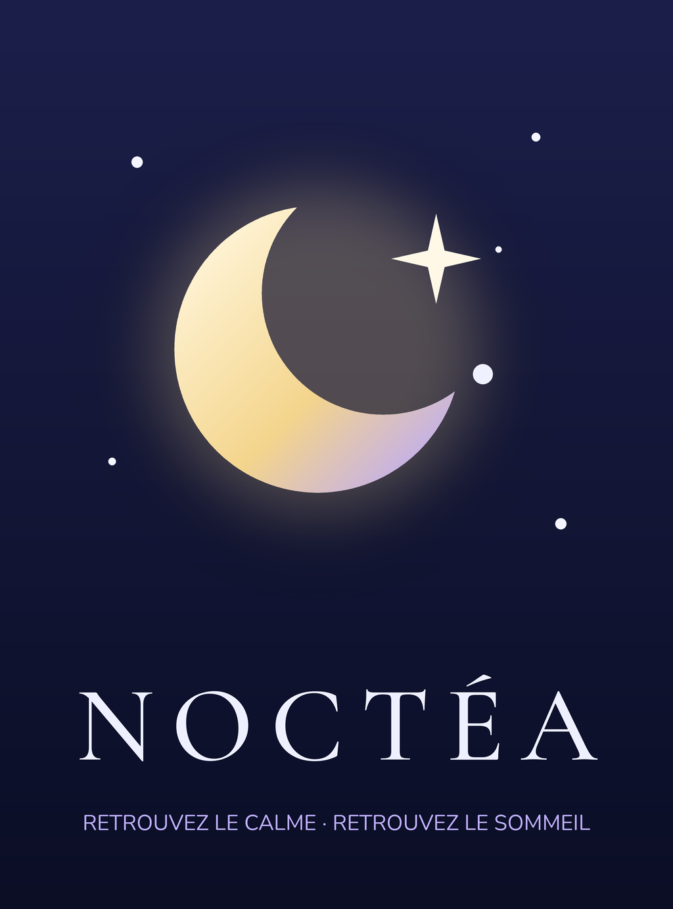

# 🌙 NOCTÉA — by Superessence Studio

> Ce dépôt contient aussi **ESSABANK**, application bancaire de simulation : voir [`essabank/README.md`](essabank/README.md).

**Retrouvez le calme. Retrouvez le sommeil.**

NOCTÉA est une application Android native (Kotlin + Jetpack Compose + Media3) de méditation guidée, de respiration, d'histoires du soir et d'ambiances sonores, éditée par **Superessence Studio**.

<p align="center"></p>

- **APK installable** : [`release/NOCTEA-Superessence-Studio.apk`](release/NOCTEA-Superessence-Studio.apk) (Android 8.0+, signé, ~22 Mo, fonctionne hors connexion)
- **Aperçus audio** (mixage réel de l'application) : [`branding/apercu-endormissement-profond.mp3`](branding/apercu-endormissement-profond.mp3), [`branding/apercu-histoire-cabane.mp3`](branding/apercu-histoire-cabane.mp3)

---

## Ce qui est inclus (et fonctionne sans compte, sans abonnement, sans Internet)

| Domaine | Contenu |
|---|---|
| Écran de lancement | Présentation animée lente « SuperEssence. » (lettre par lettre, ombre portée, reflet lumineux, « STUDIO · présente »), puis apparition du logo NOCTÉA. Toucher pour passer. |
| Bibliothèque | **29 séances guidées**, soit près de 4 heures de contenu : Sommeil (6), Relaxation (5), Respiration (5), Méditation (5), Histoires du soir (6), Réveil doux (2). Chaque séance a un titre, une description, une durée, une illustration et son texte. |
| Voix | Voix féminine française douce, **préenregistrée** (1 492 fragments, 52 min de parole), débit ralenti, vraies pauses intégrées à l'audio. |
| Créer ma méditation | Générateur : 10 objectifs × 8 durées (3 à 60 min) × 10 ambiances × 6 styles × 3 intensités musicales. Il produit un script cohérent (intention, installation, respiration, scan corporel, visualisation, cœur de l'objectif, approfondissement, conclusion), affichable, avec la voix NOCTÉA, à la **durée exacte** demandée. Historique des créations, variantes, favoris. |
| Mon texte | Transforme un texte libre en séance audio : « ... » = pause, ligne vide = pause longue, `[pause 10]` = 10 s de silence. Voix de l'appareil (Android TTS) ou serveur vocal configurable. |
| Lecteur | Lecture/pause, ±15 s, barre de progression, temps restant, minuteur de sommeil (fondu de 25 s, ou « fin de la séance »), lecture en arrière-plan et écran éteint, commandes sur l'écran verrouillé et en Bluetooth, volume voix / volume musique séparés, réglage de chaque couche d'ambiance, vitesse (×0,8 à ×1,1), favoris, reprise automatique, texte de la séance, **téléchargement en fichier audio .m4a** (voix + ambiance, dans Musique/NOCTEA), mode écran minimaliste, cercle de respiration synchronisé. |
| Ambiances | 15 boucles sans coupure : pluie douce, orage lointain, vagues, ruisseau, vent dans les arbres, vent doux, feu de cheminée, sons nocturnes, bruits blanc/rose/brun, musique ambient, piano relaxant, pads atmosphériques, univers spatial. |
| Mixeur nocturne | Jusqu'à 6 couches simultanées avec volumes indépendants, mélanges enregistrables, commandes sur l'écran verrouillé, minuteur. |
| Mon rituel | Heure du coucher, rappel par notification, étapes ordonnables (séances, créations, ambiance jusqu'à l'endormissement), lecture enchaînée. |
| Réveil doux | Alarme à l'heure exacte par jour de la semaine, écran au-dessus du verrouillage, séance du matin, répétition de 10 min. |
| Suivi | Calendrier mensuel, minutes de calme, jours de pratique, rituels accomplis. Aucune notion de série « perdue ». |
| Plus | Journal du soir (humeur, texte, gratitude), humeur du jour et suggestions, citations apaisantes, méditation aléatoire, recherche intelligente (accents, synonymes, texte des séances), séances recommandées selon l'heure, historique d'écoute, 3 thèmes, mode nuit automatique (palette chaude et atténuée le soir), profil, export et import des données en JSON. |

### Ce qui nécessite un service externe (facultatif)

| Fonction | État |
|---|---|
| **Voix premium pour les textes libres** | Le fournisseur « Serveur vocal personnalisé » est implémenté : NOCTÉA envoie `POST {"text","voice","length_scale","speed"}` et attend un fichier audio (wav/mp3/ogg). Il suffit d'un serveur. Exemple : `python3 -m piper.http_server -m fr_FR-siwis-medium` sur un ordinateur ou un serveur, ou une passerelle vers un fournisseur premium. **Aucune clé n'est dans le code** : l'URL et la clé sont saisies dans Profil › Voix et restent sur l'appareil. |
| Voix de l'appareil | Utilise le moteur TTS Android installé. La qualité dépend du téléphone. Les voix Google « réseau neuronal » sont naturelles, d'autres le sont moins : l'application l'indique honnêtement. |
| Abonnement Premium | L'architecture est prête (`billing/Entitlements.kt` : interface `BillingGateway`, quotas gratuit/premium). **Aucun paiement n'est simulé.** La passerelle « offre de lancement » accorde tout gratuitement et l'écran Premium le dit. Pour activer Google Play Billing : implémenter `BillingGateway` avec `com.android.billingclient:billing` et créer les produits `noctea_premium_monthly` / `noctea_premium_yearly` dans la Play Console. |
| Synchronisation de compte | Pas de compte pour l'instant. Les préférences s'exportent et s'importent en JSON (Réglages › Données), dans le format qu'utiliserait une synchronisation. |

### À propos de la voix (en toute transparence)
La voix embarquée est produite avec **Piper** (synthèse neuronale libre) et le modèle féminin français **« Siwis »** (CC-BY 4.0). Elle est ensuite traitée comme une production studio : débit ralenti (×1,24), égalisation chaleureuse, atténuation des aigus pour un rendu feutré, de-essing, compression douce, légère réverbération de pièce, normalisation, respirations discrètes et vrais silences entre les phrases. C'est une voix douce et naturelle pour une synthèse libre, mais **ce n'est pas une comédienne enregistrée**. Pour aller plus loin, il suffit de remplacer les fichiers `assets/voice/*.ogg` par des enregistrements humains, ou de régénérer le contenu avec un autre moteur (voir plus bas) : l'application n'a pas à être modifiée.

---

## Architecture

```
app/src/main/java/com/superessence/noctea/
├── NocteaApp.kt / MainActivity.kt
├── data/        Catalog (catalogue embarqué), UserStore (persistance locale JSON), Sounds, Discovery (recherche, recommandations)
├── generator/   MeditationGenerator : assemblage du script et calcul exact des silences (Kotlin pur, testé)
├── audio/       AudioEngine (lecteur Media3, minuteur, reprise, historique), NocteaMediaSourceFactory
│                (timeline voix + silences → une seule source continue), AmbienceMixer (boucles multiples),
│                PlaybackService (MediaSessionService : arrière-plan + écran verrouillé), AudioExporter (.m4a)
├── tts/         VoiceProvider (architecture modulaire) : voix embarquée, SystemTtsProvider, RemoteHttpTtsProvider ; TextComposer
├── notify/      Rappels du rituel, réveil doux, redémarrage
├── billing/     Entitlements / BillingGateway (prêt pour Google Play Billing)
└── ui/          Thème, composants (ciel étoilé animé, logo, illustrations vectorielles), écrans
tools/
├── build_content.py   Production vocale : scripts → fragments → Piper → traitement studio → Opus + catalog.json
├── content/bank.py    Banque de phrases du générateur (~360 phrases)
├── content/library.py Scripts des 29 séances + citations
├── build_sounds.py    Synthèse procédurale des 15 ambiances (boucles parfaites)
├── make_icons.py      Logo et icônes (vectoriel Android + PNG)
└── render_preview.py  Aperçus MP3 d'une séance
```

**Moteur audio.** Une séance est une *timeline* de clips vocaux et de silences. `NocteaMediaSourceFactory` la transforme en un seul `ConcatenatingMediaSource2`, si bien qu'une séance est un seul élément pour le lecteur, la notification et l'écran verrouillé, avec une durée et un déplacement exacts. Les silences viennent d'un fichier Opus silencieux découpé, au même format que la voix, ce qui évite les coupures. Les ambiances sont des lecteurs en boucle indépendants qui suivent le lecteur principal (lecture, pause, fondu du minuteur). Le mixeur seul s'appuie sur un « silence porteur » pour garder les commandes sur l'écran verrouillé.

---

## Compiler l'application

Prérequis : JDK 17 ou plus récent, Android SDK (plateforme 35, build-tools 35.0.0).

```bash
echo "sdk.dir=/chemin/vers/android-sdk" > local.properties
./gradlew assembleRelease          # → app/build/outputs/apk/release/app-release.apk
./gradlew testDebugUnitTest        # 34 tests (contenu, générateur, moteur audio, 18 écrans, parcours)
./gradlew testDebugUnitTest --tests '*ScreenshotTest*' -Pscreenshots=true   # captures dans app/build/screenshots
```

**Signature.** `keystore/noctea-release.jks` est une clé de projet, fournie pour que les builds soient reproductibles et que les mises à jour s'installent par-dessus. **Avant une publication sur le Play Store, créez votre propre clé** et passez-la par les variables `NOCTEA_KEYSTORE`, `NOCTEA_KEYSTORE_PASSWORD`, `NOCTEA_KEY_ALIAS` et `NOCTEA_KEY_PASSWORD` (ou utilisez Play App Signing).

## Modifier les contenus

```bash
pip install piper-tts numpy
# modèle vocal : https://huggingface.co/rhasspy/piper-voices/tree/main/fr/fr_FR/siwis/medium
python3 tools/build_content.py --model fr_FR-siwis-medium.onnx   # régénère voix + catalogue
python3 tools/build_sounds.py app/src/main/assets/sounds         # régénère les ambiances
python3 tools/make_icons.py                                      # régénère logo et icônes
```

- **Ajouter une séance** : ajoutez un `dict(...)` dans `tools/content/library.py`. La syntaxe des scripts est documentée en tête du fichier : `|6` pour une pause, `~30` pour un silence, `@cycles 4 7 8 0 6 count` pour une respiration, `@pool body 0-10 5` pour reprendre des phrases de la banque.
- **Enrichir le générateur** : ajoutez des phrases dans `tools/content/bank.py`. L'ordre des listes définit la progression.
- **Changer de voix** : autre modèle Piper (`--model`), ou adaptez `_render()` dans `build_content.py` pour appeler un autre moteur. Un cache évite de resynthétiser les phrases inchangées.

## Tests et vérifications effectués
- 34 tests automatisés, tous verts : intégrité du catalogue (chaque clip existe, chaque timeline totalise sa durée), générateur (600 combinaisons, durée exacte à la milliseconde, cohérence et déterminisme), découpage des pauses, recherche, moteur audio réel sous Robolectric (durée de la timeline concaténée = durée du catalogue, mixeur, file du rituel, minuteur), rendu de 18 écrans sans plantage, parcours « générer puis écouter » et « minuteur », écran de lancement.
- APK release minifié (R8), signé (schéma v2), vérifié avec `apksigner` et `aapt2`.
- **Non vérifié ici** : aucun émulateur ni téléphone n'était disponible dans l'environnement de compilation (pas de virtualisation matérielle). L'APK n'a donc pas encore été installé sur un appareil réel ; l'écoute réelle (décodage Opus, écran verrouillé, alarmes) reste à confirmer sur téléphone.

---

*NOCTÉA est un outil de bien-être et ne remplace pas un avis médical.*

**Une création Superessence Studio.**
