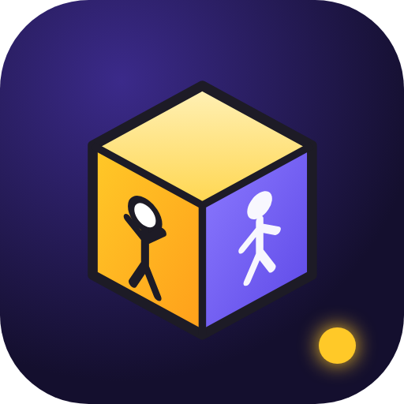

# 🧊 CUBIVERSE — by SuperEssence Studio

**Des mondes vivants dans des cubes connectés.**

<p align="center"></p>

- **APK Android** : [`release/Cubiverse-SuperEssence-Studio.apk`](release/Cubiverse-SuperEssence-Studio.apk) (Android 7.0+, signé, ~0,6 Mo, 100 % hors ligne)
- **Version web / PWA installable** : `web/dist/` (servir le dossier en HTTPS, puis « Ajouter à l'écran d'accueil »)

Un univers de cubes assemblables. Chaque cube est un petit monde avec ses habitants
(petits bonhommes 3D à tête ronde), ses objets et ses événements. Les habitants vivent seuls :
ils ont des besoins, une personnalité, des émotions, une mémoire, des habitudes, des amis et des
rivaux, et passent d'un cube à l'autre par les portes et les échelles.

---

## Ce qui fonctionne

| Domaine | Contenu |
|---|---|
| Style rétro pixel (par défaut) | Cubes en plastique brillant posés sur une table, écran rétroéclairé coloré dans un cadre noir sur la face avant, habitants en bonshommes pixelisés (tête ronde évidée, yeux, sourire) animés à partir des mêmes 45 poses que la 3D, objets en sprites, bulles en glyphes, effet LCD (ombre de l'encre, trame). Les habitants passent d'un écran à l'autre (côtés, échelle vers l'écran du dessus). Paramètres › Style pour revenir à la vue 3D en coupe. |
| Lancement | Animation « SuperEssence. STUDIO » : un cube jaune tombe, rebondit, tourne puis devient le point final du logo pendant que les lettres apparaissent. Toucher pour passer. Puis logo Cubiverse et menu. |
| Cubes | Nombre illimité (aucune limite codée). 16 thèmes : maison, jardin, forêt, plage, ville, laboratoire, salle de sport, restaurant, parc, école, usine, espace, montagne, piscine, arcade, château. |
| Connexions | 6 côtés (4 latéraux + dessus/dessous). Deux cubes sont connectés s'ils sont adjacents **et** que les deux côtés sont ouverts. Portes en arche sur les côtés, échelle + trappe entre étages. Fermer un côté bloque réellement le passage. |
| Éditeur | Ajouter (catalogue ou ➕ fantômes autour du cube), supprimer, dupliquer (objets + habitants), déplacer (glisser le cube au doigt ou flèches relatives à la caméra, monter/descendre), changer thème/nom/couleur, ouvrir/fermer chaque côté, ajouter/retirer des habitants (jusqu'à 32), poser/tourner/déplacer/retirer 44 types d'objets. |
| Grandes structures | Générateur rangée / tour / quartier / pyramide / ville, de taille libre, construit par tranches (l'interface ne se bloque pas). |
| Habitants 3D | Vrais modèles 3D instanciés (tête, buste, bras et jambes articulés, mains, pieds, yeux, sourcils, bouche, joues), ombres, 45 animations procédurales avec fondus : marcher, courir, sauter, danser, roulade, tomber, se relever, s'asseoir, dormir, manger, boire, rire, pleurer, bouder, saluer, coucou, bagarre cartoon, poignée de main, câlin, chat, cache-cache, lancer/attraper, construire, dessiner, lire, jardiner, pêcher, sport, machines, cuisiner, nettoyer, nager, piano, balançoire, toboggan, grimper, célébrer… Expressions selon l'émotion, bulles d'émotion. |
| IA | Décision par utilité, 100 % locale : 6 besoins, 7 traits de personnalité, 5 émotions, humeur, mémoire (40 souvenirs), habitudes par tranche horaire, 10 compétences, inventaire. Un timide reste seul, un sociable cherche les autres, un colérique se dispute… |
| Social | Discussions (qui peuvent mal tourner), blagues, coucou, poignée de main, câlins, danse à deux, chat, cache-cache, ballon, cadeaux, disputes, bagarres, réconciliations, visites aux amis dans d'autres cubes. Amis, meilleur ami, rivaux, groupes d'amis nommés automatiquement. |
| Objets utilisés réellement | Ex. restaurant : un client affamé s'assoit et attend, un cuisinier cuisine, sert le plat, le client mange, la table devient sale, quelqu'un la nettoie. Pêche, jardinage, dessin, laboratoire (avec petites explosions), etc. produisent des objets qu'on peut offrir. |
| Événements | Fêtes (confettis), anniversaires (invités venus d'autres cubes, gâteau, cadeaux), concours (dessin, cuisine, construction, danse, sport, blagues), courses à travers les cubes connectés, cache-cache géant, réunions de groupe, visites de voisinage, petits accidents (avec entraide), découvertes. |
| Écrans | Menu, Mon univers, Éditeur, Catalogue, Habitants (recherche, filtres, tri), Fiche individuelle (besoins, émotions, personnalité modifiable, relations modifiables, compétences, habitudes, inventaire, mémoire, statistiques), Historique filtrable, Paramètres, Galerie des univers. |
| Caméra | Glisser = tourner, pincer = zoomer, deux doigts = déplacer, double-toucher = zoomer sur un cube / suivre un habitant, vue en coupe des étages, cycle jour/nuit. |
| Sauvegarde | IndexedDB (repli localStorage) : cubes, connexions, objets et leur état, habitants, personnalités, relations, inventaires, mémoire, habitudes, groupes, historique. Sauvegarde auto toutes les 45 s, à la mise en arrière-plan et au retour menu. Plusieurs univers, export/import JSON. |

## Architecture

```
web/src/
├── sim/            Simulation pure (aucune dépendance au rendu, testée sous Node)
│   ├── world.js        cubes (index spatial), connexions, personnages, journal
│   ├── nav.js          itinéraires entre cubes (BFS) : portes et échelles
│   ├── ai.js           besoins, décision par utilité, exécution, interactions à deux, déplacements physiques
│   ├── social.js       relations, mémoire, émotions, groupes
│   ├── events.js       événements collectifs et ponctuels
│   ├── simulation.js   niveaux de détail : simulation complète près de la caméra, simplifiée ailleurs
│   ├── persistence.js  sérialisation compacte + IndexedDB
│   └── themes.js / presets.js / names.js
├── render/         Three.js (WebGL) : tout est instancié → nombre d'appels de dessin constant
│   ├── renderer.js     scène, caméra tactile, jour/nuit, ombres, sélection
│   ├── cubes.js        sols, murs en coupe, portes, cadres, échelles, objets, LOD lointain
│   ├── characters.js   squelette procédural, visages, bulles
│   ├── poses.js        45 animations
│   ├── props.js / geom.js / fx.js
└── ui/ + main.js   écrans et interactions
android/            hôte natif minimal (WebView plein écran, origine https virtuelle, bouton retour, import/export)
```

### Performances
- **Simulation par niveaux** : seuls les cubes proches de la caméra (rayon et budget réglables) sont simulés image par image ; les autres vivent en arrière-plan avec une simulation simplifiée par tranches (besoins, activités, rencontres, migrations).
- **Rendu** : instanciation de tous les éléments (personnages, murs, objets), cubes lointains en version simplifiée, plafond d'habitants affichés, mode économie de batterie (30 i/s), pause complète en arrière-plan.
- Tests (`npm test` dans `web/`) : 32 habitants dans un cube pendant 10 min simulées, passages entre cubes, côté fermé infranchissable, sauvegarde/restauration, **2 000 cubes / 8 000 habitants : < 1 ms par image de simulation**.

## Construire

```bash
cd web && npm install && npm test
```

```bash
./build-apk.sh
```

`build-apk.sh` n'utilise pas Gradle : `aapt`, `javac`, `dx`, `zipalign`, `apksigner` et `android.jar`
(paquets Ubuntu : `aapt dalvik-exchange zipalign apksigner android-sdk-platform-23`).
La clé de signature fournie (`keystore/`) sert aux tests : remplacez-la avant une publication
(variables `CUBIVERSE_KEYSTORE`, `CUBIVERSE_KEYSTORE_PASSWORD`).

Polices : Fredoka et Nunito (SIL Open Font License, voir `FONTS_LICENSE_OFL.txt` à la racine du dépôt).

## Captures

| Rétro pixel | Écran | Lancement | Menu | Univers | Édition | Fiche | 400 cubes |
|---|---|---|---|---|---|---|---|
|  |  |  |  |  |  |  |  |
