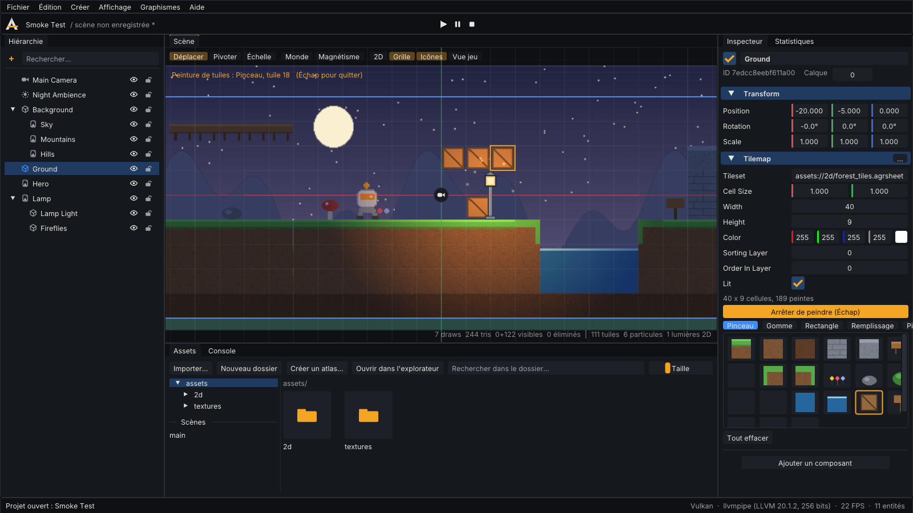
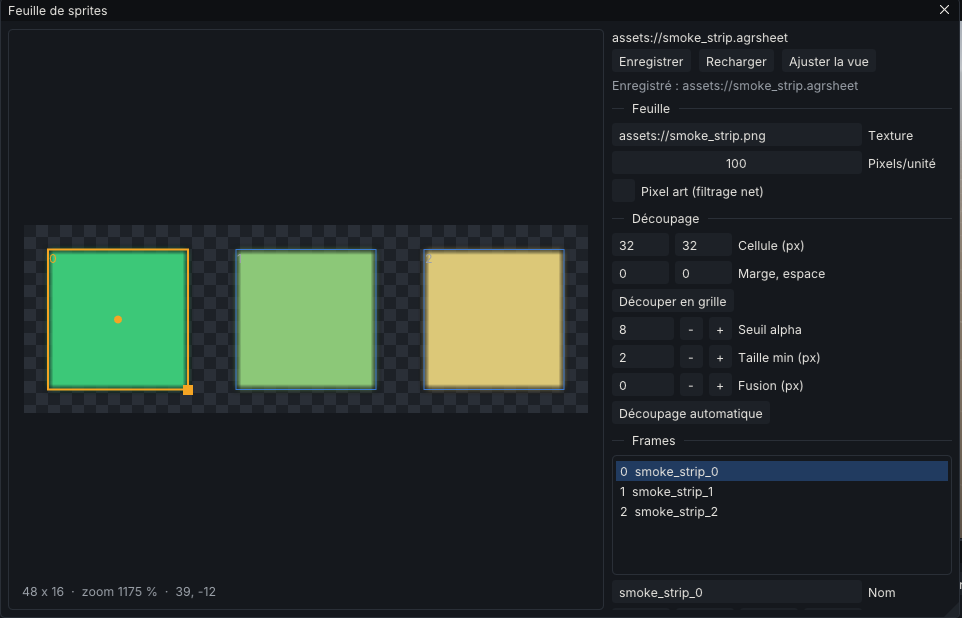
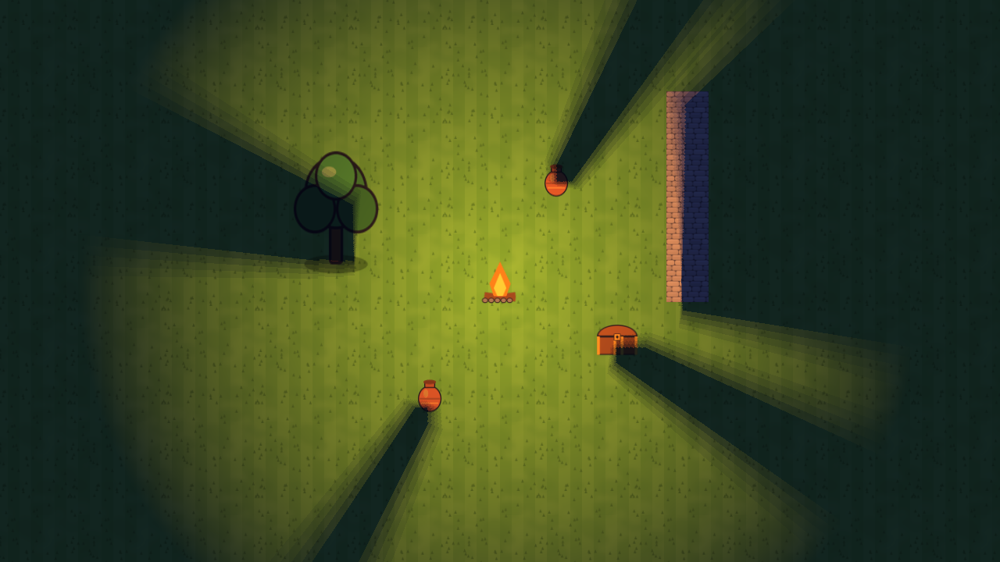
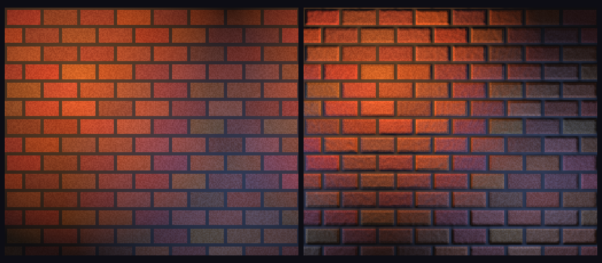
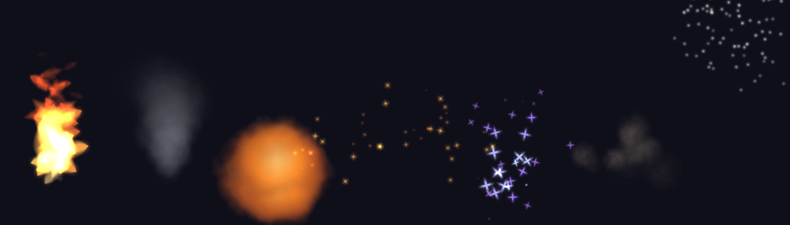
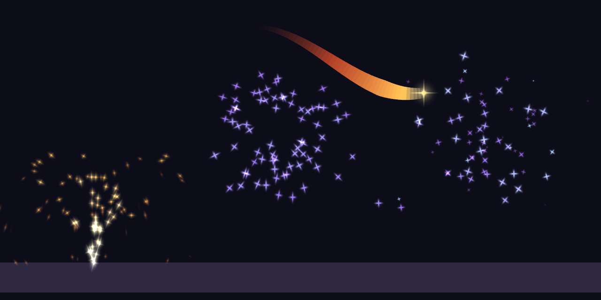
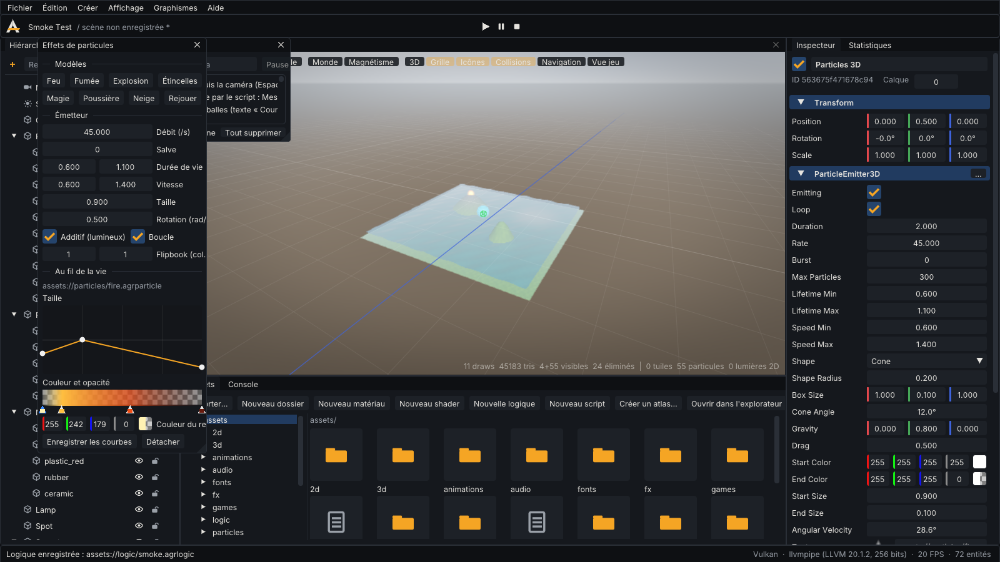

# Systèmes 2D (phase 4)

Ce guide décrit ce que la 2D d'AGR ENGINE sait faire aujourd'hui, comment l'utiliser dans l'éditeur
et depuis le code, et ce qui n'existe pas encore. Tout ce qui est listé ici est couvert par des tests
automatisés (unitaires, GPU au pixel près sur Vulkan / OpenGL / OpenGL ES, test de bout en bout de
l'éditeur).



*Le modèle « Vitrine 2D » dans l'éditeur (Vulkan), pendant la peinture de tuiles. Capture produite par le test automatisé.*

## Vue d'ensemble

| Fonction | Composant / API | Module |
|---|---|---|
| Sprites (texture ou frame d'une feuille), teinte, miroir, pivot, calques de tri | `SpriteRenderer` | `agr::render` |
| Feuilles de sprites (`.agrsheet`) : frames, pivots, clips | `SpriteSheet`, `SpriteSheetLibrary` | `agr::render` |
| Découpe en grille, atlas (empaquetage d'images) | `buildGridSheetFile`, `buildAtlasFiles`, `packAtlas` | `agr::twod` |
| Animation image par image | `SpriteAnimator` | `agr::twod` |
| Tilemaps (grille de tuiles d'une feuille), édition | `Tilemap`, `tilemapSet` / `FillRect` / `FloodFill` | `agr::render`, `agr::twod` |
| Parallaxe | `Parallax` | `agr::render` |
| Lumières 2D ponctuelles, ombres | `Light2D` + `lit` sur sprites et tilemaps ; `LightOccluder2D` | `agr::render` |
| Particules 2D | `ParticleEmitter2D` | `agr::render`, `agr::twod` |
| Adaptation aux écrans (téléphones, tablettes) | `Camera.scaleMode`, `referenceAspect` | `agr::render` |

Le module `agr::twod` contient la simulation (animations, particules) et les outils (atlas, édition de
tilemaps). Il s'active avec un plugin statique, après le rendu :

```cpp
engine.plugins().addStatic(std::make_unique<agr::RenderPlugin>());
engine.plugins().addStatic(std::make_unique<agr::TwoDPlugin>());
```

## Feuilles de sprites (`.agrsheet`)

Un fichier JSON lisible qui découpe une texture en frames et définit des clips d'animation :

```json
{
  "format": "agr.spritesheet", "version": 1,
  "texture": "assets://2d/hero.png", "textureWidth": 320, "textureHeight": 32,
  "pixelsPerUnit": 32, "pixelArt": true,
  "frames": [ { "name": "hero_0", "x": 0, "y": 0, "w": 32, "h": 32, "pivot": [0.5, 0.0] } ],
  "clips":  [ { "name": "run", "fps": 12, "loop": true, "frames": [4, 5, 6, 7, 8, 9] } ]
}
```

- Coordonnées en pixels, origine en haut à gauche de la texture. `pivot` : (0, 0) = bas gauche de la frame.
- Les clips référencent les frames par index ou par nom. Le fichier est validé au chargement (frames hors
  de la texture, clips invalides, version future) avec un message d'erreur précis dans la console.
- `pixelsPerUnit` sert à la « taille native » (pixels ➜ unités du monde) ; `pixelArt` active le filtrage net.
- Les feuilles sont mises en cache et **rechargées à chaud** quand le fichier change.

**Dans l'éditeur** (panneau Assets) :
- clic droit sur une image ➜ *Découper en grille (feuille de sprites)…* (taille de cellule, marge,
  espacement, pixel art) ;
- bouton *Créer un atlas…* : regroupe toutes les images du dossier courant dans une texture (empaquetage
  par étagères, bordures répétées pour éviter les fuites de couleur au filtrage) et écrit la feuille
  correspondante, frames nommées d'après les fichiers ;
- les fichiers générés ne remplacent jamais un fichier existant (suffixe `_2`, `_3`…) ;
- une feuille s'affiche avec sa première frame et son nombre de frames ; la glisser dans la scène crée un
  sprite à la taille native, avec un `SpriteAnimator` sur le premier clip s'il en existe.

## Sprites

`SpriteRenderer` : `texture` **ou** `sheet` + `frame`. Avec une feuille, le pivot de la frame remplace
celui du composant (les frames d'un même clip peuvent avoir des pivots différents) ; le picking de
l'éditeur en tient compte. L'inspecteur propose la liste des frames avec aperçu et un bouton
*Taille native*.

Tri : `sortingLayer`, puis `orderInLayer`, puis profondeur. Les sprites consécutifs qui partagent texture
et mode de rendu (normal, éclairé, additif) sont dessinés en **un seul draw call**.

## Shaders de sprites

`SpriteRenderer.shader` : un `.agrshader` avec `void sprite(inout Sprite s)` modifie la couleur de
chaque pixel du sprite (contour, dissolution, flash, ondulation) : voir [SHADERS.md](SHADERS.md).

## Éditeur de feuilles de sprites

*Affichage › Feuilles de sprites*, double-clic sur un `.agrsheet`, ou clic droit sur une image ›
« Éditer comme feuille de sprites (découpage automatique) » (crée la feuille à côté de l'image).



- **Vue** : la texture sur un damier (transparence), molette = zoom autour du curseur, clic droit ou
  milieu glissé = déplacer la vue. Les frames sont encadrées et numérotées ; la frame choisie montre
  son pivot et une poignée de redimensionnement.
- **À la souris** : glisser dans le vide dessine une nouvelle frame, glisser une frame la déplace,
  glisser son coin la redimensionne (au pixel près) ; Suppr la supprime.
- **Découpage** : en grille (cellule, marge, espace) ou **automatique** : une frame par îlot de pixels
  opaques (seuil alpha, taille minimale, distance de fusion pour garder une épée avec son héros),
  rangées par lignes.
- **Frame** : nom, rectangle, pivot (boutons *Centre* et *Pieds*), *Rogner* (réduit aux pixels
  opaques), monter / descendre (les clips suivent), supprimer.
- **Clips** : ajout, nom, frames (`0,1,2,1`, ou « + frame sélectionnée »), images/s, boucle, avec un
  **aperçu animé**.
- *Enregistrer* (Ctrl+S) réécrit le `.agrsheet` ; les sprites de la scène se mettent à jour.
  Les modifications ne passent pas par *Annuler* (comme les clips de la timeline).

## Animation image par image

`SpriteAnimator` (`clip`, `speed`, `playing`) joue un clip de la feuille du `SpriteRenderer` de la même
entité et écrit `SpriteRenderer.frame`. L'inspecteur liste les clips (nombre de frames, cadence, boucle).
L'animation se joue en mode Jeu (elle modifie un champ enregistré dans la scène ; elle n'est donc pas
prévisualisée en mode édition). `clipFrameAt(clip, t)` donne la frame d'un instant (boucle ou dernière
frame tenue).

## Tilemaps

`Tilemap` : une grille `width × height` de cellules de taille `cellSize`, dans le plan XY local de
l'entité ; la cellule (x, y) couvre `[x, x+1] × [y, y+1] × cellSize`, y vers le haut. Chaque cellule
contient l'index d'une frame du `tileset` (une feuille), ou −1 (vide).

- Rendu : seules les cellules **visibles par la caméra** sont générées (une carte 1000 × 1000 coûte le prix
  de l'écran, pas de la carte), en un draw call par tileset.
- Enregistrement compact : les données sont compressées par plages (RLE) dans la scène ; une carte de
  1 million de cellules typique tient en moins d'1 Ko et se charge en ~0,4 ms.
- Redimensionner la carte conserve les tuiles à leur position.
- **Tuiles animées** (`animatedTiles`) : `"f0,f1,f2@fps;..."` — chaque cellule contenant la frame `f0`
  boucle sur la liste à `fps` images par seconde (toutes en phase, temps du moteur).
- **Tuiles automatiques** (`autotile`) : `"F;G;..."` — chaque frame de base commence un groupe de
  16 frames rangées selon un masque des 4 voisins (+y = 1, +x = 2, −y = 4, −x = 8). Une cellule
  contenant n'importe quelle frame du groupe s'affiche avec `F + masque` de ses voisins du même groupe :
  on peint avec `F`, bords et coins suivent. Les frames résolues peuvent elles-mêmes être animées.
  `"F:47"` : jeu **« blob » de 47 frames** sur les 8 voisins (coins intérieurs compris ; un coin ne
  compte qu'avec ses deux côtés) ; la frame `F + i` correspond au i-ème masque de `blobTileMasks()`
  (bits : +y = 1, +x+y = 2, +x = 4, +x−y = 8, −y = 16, −x−y = 32, −x = 64, −x+y = 128, par ordre
  croissant).
  `"F:c"` : **transitions entre terrains par coins** (16 frames, « Wang de coins ») — chaque cellule
  regarde ses 4 coins ; un coin appartient au terrain si l'une des 4 cellules qui le touchent est du
  groupe (bits : haut-gauche = 1, haut-droit = 2, bas-gauche = 4, bas-droit = 8). Une cellule non vide
  dont un coin touche le terrain s'affiche `F + masque` : l'herbe déborde sur le sable voisin avec des
  bords et coins arrondis. Plusieurs jeux `F:c` peuvent cohabiter (le premier listé gagne).

**Peindre dans l'éditeur** : sélectionner l'entité, déposer une feuille dans *Tileset*, puis dans
l'inspecteur choisir une tuile dans la palette (ou *Peindre dans la vue*). Outils :

| Outil | Raccourci (vue survolée) | Effet |
|---|---|---|
| Pinceau | B | Peint ; glisser trace une ligne continue (pas de trous même en mouvement rapide) |
| Gomme | E | Vide les cellules |
| Rectangle | U | Remplit le rectangle tracé |
| Remplissage | G | Remplit la zone contiguë de même tuile |
| Pipette | I | Prend la tuile cliquée |
| Quitter | Échap | Revient aux gizmos et à la sélection |

Chaque geste (un trait, un rectangle, un remplissage) est **une** entrée d'annulation. Pendant la
peinture, les clics ne changent pas la sélection et le gizmo est masqué. La carte et la cellule
survolée sont surlignées. Hors peinture, cliquer une tuile peinte sélectionne la tilemap ; les cellules
vides laissent sélectionner ce qui est derrière.

## Parallaxe

`Parallax.factor` (x, y) s'applique à l'entité et à ses enfants : 1 = défile avec le monde, 0 = reste
attaché à la caméra, entre les deux = plan lointain. Le décalage est appliqué au rendu (les
transformations ne changent pas). Pour un fond qui se répète, utiliser `uvRect` (ex. `z = 4` répète
la texture 4 fois horizontalement).

## Lumières 2D

`Light2D` (couleur, intensité, rayon, `falloff`) éclaire les sprites et tilemaps dont `lit` est coché :
lumière = ambiance (`Environment`) + Σ couleur × intensité × (1 − distance / rayon)^falloff, en espace
linéaire. Jusqu'à **16 lumières visibles** par image (les lumières hors champ sont ignorées). Sans
`Environment`, l'ambiance par défaut s'applique. Les sprites non éclairés ignorent lumières et ambiance.

`Light2D.directional` : lumière de type soleil/lune selon l'axe +X local de l'entité, sans rayon ni
atténuation (éclaire toute la scène ; la position est ignorée). Avec une normal map, le relief est
ombré depuis cette direction et `height`. Avec `castShadows`, les occulteurs projettent des **ombres
parallèles** : une carte de 512 lignes le long de la lumière couvre la vue, chaque ligne gardant le
premier occulteur rencontré ; `shadowSoftness`, `shadowStrength` et `shadowPenetration` s'appliquent.

### Ombres 2D



- **`LightOccluder2D`** bloque la lumière : une boîte (`size`, `offset`) dans le plan XY de l'entité
  (tournée et mise à l'échelle avec elle), ou, sur une entité qui a une `Tilemap`, **toutes ses cases
  non vides** (regroupées par rangées pour limiter les arêtes).
- **`Light2D.castShadows`** (8 lumières à ombres au plus par image) : pour 512 directions autour de la
  lumière, le moteur calcule la distance de l'obstacle le plus proche (*carte d'ombre polaire*, sur le
  processeur, une ligne d'une petite texture par lumière, mise à jour à chaque image ; seules les
  arêtes à portée sont testées). Le shader compare la distance du pixel à celle de sa direction.
- `shadowSoftness` adoucit les bords (5 lectures réparties sur les directions voisines),
  `shadowStrength` règle l'obscurité de l'ombre (0..1), `shadowPenetration` (unités du monde) laisse la
  lumière entrer un peu dans les obstacles : la face éclairée d'un mur ou d'une tuile reste claire et
  l'ombre commence derrière. La partie d'un objet située derrière sa propre boîte d'obstacle reste dans
  l'ombre : ajuster la boîte (souvent la base de l'objet) et la pénétration.
- Une lumière placée à l'intérieur d'un obstacle est entièrement masquée. `RenderStats::shadowedLights2D`
  et `occluderEdges2D` comptent les lumières à ombres et les arêtes testées.

### Normal maps 2D (relief)



Une **normal map** donne du relief aux sprites et tilemaps éclairés : briques, plis, écailles, pierres
captent la lumière du côté de chaque `Light2D`.

- `SpriteRenderer.normalMap` / `Tilemap.normalMap` : image de même disposition que la texture (ou que
  la texture du tileset / de la feuille de sprites), convention OpenGL (vert vers le haut). Seulement
  avec `lit` coché. Rotation et miroirs (`flipX` / `flipY`) sont gérés : le repère est reconstruit dans
  le shader à partir des dérivées écran, sans données de sommets en plus.
- `Light2D.height` : hauteur de la lumière au-dessus des sprites (1 par défaut). Basse = lumière
  rasante, relief marqué ; haute = lumière de face, relief doux.
- L'éclairage est **relatif à une surface plate** : une zone plate de la normal map s'éclaire exactement
  comme sans normal map. Ajouter une normal map ne change donc pas la luminosité générale de la scène ;
  les pentes tournées vers une lumière s'éclaircissent (jusqu'à ×2), les autres s'assombrissent.
- Les sprites avec normal map sont regroupés par paire texture + normal map (un draw par groupe) ;
  `RenderStats::normalMappedSprites` les compte.

**Générer une normal map** à partir d'une image existante (relief estimé d'après la luminosité et les
bords transparents) :

```
python3 tools/generate_normal_map.py assets/2d/forest_tiles.png --tile 32            # tileset sans raccords
python3 tools/generate_normal_map.py assets/2d/hero.png --tile 32 --bevel 3          # feuille de sprites
python3 tools/generate_normal_map.py assets/walls/bricks.png --tileable --strength 2.5  # texture répétée
```

Options : `--strength` (force du relief), `--bevel` (largeur des bords arrondis en pixels), `--detail`
(poids de la luminosité), `--tile-bevel` (arrondir aussi le bord de chaque tuile : caisses, blocs).
Le modèle « Vitrine 2D » l'utilise pour le sol, le héros, la caisse et les champignons.


Tests : `2D normal maps` (tests GPU, GL / GLES / Vulkan) : relief éclairé du bon côté, miroir,
rotation, hauteur de la lumière, identique à un sprite sans normal map quand la surface est plate.

## Particules 2D

`ParticleEmitter2D` : débit (`rate`), salves (`burst`) à chaque cycle, durée et boucle, durée de vie,
vitesse, direction et dispersion, rayon d'apparition, gravité, freinage, couleurs et tailles de début et
de fin, rotation, texture (vide = disque doux généré par le moteur), mélange additif, espace monde ou
local, graine (0 = aléatoire, sinon déterministe), plafond `maxParticles`.

- Simulation sur CPU dans `agr::twod` (10 000 particules : ~0,02 ms par pas), rendu par lots avec les sprites.
- L'état (particules vivantes) n'est jamais enregistré dans la scène.
- Dans l'éditeur, les particules s'animent aussi en mode édition (aperçu) ; *Redémarrer* dans l'inspecteur.

### Effets : courbes, flipbook, modèles et éditeur visuel

Valable pour `ParticleEmitter2D` et `ParticleEmitter3D` :

- **Courbes au fil de la vie** (`curves`, fichier `.agrparticle` partageable entre émetteurs) : une
  **courbe de taille** (multiplicateur de `startSize`) et un **dégradé de couleur et d'opacité** (repères
  RGBA) selon l'âge de la particule (0 = naissance, 1 = mort). Ils remplacent les valeurs de début / fin ;
  sans courbes, rien ne change. Le renderer lit une table précalculée (64 échantillons, une recherche par
  émetteur et non par particule).
- **Flipbook** (`flipbookColumns` × `flipbookRows`, `flipbookCycles`) : la texture est découpée en images
  jouées pendant la vie de chaque particule (explosions, fumées animées).
- **Modèles** (`agr/editor/ParticlePresets.hpp`) : *Feu, Fumée, Explosion, Étincelles, Magie,
  Poussière, Neige*, pour la 2D comme pour la 3D, sur des textures et courbes originales livrées dans
  `assets/particles` (`tools/generate_particle_art.py` : étincelle, bouffée de fumée, flamme, étoile
  magique, explosion en 4 × 4 images). Les textures sont blanches : les dégradés les colorent.
- **Éditeur** : *Affichage › Effets de particules* sur un émetteur sélectionné : boutons des modèles,
  *Rejouer*, réglages principaux (débit, salve, durée de vie, vitesse, taille, rotation, additif,
  boucle, flipbook), **éditeur de courbe** (clic : ajouter / déplacer une clé ; clic droit : supprimer) et
  **éditeur de dégradé** (repères à glisser, couleur et opacité de chacun). Les modifications de courbes
  s'affichent **en direct** dans la scène (aperçu sans écrire le fichier) ; *Enregistrer les courbes*,
  *Créer des courbes* (depuis les couleurs et tailles actuelles), *Détacher*. Un ancien projet sans
  `assets/particles` les reçoit au premier modèle appliqué.



### Comportements : collisions, attracteurs, sous-émetteurs, étirement, traînées



- **Collisions** (`collisions`, émetteurs en espace monde) : le **sol** (`groundPlane`, plan y =
  `groundHeight`) et les composants **`ParticleCollider`** (sphère de diamètre `size.x` ou boîte `size`,
  tournés et mis à l'échelle avec l'entité ; les particules 2D utilisent leur coupe XY). `bounce` garde
  la vitesse normale (0 = s'arrête, 1 = élastique), `collisionFriction` freine le long de la surface,
  `dieOnCollision` fait disparaître la particule au contact (pluie, balles).
- **Attracteurs** (`ParticleAttractor` : `strength` > 0 attire, < 0 repousse, `radius`, décroissance
  linéaire) : vortex, aimants, souffles. `affectedByAttractors` sur l'émetteur.
- **Sous-émetteurs** : `subEmitter` désigne un autre émetteur (souvent `emitting` décoché) qui lance
  `subEmitCount` particules là où une particule **meurt** ou **touche** quelque chose (`subEmitOn`) :
  feux d'artifice, éclaboussures, étincelles d'impact. `burstParticles2D / 3D(scène, émetteur, position,
  nombre)` fait la même chose à la demande (impacts depuis le code).
- **Étirement** (`velocityStretch`, en secondes de vitesse) : la particule s'allonge dans le sens de son
  mouvement (vu de la caméra en 3D) — étincelles, pluie (modèle *Pluie*), traits de vitesse.
- **Traînées** (`Trail` sur n'importe quelle entité : projectile, épée, comète, personnage qui fonce) : un
  ruban qui suit l'entité, un point fixé tous les `minDistance`, effacé après `lifetime` ; largeur et
  couleur suivent `curves` (`.agrparticle` : courbe = largeur selon l'âge du point, dégradé = couleur)
  ou s'amincissent et s'effacent ; texture étirée le long du ruban (u de la queue à la tête), additif,
  tri. Face à la caméra (dans le plan XY en 2D).
- Le panneau *Effets de particules* a une section *Comportement* (étirement, collisions, rebond,
  frottement, sous-émetteur) ; les nouveaux composants sont dans *Ajouter un composant › Effects*.

Tests : `particles: ground and collider bounces, attractors, sub-emitters, bursts` et `trails record
points` (`tests/test_twod.cpp`), `trails and velocity-stretched particles` (GPU, GL / GLES / Vulkan).



Tests : `particle curves` (`tests/test_render.cpp`), `particles: over-lifetime curves and flipbook frames`
(GPU, GL / GLES / Vulkan), `particle presets` (`tests/test_editor.cpp`), étape du test de bout en bout.

## Écrans de téléphones : modes d'échelle

Une caméra orthographique définit une **zone de conception** de `2 × orthographicSize` de haut et
`referenceAspect` fois plus large (16:9 par défaut). `scaleMode` choisit comment l'adapter à l'écran :

| Mode | Garanti | Conséquence |
|---|---|---|
| `FixedHeight` (défaut) | même hauteur visible | plus ou moins de monde sur les côtés |
| `FixedWidth` | même largeur visible | plus ou moins de monde en haut et en bas |
| `FitInside` | toute la zone est visible | bandes de monde en plus sur certains écrans |
| `Crop` | l'écran est toujours rempli | une partie de la zone peut être coupée |

`orthographicHalfExtents(mode, size, referenceAspect, screenAspect)` donne la taille visible exacte
(utile pour placer une interface ou des limites de caméra).

## Modèle « Vitrine 2D »

Disponible dans l'assistant de projet (type 2D) et dans *Fichier › Nouvelle scène*. Il assemble tous les
systèmes : fonds en parallaxe sur 3 plans, tilemap de 40 × 9 (sol, mare, plateformes, décor), héros
« AGR-1 » animé, lampe avec lumière 2D, lucioles en particules, caméra en `FixedHeight`.
Toutes les images sont **originales**, générées par `tools/generate_template_2d_art.py` (reproductible).
Il ne contient pas encore de gameplay : déplacements, collisions et scripts arrivent en phase 6.

## Performances (llvmpipe, rastériseur logiciel, 1280 × 720)

| Scène | Collecte CPU | Draw calls |
|---|---|---|
| Tilemap 1000 × 1000, ~16 700 cellules à l'écran | 0,8 ms | 1 |
| 10 000 particules additives | 0,8 ms | 1 |
| 10 000 sprites éclairés, 16 lumières | 1,1 ms | 1 |

Détails et autres mesures : [BENCHMARKS.md](BENCHMARKS.md).

## Limites actuelles (non implémenté)

- Ombres directionnelles 2D : définies sur la vue (un occulteur hors champ, du côté d'où vient la
  lumière, compte ; pas au-delà de 512 lignes de précision). Normal maps : carte spéculaire
  (`SpriteRenderer.specularMap`, sprites seulement : rgb = force des reflets, alpha = brillance) ; pas de normal
  map pour les particules, pas de carte spéculaire pour les tilemaps et les peaux 2D.
- Tuiles automatiques : jeux de 16 (4 voisins), 47 frames (8 voisins) ou transitions par coins (16
  frames, un terrain sur un autre à la fois) ; pas de règles personnalisées par script ; pas de calques multiples dans un seul composant (utiliser plusieurs entités
  `Tilemap` avec `sortingLayer`).
- Particules 2D : `lit` (éclairées par les `Light2D` et leurs ombres, sauf en additif) ; `spawnShape` disque, cercle, rectangle (`spawnSize`) ou ligne (cascades, pluie le
  long d'un bord), tournés avec l'émetteur. Particules 2D simulées sur CPU (turbulence, héritage de vitesse, collisions, attracteurs et
  sous-émetteurs compris), ou **sur le GPU** avec `gpu` (comme `ParticleEmitter3D`, voir 3D.md : direction
  et ouverture, disque, cercle, rectangle et ligne, gravité, freinage ; test GPU sur les 3 API avec
  150 000 particules) ; en mode GPU : ni courbes, ni collisions, ni attracteurs, ni `lit`, ni couche de tri
  (dessinées après les autres sprites).
