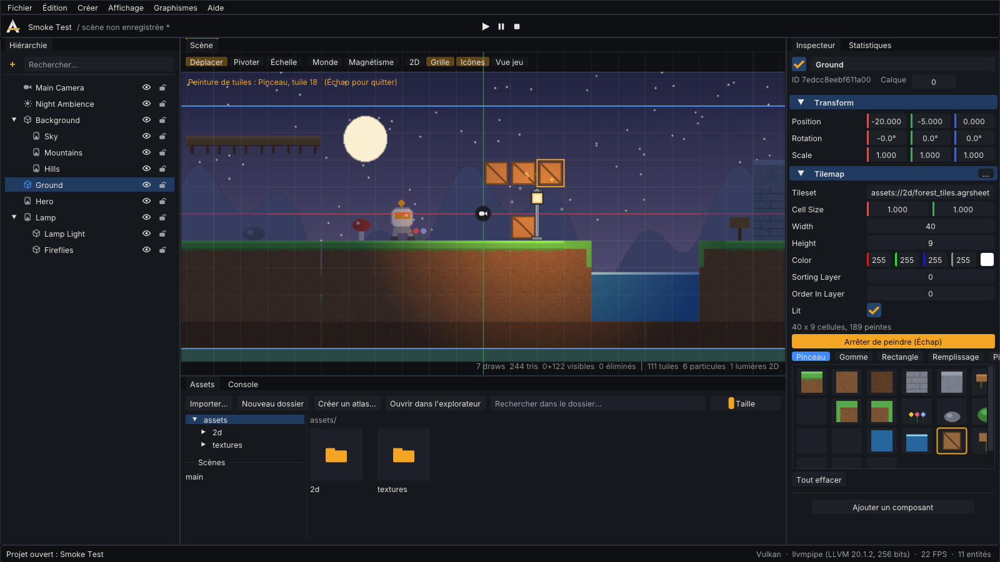

# Systèmes 2D (phase 4)

Ce guide décrit ce que la 2D d'AGR ENGINE sait faire aujourd'hui, comment l'utiliser dans l'éditeur
et depuis le code, et ce qui n'existe pas encore. Tout ce qui est listé ici est couvert par des tests
automatisés (unitaires, GPU au pixel près sur Vulkan / OpenGL / OpenGL ES, test de bout en bout de
l'éditeur).



*Le modèle « Vitrine 2D » dans l'éditeur (Vulkan), pendant la peinture de tuiles. Capture produite par le test automatisé.*

## Vue d'ensemble

| Fonction | Composant / API | Module |
|---|---|---|
| Sprites (texture ou frame d'une feuille), teinte, miroir, pivot, calques de tri | `SpriteRenderer` | `agr::render` |
| Feuilles de sprites (`.agrsheet`) : frames, pivots, clips | `SpriteSheet`, `SpriteSheetLibrary` | `agr::render` |
| Découpe en grille, atlas (empaquetage d'images) | `buildGridSheetFile`, `buildAtlasFiles`, `packAtlas` | `agr::twod` |
| Animation image par image | `SpriteAnimator` | `agr::twod` |
| Tilemaps (grille de tuiles d'une feuille), édition | `Tilemap`, `tilemapSet` / `FillRect` / `FloodFill` | `agr::render`, `agr::twod` |
| Parallaxe | `Parallax` | `agr::render` |
| Lumières 2D ponctuelles | `Light2D` + `lit` sur sprites et tilemaps | `agr::render` |
| Particules 2D | `ParticleEmitter2D` | `agr::render`, `agr::twod` |
| Adaptation aux écrans (téléphones, tablettes) | `Camera.scaleMode`, `referenceAspect` | `agr::render` |

Le module `agr::twod` contient la simulation (animations, particules) et les outils (atlas, édition de
tilemaps). Il s'active avec un plugin statique, après le rendu :

```cpp
engine.plugins().addStatic(std::make_unique<agr::RenderPlugin>());
engine.plugins().addStatic(std::make_unique<agr::TwoDPlugin>());
```

## Feuilles de sprites (`.agrsheet`)

Un fichier JSON lisible qui découpe une texture en frames et définit des clips d'animation :

```json
{
  "format": "agr.spritesheet", "version": 1,
  "texture": "assets://2d/hero.png", "textureWidth": 320, "textureHeight": 32,
  "pixelsPerUnit": 32, "pixelArt": true,
  "frames": [ { "name": "hero_0", "x": 0, "y": 0, "w": 32, "h": 32, "pivot": [0.5, 0.0] } ],
  "clips":  [ { "name": "run", "fps": 12, "loop": true, "frames": [4, 5, 6, 7, 8, 9] } ]
}
```

- Coordonnées en pixels, origine en haut à gauche de la texture. `pivot` : (0, 0) = bas gauche de la frame.
- Les clips référencent les frames par index ou par nom. Le fichier est validé au chargement (frames hors
  de la texture, clips invalides, version future) avec un message d'erreur précis dans la console.
- `pixelsPerUnit` sert à la « taille native » (pixels ➜ unités du monde) ; `pixelArt` active le filtrage net.
- Les feuilles sont mises en cache et **rechargées à chaud** quand le fichier change.

**Dans l'éditeur** (panneau Assets) :
- clic droit sur une image ➜ *Découper en grille (feuille de sprites)…* (taille de cellule, marge,
  espacement, pixel art) ;
- bouton *Créer un atlas…* : regroupe toutes les images du dossier courant dans une texture (empaquetage
  par étagères, bordures répétées pour éviter les fuites de couleur au filtrage) et écrit la feuille
  correspondante, frames nommées d'après les fichiers ;
- les fichiers générés ne remplacent jamais un fichier existant (suffixe `_2`, `_3`…) ;
- une feuille s'affiche avec sa première frame et son nombre de frames ; la glisser dans la scène crée un
  sprite à la taille native, avec un `SpriteAnimator` sur le premier clip s'il en existe.

## Sprites

`SpriteRenderer` : `texture` **ou** `sheet` + `frame`. Avec une feuille, le pivot de la frame remplace
celui du composant (les frames d'un même clip peuvent avoir des pivots différents) ; le picking de
l'éditeur en tient compte. L'inspecteur propose la liste des frames avec aperçu et un bouton
*Taille native*.

Tri : `sortingLayer`, puis `orderInLayer`, puis profondeur. Les sprites consécutifs qui partagent texture
et mode de rendu (normal, éclairé, additif) sont dessinés en **un seul draw call**.

## Animation image par image

`SpriteAnimator` (`clip`, `speed`, `playing`) joue un clip de la feuille du `SpriteRenderer` de la même
entité et écrit `SpriteRenderer.frame`. L'inspecteur liste les clips (nombre de frames, cadence, boucle).
L'animation se joue en mode Jeu (elle modifie un champ enregistré dans la scène ; elle n'est donc pas
prévisualisée en mode édition). `clipFrameAt(clip, t)` donne la frame d'un instant (boucle ou dernière
frame tenue).

## Tilemaps

`Tilemap` : une grille `width × height` de cellules de taille `cellSize`, dans le plan XY local de
l'entité ; la cellule (x, y) couvre `[x, x+1] × [y, y+1] × cellSize`, y vers le haut. Chaque cellule
contient l'index d'une frame du `tileset` (une feuille), ou −1 (vide).

- Rendu : seules les cellules **visibles par la caméra** sont générées (une carte 1000 × 1000 coûte le prix
  de l'écran, pas de la carte), en un draw call par tileset.
- Enregistrement compact : les données sont compressées par plages (RLE) dans la scène ; une carte de
  1 million de cellules typique tient en moins d'1 Ko et se charge en ~0,4 ms.
- Redimensionner la carte conserve les tuiles à leur position.

**Peindre dans l'éditeur** : sélectionner l'entité, déposer une feuille dans *Tileset*, puis dans
l'inspecteur choisir une tuile dans la palette (ou *Peindre dans la vue*). Outils :

| Outil | Raccourci (vue survolée) | Effet |
|---|---|---|
| Pinceau | B | Peint ; glisser trace une ligne continue (pas de trous même en mouvement rapide) |
| Gomme | E | Vide les cellules |
| Rectangle | U | Remplit le rectangle tracé |
| Remplissage | G | Remplit la zone contiguë de même tuile |
| Pipette | I | Prend la tuile cliquée |
| Quitter | Échap | Revient aux gizmos et à la sélection |

Chaque geste (un trait, un rectangle, un remplissage) est **une** entrée d'annulation. Pendant la
peinture, les clics ne changent pas la sélection et le gizmo est masqué. La carte et la cellule
survolée sont surlignées. Hors peinture, cliquer une tuile peinte sélectionne la tilemap ; les cellules
vides laissent sélectionner ce qui est derrière.

## Parallaxe

`Parallax.factor` (x, y) s'applique à l'entité et à ses enfants : 1 = défile avec le monde, 0 = reste
attaché à la caméra, entre les deux = plan lointain. Le décalage est appliqué au rendu (les
transformations ne changent pas). Pour un fond qui se répète, utiliser `uvRect` (ex. `z = 4` répète
la texture 4 fois horizontalement).

## Lumières 2D

`Light2D` (couleur, intensité, rayon, `falloff`) éclaire les sprites et tilemaps dont `lit` est coché :
lumière = ambiance (`Environment`) + Σ couleur × intensité × (1 − distance / rayon)^falloff, en espace
linéaire. Jusqu'à **16 lumières visibles** par image (les lumières hors champ sont ignorées). Sans
`Environment`, l'ambiance par défaut s'applique. Les sprites non éclairés ignorent lumières et ambiance.

## Particules 2D

`ParticleEmitter2D` : débit (`rate`), salves (`burst`) à chaque cycle, durée et boucle, durée de vie,
vitesse, direction et dispersion, rayon d'apparition, gravité, freinage, couleurs et tailles de début et
de fin, rotation, texture (vide = disque doux généré par le moteur), mélange additif, espace monde ou
local, graine (0 = aléatoire, sinon déterministe), plafond `maxParticles`.

- Simulation sur CPU dans `agr::twod` (10 000 particules : ~0,02 ms par pas), rendu par lots avec les sprites.
- L'état (particules vivantes) n'est jamais enregistré dans la scène.
- Dans l'éditeur, les particules s'animent aussi en mode édition (aperçu) ; *Redémarrer* dans l'inspecteur.

## Écrans de téléphones : modes d'échelle

Une caméra orthographique définit une **zone de conception** de `2 × orthographicSize` de haut et
`referenceAspect` fois plus large (16:9 par défaut). `scaleMode` choisit comment l'adapter à l'écran :

| Mode | Garanti | Conséquence |
|---|---|---|
| `FixedHeight` (défaut) | même hauteur visible | plus ou moins de monde sur les côtés |
| `FixedWidth` | même largeur visible | plus ou moins de monde en haut et en bas |
| `FitInside` | toute la zone est visible | bandes de monde en plus sur certains écrans |
| `Crop` | l'écran est toujours rempli | une partie de la zone peut être coupée |

`orthographicHalfExtents(mode, size, referenceAspect, screenAspect)` donne la taille visible exacte
(utile pour placer une interface ou des limites de caméra).

## Modèle « Vitrine 2D »

Disponible dans l'assistant de projet (type 2D) et dans *Fichier › Nouvelle scène*. Il assemble tous les
systèmes : fonds en parallaxe sur 3 plans, tilemap de 40 × 9 (sol, mare, plateformes, décor), héros
« AGR-1 » animé, lampe avec lumière 2D, lucioles en particules, caméra en `FixedHeight`.
Toutes les images sont **originales**, générées par `tools/generate_template_2d_art.py` (reproductible).
Il ne contient pas encore de gameplay : déplacements, collisions et scripts arrivent en phase 6.

## Performances (llvmpipe, rastériseur logiciel, 1280 × 720)

| Scène | Collecte CPU | Draw calls |
|---|---|---|
| Tilemap 1000 × 1000, ~16 700 cellules à l'écran | 0,8 ms | 1 |
| 10 000 particules additives | 0,8 ms | 1 |
| 10 000 sprites éclairés, 16 lumières | 1,1 ms | 1 |

Détails et autres mesures : [BENCHMARKS.md](BENCHMARKS.md).

## Limites actuelles (non implémenté)

- **Collisions et physique 2D** (Box2D) : phase 6. Les tilemaps n'ont pas encore de formes de collision.
- **Scripts et déplacements** des personnages : phase 6.
- **Animation squelettique 2D**, timeline et machines à états d'animation : phase 7.
- **Canvas d'interface (UI)** avec ancres : phase 7.
- **Ombres 2D**, normal maps et lumières directionnelles 2D : non implémentés (pas encore planifiés en détail).
- **Tuiles animées** et tuiles automatiques (*autotiling* / règles) : non implémentés ; pas de calques
  multiples dans un seul composant (utiliser plusieurs entités `Tilemap` avec `sortingLayer`).
- Pas d'éditeur visuel de feuilles de sprites (frames et clips se définissent par découpe en grille, par
  atlas ou dans le fichier `.agrsheet`), ni d'éditeur de particules dédié (l'inspecteur sert d'éditeur).
- Particules simulées sur CPU uniquement ; pas de collisions de particules.
- Navigation / pathfinding 2D : phase 9.
