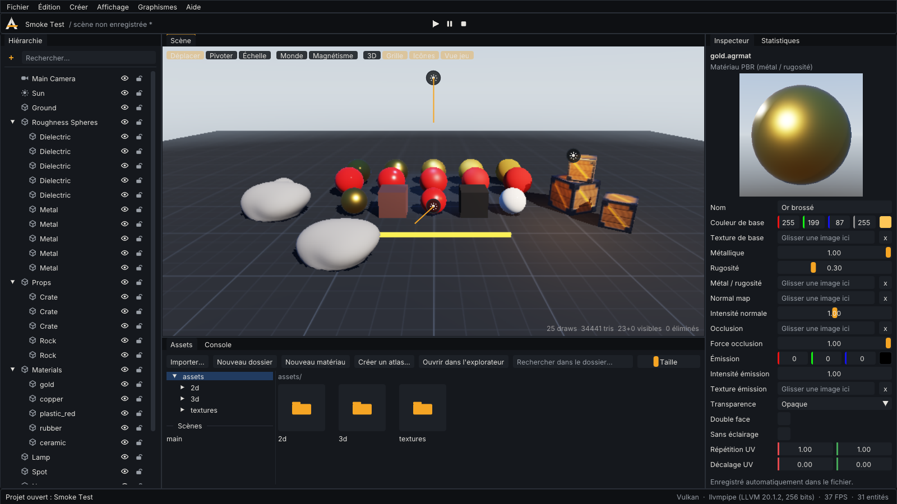

# Rendu 3D (phase 5)

Ce guide décrit la 3D d'AGR ENGINE telle qu'elle fonctionne aujourd'hui : import de modèles, matériaux
PBR, lumières, ombres, ciel, brume, instanciation, et ce qui n'existe pas encore. Tout ce qui est listé
comme disponible est couvert par des tests automatisés : unitaires (importeurs, matériaux, éditeur),
GPU au pixel près sur Vulkan, OpenGL et OpenGL ES, et test de bout en bout de l'éditeur.



*Le modèle « Vitrine 3D » (vue jeu, Vulkan) et l'éditeur de matériau avec son aperçu. Capture du test automatisé.*

## Importer des modèles

| Format | Lu par | Contenu importé |
|---|---|---|
| glTF 2.0 `.gltf` (buffers externes ou base64) et `.glb` | [cgltf](https://github.com/jkuhlmann/cgltf) | maillages (plusieurs primitives = sous-maillages), hiérarchie de nœuds, matériaux PBR, textures externes ou intégrées |
| Wavefront `.obj` + `.mtl` | AGR | polygones (triangulés), groupes de matériaux, indices négatifs, `Kd`, `map_Kd`, `map_Bump`, `Ke`, `d`, `Ns`, `Pr`, `Pm` |
| Autodesk `.fbx` (binaire et ASCII) | [ufbx](https://github.com/ufbx/ufbx) | maillages par matériau, hiérarchie, matériaux PBR de base, textures externes ou intégrées ; converti en +Y haut et en mètres |

- Les normales manquantes sont calculées (lissées, pondérées par l'aire) ; les tangentes aussi (à partir
  des UV), pour les normal maps.
- Les textures intégrées à un GLB / FBX sont adressées `assets://modele.glb#image2` et chargées comme des
  fichiers (cache, rechargement à chaud quand le modèle change).
- Ce qui n'est pas importé est signalé (console, inspecteur) au lieu d'être ignoré en silence :
  squelettes et animations, cibles de morphing, caméras et lumières du fichier, extensions glTF avancées
  (transmission, vernis...), second jeu d'UV.

**Dans l'éditeur :** importer les fichiers (bouton *Importer…* ou glisser-déposer sur la fenêtre ; pour un
`.gltf`, importer aussi son `.bin` et ses textures), puis **glisser le modèle dans la vue** : sa hiérarchie
est créée en une seule étape d'annulation, posée sous le curseur. Chaque nœud avec un maillage reçoit un
`MeshRenderer` (`model`, `meshIndex`). L'inspecteur affiche l'état du modèle, ses statistiques et ses
avertissements.

**Depuis le code :**

```cpp
auto* models = engine.service<agr::ModelLibrary>();
const agr::ModelAsset* robot = models->load("assets://models/robot.glb");  // ou get() : asynchrone
if (robot->state == agr::AssetState::Ready) agr::instantiateModel(engine.scene(), *robot);
```

Le chargement asynchrone importe sur un thread du `JobSystem` et envoie les buffers au GPU sur le thread
principal ; les modèles modifiés sur le disque sont rechargés à chaud dans l'éditeur.

## Matériaux PBR (`.agrmat`)

Modèle métal / rugosité de glTF 2.0, enregistré en JSON lisible :

| Champ | Rôle |
|---|---|
| `baseColor`, `baseColorTexture` | couleur (sRGB) ; alpha = opacité |
| `metallic`, `roughness`, `metallicRoughnessTexture` | texture linéaire : vert = rugosité, bleu = métal |
| `normalTexture`, `normalScale` | espace tangent, vert vers le haut (convention OpenGL / glTF) |
| `occlusionTexture`, `occlusionStrength` | occlusion ambiante (rouge) |
| `emissive`, `emissiveIntensity`, `emissiveTexture` | lumière propre (néons, écrans) |
| `alphaMode` (`opaque`, `mask`, `blend`), `alphaCutoff` | découpe (feuillages, grillages) ou transparence triée |
| `doubleSided`, `unlit`, `uvScale`, `uvOffset` | double face, sans éclairage, répétition / décalage |

Choix du matériau d'un `MeshRenderer` : le fichier `material` s'il est renseigné, sinon les matériaux du
modèle, sinon un matériau intégré fait des champs `texture`, `metallic`, `roughness`. La `color` du
composant teinte toujours le résultat, par instance (elle ne casse pas l'instanciation).

**Dans l'éditeur :** *Nouveau matériau* dans l'explorateur d'assets, cliquer un `.agrmat` pour l'ouvrir
dans l'inspecteur : couleurs, curseurs, emplacements de textures (glisser une image), mode de
transparence, avec une **sphère d'aperçu** rendue en direct. Glisser un matériau sur un objet de la vue
l'applique. Les modifications sont enregistrées dans le fichier (elles ne font pas partie de l'historique
Ctrl+Z de la scène, qui ne concerne que la scène).

**Shaders personnalisés :** un matériau peut utiliser un fichier `.agrshader` (code GLSL qui modifie la
surface et les sommets avant l'éclairage PBR), avec ses paramètres réglés dans l'inspecteur du matériau
— voir [SHADERS.md](SHADERS.md).

## Lumières, ombres, ciel

| Composant | Rôle |
|---|---|
| `DirectionalLight` | soleil : direction = axe −Z de l'entité ; ombres (`castShadows`, `shadowDistance`, `shadowStrength`) |
| `PointLight` | ampoule : couleur, intensité, portée (atténuation en carré inverse, nulle à la portée) |
| `SpotLight` | projecteur le long de −Z : angles intérieur / extérieur |
| `Environment` | ambiance plate ou **ciel en dégradé** (zénith, horizon, sol, disque solaire) qui éclaire en hémisphère ; brume linéaire ; exposition |

- **Ombres en cascades** : la portion de vue `[proche, shadowDistance]` est découpée en 1 à 4
  tranches (selon le profil ; découpage mi-logarithmique mi-uniforme), chacune avec sa propre carte
  d'ombre dans un **atlas** de profondeur (une carte seule, ou 2 × 2 tuiles, 4096 texels au plus).
  Près de la caméra, les ombres sont donc fines ; loin, elles couvrent une grande surface. Chaque
  cascade est ajustée à la sphère englobante de sa tranche (taille indépendante de l'orientation de la
  caméra) et alignée sur ses texels : les bords ne « nagent » pas. Les objets ne sont dessinés que dans
  les cascades qu'ils touchent ; un **fondu** sur les derniers 10 % de chaque tranche masque le
  passage d'une cascade à l'autre, et l'ombre s'estompe à `shadowDistance`. Biais de profondeur +
  décalage selon la normale (proportionnel à la taille d'un texel de la cascade) contre l'acné ;
  filtrage 3×3 (PCF) selon le profil. `MeshRenderer.castShadows` exclut un objet.
- **Lumières locales** : jusqu'à 8 par image (les plus proches de la caméra), limitées par le profil.
- **Sortie** : éclairage en espace linéaire, *tone mapping* ACES, puis encodage gamma ; `exposure`
  règle la luminosité avant le tone mapping. Unité d'intensité : une surface blanche face à une lumière
  d'intensité 1 renvoie du blanc (avant tone mapping).

### Profils graphiques

| Profil | Cascades | Taille par cascade (atlas) | Ombres douces (PCF 3×3) | Lumières locales |
|---|---|---|---|---|
| ultra | 4 | 2048 (4096) | oui | 8 |
| high | 3 | 2048 (4096) | oui | 8 |
| medium | 2 | 1024 (2048) | oui | 4 |
| low | 1 | 1024 | non | 4 |
| ultra-mobile | aucune | — | — | 2 |

Mémoire de l'atlas (4 octets par texel) : 64 Mo en ultra / high, 16 Mo en medium, 4 Mo en low.

## Ciel en image et éclairage par l'image (IBL)

`Environment.sky = Image` + `skyTexture` : une image **équirectangulaire** (2:1, latitude /
longitude) sert de fond **et** éclaire la scène. Formats : `.hdr` (Radiance, vraies intensités : le
soleil peut valoir 50 ou plus, utile aux reflets et au bloom) ou une image 8 bits (`.png`, `.jpg`,
convertie de sRGB en linéaire). `skyIntensity` règle la luminosité, `skyRotation` tourne le ciel
autour de la verticale, `ambientIntensity` dose la lumière ambiante qu'il donne.

Au chargement (sur un thread de travail, puis envoi au GPU) :

- l'image est ramenée à une taille 2:1 en puissance de deux (2048 de large au plus ; 512 à 2048
  selon la taille de texture du profil) ;
- une **chaîne de mips préfiltrée** est calculée sur le CPU (RGBA16F) : le niveau 0 est le ciel
  net, chaque niveau suivant est flouté pour une rugosité croissante (flou gaussien dont la largeur
  suit la rugosité, élargi vers les pôles). Les reflets lisent le niveau correspondant à la rugosité
  du matériau. C'est une **approximation** du préfiltrage GGX, pas une convolution exacte ;
- la **lumière diffuse** est projetée en harmoniques sphériques d'ordre 2 (9 coefficients,
  convolution par le lobe cosinus) : une évaluation par pixel, sans texture.

Tant que l'image se charge, le dégradé (`skyColor`, `horizonColor`, `groundColor`) la remplace ; une
image absente ou invalide est signalée dans la console et le dégradé reste. Les fichiers modifiés sont
rechargés à chaud dans l'éditeur. La Vitrine 3D utilise `sky/afternoon.hdr`, un ciel **original**
généré par `tools/generate_template_sky.py` (dégradé, soleil aligné sur la lumière de la scène,
nuages procéduraux, 373 Kio grâce à la compression RLE du format).

## Post-traitement (composant `PostProcess`)

Ajouter `PostProcess` à une entité active (en général la caméra) active une chaîne plein écran ; le
premier composant actif de la scène s'applique. La scène est alors rendue dans une cible **HDR**
(RGBA16F ; RGBA8 si le GPU ne sait pas rendre en demi-flottants, cas de certains GLES : le bloom ne
voit alors que des valeurs ≤ 1), puis :

1. **Bloom** : extraction des pixels au-dessus de `bloomThreshold` (genou doux), chaîne de
   sous-échantillonnage (jusqu'à 6 niveaux depuis la demi-résolution, filtre 13 points), remontée
   additive (filtre tente 3×3, `bloomRadius`), mélange avec `bloomIntensity`.
2. **Composition** : exposition, tone mapping ACES (`filmicToneMapping`, désactivable pour les
   couleurs plates de la 2D), contraste, saturation, filtre de couleur, vignettage, encodage gamma.
3. **FXAA** (`fxaa`) : anti-crénelage sur l'image finale, en complément ou à la place du MSAA.

L'interface du jeu (UI) est dessinée après, sans être affectée. Le profil graphique peut couper des
effets quel que soit le composant :

| Profil | Bloom | FXAA |
|---|---|---|
| ultra / high / medium | oui | oui |
| low | non | oui |
| ultra-mobile | non | non |

Coût : 2 cibles plein écran (+ 1 avec FXAA) et ~2 × niveaux passes de bloom. Les vues `direct`
(vignettes, aperçu de matériau) n'en ont pas. La Vitrine 3D l'utilise (néon qui « brille »).

## Instanciation automatique

Les parties de maillage opaques qui partagent maillage et matériau sont dessinées en **un seul draw
instancié** : transformations et teinte passent par un flux de sommets par instance (128 octets), sur les
trois API. Aucun réglage n'est nécessaire.

## Modèle « Vitrine 3D »

Proposé par l'assistant de projet (type 3D) et *Fichier › Nouvelle scène* : sphères de rugosité
(diélectrique et métal), caisses glTF avec textures de couleur, normal map et métal / rugosité, rochers,
matériaux `.agrmat` (or, cuivre, plastique, caoutchouc, céramique, néon émissif), soleil avec ombres,
lampe, projecteur, ciel et brume. Toutes les ressources sont **originales**, générées par
`tools/generate_template_3d_art.py` (reproductible). Pas encore de gameplay : physique et scripts en phase 6.

## Performances (llvmpipe, rastériseur logiciel, 1280 × 720)

| Scène | Collecte CPU | Draw calls |
|---|---|---|
| 2 000 cubes (1 665 visibles), instanciés | 0,24 ms | 1 (contre 1 665 avant l'instanciation) |
| 10 000 cubes instanciés | 1,5 ms | 1 |
| 2 000 cubes + sol, ombres 2048 + PCF | 0,37 ms | 4 (2 passes) |
| Import OBJ de 20 000 triangles (normales et tangentes comprises) | 6 à 8 ms | — |

Détails : [BENCHMARKS.md](BENCHMARKS.md). Ce ne sont pas des mesures sur téléphone (phase 8).

## Particules 3D

Composant `ParticleEmitter3D` (*Créer › Particules 3D*, préréglage « Fire » par défaut). Les particules
sont simulées sur le CPU (`agr::twod`, comme les particules 2D) et dessinées en billboards toujours face à
la caméra, dans la passe transparente : test de profondeur actif (cachées par les murs), pas d'écriture
de profondeur.

| Champ | Rôle |
|---|---|
| `rate`, `burst`, `duration`, `loop`, `maxParticles` | débit par seconde, salve à chaque cycle, durée d'un cycle, répétition, plafond |
| `shape`, `shapeRadius`, `boxSize`, `coneAngle` | forme d'émission : point, sphère, boîte, cône (orienté selon l'axe Y local) |
| `lifetimeMin/Max`, `speedMin/Max` | durée de vie et vitesse initiale tirées au hasard |
| `gravity`, `drag` | accélération (m/s²) et freinage |
| `startColor` → `endColor`, `startSize` → `endSize`, `angularVelocity` | évolution sur la vie de la particule |
| `texture`, `additive` | image (cercle doux par défaut), mélange additif (feu, étincelles) ou alpha (fumée) |
| `worldSpace`, `seed` | les particules restent où elles sont nées ou suivent l'émetteur ; graine 0 = aléatoire |

L'inspecteur affiche le nombre de particules vivantes, un bouton *Rejouer* et 7 préréglages : Fire,
Smoke, Sparks, Magic, Rain, Snow, Dust. Les particules s'animent dans la vue en mode édition. Tests :
unitaire (formes, gravité, durée de vie, espaces, graine, préréglages) et GPU sur les 3 API (orientation
face caméra, additif plus lumineux, occultation).

Limites : simulation sur CPU (quelques milliers de particules par émetteur restent raisonnables), pas de
collisions ; les particules sont triées entre elles (de l'arrière vers l'avant) mais dessinées après
l'eau et les matériaux transparents 3D, sans tri commun ; pas d'éclairage des particules, pas d'éditeur de courbes (évolution linéaire début → fin).

## Limites actuelles (non implémenté)

- **Animation squelettique** : skinning GPU et clips glTF existent ([ANIMATION.md](ANIMATION.md)) ;
  pas de *morph targets*, ni d'arbres de mélange ou d'IK.
- **Post-traitement** : bloom, FXAA, étalonnage et vignettage existent ; pas de SSAO, profondeur de
  champ, flou de mouvement, TAA ni d'exposition automatique.
- **Réflexions** : l'IBL vient du ciel seulement (infini) ; pas de sondes de réflexion locales ni de
  réflexions en espace écran : un objet ne se reflète pas dans un autre. Le préfiltrage est approché.
- Une seule lumière directionnelle éclaire et projette des ombres (en cascades) ; pas d'ombres de
  lumières ponctuelles ou de projecteurs.
- **Terrain, eau, végétation, LOD, occlusion culling** : non implémentés (phase 9 pour les éditeurs de
  terrain ; à planifier pour le reste). Le frustum culling par objet existe.
- Ciel en image : format équirectangulaire uniquement (pas de cubemap en 6 faces).
- Les miroirs (échelle négative) inversent l'ordre des faces : le culling des faces arrière les rend mal.
- Shaders personnalisés limités aux fonctions de surface et de sommets du PBR ([SHADERS.md](SHADERS.md)) ;
  les importeurs ne gèrent qu'un jeu d'UV.
