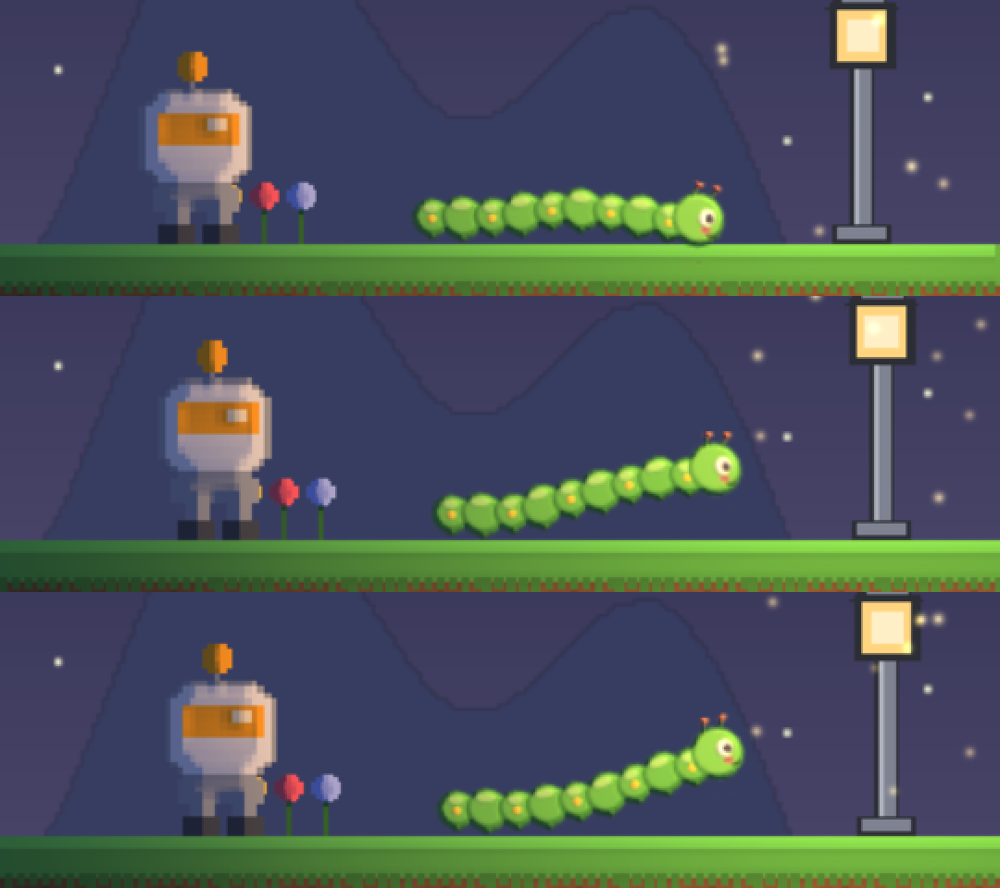

# Animation (phase 7)

Module `agr::animation`. Deux niveaux, complémentaires de l'animation image par image des sprites
([2D.md](2D.md)) :

1. **Clips de propriétés** (`.agranim`) : des courbes qui animent n'importe quel champ de composant de
   l'entité et de ses enfants.
2. **Machines à états** (`.agrctrl`) : des états (un clip de propriétés et / ou un clip de sprite) reliés
   par des transitions qui dépendent de paramètres réglés par les scripts.

Tests : `tests/test_animation.cpp`, test de script d'animation, test de jeu des modèles (héros piloté
par sa machine à états), test de bout en bout de l'éditeur.

## Clips et courbes

- Une **piste** anime un canal d'un champ réfléchi : `cible` (chemin de noms sous l'entité animée,
  vide = elle-même, `"Bras/Main"`), composant, champ, canal (x, y, z, w d'un vecteur ou d'une couleur).
  Tout champ est animable : nombres, booléens, entiers, énumérations, vecteurs, couleurs, rotations
  (en degrés d'Euler) et textes (`SpriteAnimator.clip`, une texture...).
- **Clés** : interpolation constante, linéaire, **lissée** (tangentes automatiques, sans dépassement
  aux extrémums ni sur des données monotones) ou à **tangentes** réglables.
- **Événements** : à un instant donné, le script de l'entité reçoit `onAnimationEvent(nom)` (une
  fois par passage, boucles comprises : bruits de pas, tirs...).
- Durée, boucle ; un clip non bouclé garde sa dernière valeur.

## Machines à états

| Élément | Détail |
|---|---|
| Paramètres | nombre, entier, booléen, **déclencheur** (consommé par la transition qu'il active) |
| États | clip de propriétés, clip de sprite (`SpriteAnimator.clip`), vitesse ; un état initial |
| Transitions | depuis un état ou **tout état**, conditions toutes requises (`>`, `<`, `==`, `!=`, vrai, faux), **instant de sortie** (fraction du clip), **fondu** (mélange des valeurs animées pendant la durée) |
| Contrôles | références vérifiées (états, paramètres, transitions qui se déclencheraient en boucle) : messages dans l'inspecteur et la console |

Le composant `Animator` joue un `controller` (machine à états) ou, à défaut, un `clip` seul ; `speed`
et `playing` le règlent. Il tourne après les scripts (qui règlent les paramètres) et avant le rendu.
Le script reçoit `onStateEnter(nom)` à chaque changement d'état.

```lua
function Hero:onUpdate(dt)
    self.entity:setParameter("speed", math.abs(move))
    self.entity:setParameter("grounded", self.grounded)
    if attack then self.entity:setTrigger("attack") end
end
function Hero:onAnimationEvent(name) if name == "step" then agr.audio.play("assets://audio/step.wav") end end
```

## États de mélange (blend tree 1D)

Un état peut mélanger plusieurs clips selon un paramètre `float` ou `int` (l'équivalent du
`BlendSpace1D` de Godot) : par exemple *Locomotion* = Idle à 0, Walk à 2, Run à 5 selon `speed`.

```json
{ "name": "Locomotion", "clip": "", "speed": 1.0,
  "blend": { "parameter": "speed",
             "motions": [ { "clip": "assets://hero.glb#Idle", "threshold": 0 },
                          { "clip": "assets://hero.glb#Walk", "threshold": 2 },
                          { "clip": "assets://hero.glb#Run",  "threshold": 5 } ] } }
```

- Les deux mouvements qui encadrent la valeur sont mélangés (poids linéaire entre leurs seuils) ; en
  dessous du premier seuil ou au-dessus du dernier, un seul joue.
- **Phases synchronisées** : les deux clips avancent de la même fraction de leur propre durée (la durée
  du cycle est interpolée), donc les pieds restent en phase même si Walk dure 0,8 s et Run 0,5 s.
- Fondus, transitions, temps de sortie (`exitTime`, sur la phase) et déclencheurs fonctionnent comme
  pour les autres états, y compris pour entrer dans un mélange ou en sortir.
- Le mélange s'applique à **toutes les pistes** : transformations (squelettes, nœuds importés) et
  propriétés (os 2D, couleurs, tailles...). Les événements et le temps de sortie suivent le mouvement
  dominant.
- Éditeur : *Machine à états* ➜ état ➜ *Mélange (blend tree)* : paramètre, mouvements (glisser un
  clip, seuil, ajouter / retirer).
- Le *Duel des Tours* l'utilise : `Locomotion` mélange Idle et Walk selon la vitesse réelle de l'unité.

## Espaces de mélange 2D (blend space)

Un état de mélange avec un **second paramètre** (`parameterY`) place chaque clip en un point (x, y) :
l'équivalent du `BlendSpace2D` de Godot. Exemple : se déplacer dans toutes les directions selon
`moveX` / `moveY`, viser en haut / en bas et à gauche / à droite.

```json
{ "name": "Strafe",
  "blend": { "parameter": "moveX", "parameterY": "moveY",
             "motions": [ { "clip": "assets://idle.agranim",  "position": [0, 0] },
                          { "clip": "assets://right.agranim", "position": [1, 0] },
                          { "clip": "assets://left.agranim",  "position": [-1, 0] },
                          { "clip": "assets://fwd.agranim",   "position": [0, 1] },
                          { "clip": "assets://back.agranim",  "position": [0, -1] } ] } }
```

- **Interpolation par bandes de gradient** (*gradient band*, comme les blend spaces « freeform » des
  autres moteurs) : sur un point, son clip joue seul ; entre plusieurs, les plus proches se partagent
  le poids, sans triangulation à faire ; hors de la zone couverte, le clip le plus proche.
- Phases synchronisées (durée du cycle pondérée), fondus et transitions comme en 1D.
- Éditeur : case *2D* à côté de *Mélange*, paramètres X et Y, position (x, y) de chaque mouvement.

## Couches et masques

Une machine à états peut avoir des **couches** (`layers`) jouées par-dessus la base, chacune avec ses
propres états et transitions (les paramètres sont communs) :

```json
"layers": [ { "name": "Upper", "weight": 1.0, "mask": ["Torso"], "entry": "Idle",
              "states": [ ... ], "transitions": [ ... ] } ]
```

- **Masque** : chemins sous l'Animator (`"Torso"`, `"Hips/Spine"`) ; la couche n'anime que ces objets
  et leurs enfants (vide = tout). Exemple classique : les jambes courent (base) pendant que le haut du
  corps tire (couche `Upper` masquée sur `Torso`).
- **Poids** (0..1) : la couche remplace les valeurs du dessous dans cette proportion ; les scripts le
  font varier (`self.entity:setLayerWeight("Upper", 1)` pour viser, 0 pour relâcher) avec
  `layerWeight(nom)`. Les couches s'appliquent dans l'ordre.
- `playState(état, fondu, couche)` et `currentState(couche)` agissent sur une couche ;
  `onStateEnter(nom, couche)` et `onAnimationEvent(nom, couche)` reçoivent le nom de la couche en
  second argument (`nil` pour la base).
- Éditeur : *Machine à états* ➜ liste *Couche* (Base ou une couche), *+ Couche*, nom, poids, masque
  (chemins séparés par des virgules), suppression ; le graphe montre les états de la couche choisie et,
  en jeu, son état courant.

Coût : 500 personnages avec un espace de mélange de 5 clips et une couche masquée (18 courbes) :
~0,37 ms par image ; 1 000 Animators simples : ~0,15 ms ([BENCHMARKS.md](BENCHMARKS.md)). Tests : cas
`layers` de `tests/test_animation.cpp` et test de script d'animation.

## Animation squelettique (modèles glTF)

- **Import** : les *skins* glTF (articulations, matrices de liaison inverses, `JOINTS_0` /
  `WEIGHTS_0`, 4 influences par sommet, poids normalisés) et les **animations** (translation,
  rotation, échelle ; interpolation pas à pas ou linéaire ; les splines cubiques sont lues par leurs
  valeurs, sans tangentes, avec un avertissement). Les poids de *morph targets* ne sont pas importés.
- **Instanciation** : les nœuds du modèle deviennent des entités (le squelette est une hiérarchie
  d'entités ordinaires, visible et modifiable) ; un `MeshRenderer` à peau référence son skin.
- **Clips** : une animation importée est un clip nommé `"<modèle>#<animation>"`
  (`assets://3d/sprout.glb#Dance`), utilisable comme `clip` d'un Animator ou d'un état de machine à
  états, avec fondus entre clips (interpolation sphérique des rotations). Glisser un modèle animé dans
  la scène lui ajoute un Animator qui joue sa première animation ; l'inspecteur liste ses clips.
- **Rendu** : skinning sur GPU (palette de 128 articulations maximum par maillage, buffer uniforme),
  ombres comprises, sur Vulkan, OpenGL et GLES ; les volumes englobants sont élargis pour le culling.
- **Vitrine 3D** : la plante `sprout.glb` (4 articulations, clips *Idle* et *Dance* générés par
  `tools/generate_template_character.py`) danse quand une balle la touche (script + machine à états).

## Animation squelettique 2D (os, peaux déformées, IK)



Comme les `Skeleton2D` / `Bone2D` / `Polygon2D` de Godot :

| Composant | Rôle |
|---|---|
| `Skeleton2D` | racine du squelette (`showBones` : dessin des os dans l'éditeur) |
| `Bone2D` | un os, orienté selon son axe +X, de longueur `length` ; ses enfants le suivent (os suivants, sprites attachés rigidement : animation « découpée » classique) |
| `Skin2D` | une image **déformée** par les os du squelette au-dessus d'elle : une grille de `columns` × `rows` cases dont chaque point suit les os proches (poids automatiques : les 4 os les plus proches au repos, inverse de la distance à la puissance `stiffness`). Texture, normal map, couleur, taille, pivot, `uvRect`, tri, éclairage comme un sprite |
| `TwoBoneIK2D` | sur le premier os d'un bras ou d'une jambe : tourne cet os et son os enfant pour que le bout de l'enfant atteigne l'entité `target` (main, pied posé au sol) ; `flipBend` choisit le sens du coude ou du genou, `weight` mélange avec la pose animée. Résolu après les clips, à chaque image du jeu |

- **Pose de repos** : la pose dans laquelle les peaux sont dessinées. Dans l'éditeur, en mode Édition,
  la pose des os **est** la pose de repos (on place les os sur l'image) ; en jeu et pendant l'aperçu
  de la timeline, les animations et l'IK les en écartent. Le code qui construit un squelette appelle
  `captureBone2DRest(scene, racine)`.
- **Animer** : un Animator sur la racine, des pistes `Transform.rotation` (canal z) sur les chemins
  des os (`"Bone 1/Bone 2"`), éditables dans la timeline. Les machines à états et les mélanges
  fonctionnent comme pour le reste.
- **Rendu** : la déformation est faite sur le processeur (`skin2DPoints`) et chaque case devient un
  quadrilatère du lot de sprites : même texture = un seul draw, tri, éclairage, normal maps et
  parallaxe compris. `RenderStats::skins2D` compte les peaux dessinées.
- **Éditeur** : *Créer › Squelette 2D* (racine, chaîne de 3 os, une peau) ; les os sont dessinés en
  losanges sur la vue de scène, un clic sur une articulation sélectionne l'os.
- **Vitrine 2D** : une chenille (`caterpillar.png`, 4 os, clip `caterpillar_crawl.agranim` : une vague
  qui court de la queue à la tête), générée par `tools/generate_skeleton_2d_art.py`.

Tests : `2D skeleton` et `2D two-bone IK` (`tests/test_animation.cpp`), `2D skins` (test GPU, GL /
GLES / Vulkan), création depuis l'éditeur (`tests/test_editor.cpp`).

## Dans l'éditeur

- **Timeline** (*Affichage › Animation*, ou bouton *Timeline* de l'Animator) : clips de l'Animator
  sélectionné (ou de l'un de ses enfants) et de ses états ; *Nouveau clip* ; *+ Piste* (objet,
  composant, champ ; clé à la valeur actuelle) ; règle temporelle avec **tête de lecture** à glisser,
  lecture, **aperçu** dans la scène (les valeurs animées reprennent leur état d'origine à la fin de
  l'aperçu, avant de jouer et avant d'enregistrer la scène) ; clés : double-clic pour en ajouter,
  glisser pour les déplacer (pas de 10 ms), Suppr, valeur / interpolation / tangentes ; *Clé* :
  enregistre la pose actuelle (modifier l'objet dans l'inspecteur ou au gizmo, puis *Clé*) ; vue de la
  courbe de la piste choisie ; événements ; Ctrl + molette : zoom.
- **Machine à états** (*Affichage › Machine à états*, ou bouton de l'Animator) : graphe des états
  (glisser pour placer, clic molette pour déplacer la vue), flèches des transitions, clic droit pour
  ajouter un état, une transition, choisir l'état initial ou supprimer ; propriétés de l'état et de
  la transition (conditions, instant de sortie, fondu) ; paramètres ; problèmes détectés. En mode Jeu,
  l'état courant est encadré en rouge et l'inspecteur montre l'état et les paramètres.
- Les fichiers sont enregistrés par le bouton *Enregistrer* du panneau ; le jeu en cours les recharge.
- Les modèles de projet contiennent `hero.agrctrl` (Idle / Run / Air), des clips de pulsation, de
  rotation et de lumière vacillante.

## Performances

1 000 Animators (dont 500 machines à états), 3 courbes chacun : ~0,18 ms par image sur la machine de
test ([BENCHMARKS.md](BENCHMARKS.md)).

## Limites actuelles

- Pas de couches additives (les couches remplacent) ni de masques pondérés par os ; IK : deux os en 2D seulement (pas de chaînes plus longues ni d'IK 3D), pas de poids peints à la main pour les peaux 2D ; pas de *morph targets* ; au plus 128 articulations par
  maillage, 4 influences par sommet.
- Les clips importés ne s'éditent pas dans la timeline (ils viennent du fichier du modèle).
- Une transition ne peut pas être interrompue pendant son fondu ; une seule transition par image.
- Timeline : pas de sélection de plusieurs clés, de copier-coller ni de poignées de tangentes à
  glisser (valeurs numériques) ; les modifications d'un clip ou d'une machine à états ne passent pas
  par *Annuler* (elles sont enregistrées dans leur fichier avec *Enregistrer*).
- L'aperçu de la timeline ne fonctionne qu'en mode Édition.
