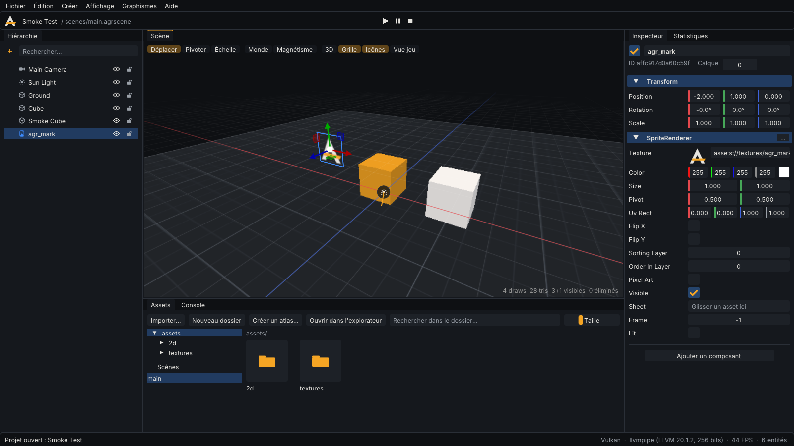
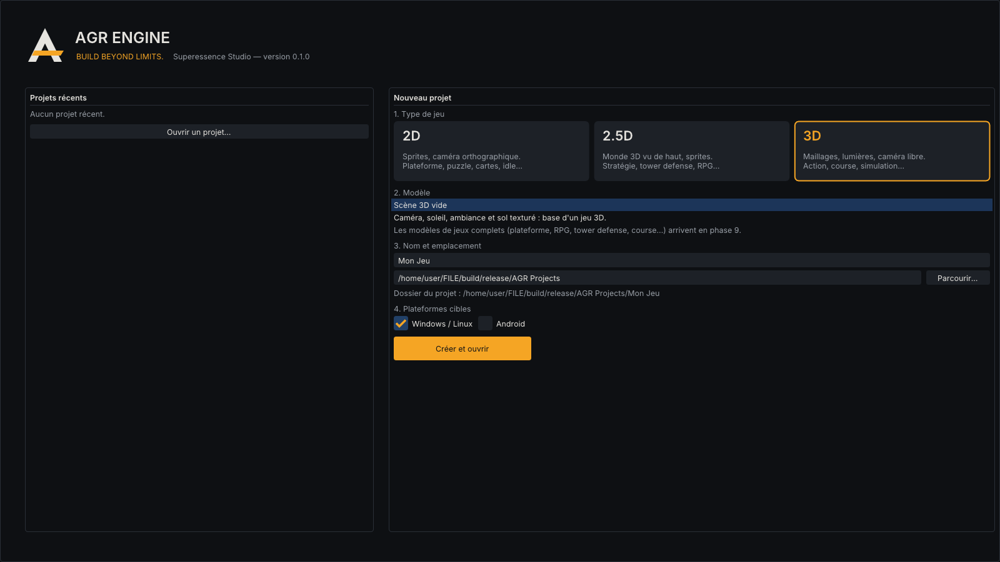

# AGR Editor



*L'éditeur en Vulkan. Capture produite automatiquement par le test de bout en bout
(`agr_editor --smoke-test`), exécuté en CI sur Vulkan, OpenGL et OpenGL ES.*

## Lancer

```bash
./build/release/bin/agr_editor                    # hub de projets
./build/release/bin/agr_editor "/chemin/Mon Jeu"  # ouvre directement un projet
./build/release/bin/agr_editor --opengl           # forcer une API (--vulkan, --gles), --validation
```

L'éditeur tourne sur PC (Windows, Linux). Les jeux qu'il produit ciblent PC et Android : la plateforme
qui **héberge** l'éditeur n'est pas celle qui **exécute** le jeu.

## Hub de projets



1. **Type de jeu** : 2D, 2.5D ou 3D.
2. **Modèle** : une scène de départ jouable pour chaque type (caméra, lumière, sol ou sprite).
   Les modèles de jeux complets (plateforme, RPG, tower defense, course...) arrivent en phase 9.
3. **Nom et emplacement** (sélecteur de dossier natif).
4. **Plateformes cibles** : Windows / Linux, Android. Le choix Android est enregistré dans le projet ;
   l'export APK / AAB arrive en phase 8.

Un projet est un dossier :

```
Mon Jeu/
  project.agrproject   nom, type, cibles, scène de démarrage, profil graphique (JSON)
  assets/              données du jeu, montées en assets:// (textures/ contient les assets du modèle)
  scenes/              scènes *.agrscene (JSON lisible et fusionnable)
```

Les projets récents sont mémorisés dans le dossier de préférences de l'utilisateur.

## Panneaux

| Panneau | Fonctions |
|---|---|
| **Hiérarchie** | Arborescence de la scène, recherche, sélection (clic, Ctrl+clic, Maj+clic), renommage en place (F2 ou double-clic), glisser-déposer pour changer de parent ou réordonner, masquer dans la vue (œil), verrouiller (cadenas), menu contextuel (créer un enfant, dupliquer, grouper, détacher, supprimer), dépôt d'une image pour créer un sprite |
| **Scène** | Rendu de la scène par le moteur (même renderer que le jeu), caméra d'édition 3D (orbite, survol, panoramique, zoom) ou 2D, gizmos déplacer / pivoter / échelle (repère local ou monde, magnétisme), sélection par clic (lancer de rayon), icônes des caméras et lumières, cadres de sélection, grille, **vue jeu** (caméra principale), dépôt d'images, statistiques de rendu |
| **Inspecteur** | Généré par la réflexion : chaque champ reçoit le bon widget (cases à cocher, champs X/Y/Z aux couleurs des axes, couleurs, listes d'énumérations, angles en degrés, chemins d'assets avec aperçu et glisser-déposer, références d'entités par glisser-déposer). « Ajouter un composant » liste tous les composants par catégorie, y compris ceux des plugins. Outils 2D : choix de frame avec aperçu et taille native (sprites), choix de clip (animateur), palette et outils de peinture (tilemaps), redémarrage (particules), préréglages et nombre de particules vivantes (particules 3D), pinceaux de terrain. 3D : état et avertissements du modèle. Un matériau `.agrmat` sélectionné dans l'explorateur s'y édite avec une sphère d'aperçu ([3D.md](3D.md)), y compris son shader personnalisé et ses paramètres |
| **Assets** | Dossiers, vignettes des images et des feuilles de sprites, recherche, import (sélecteur natif ou glisser-déposer de fichiers sur la fenêtre), nouveau dossier, renommer, supprimer (toujours avec confirmation), ouvrir dans l'explorateur, liste des scènes (double-clic pour ouvrir), découpe d'une image en grille, création d'atlas, nouveau matériau, nouveau shader ; glisser un modèle 3D dans la vue l'ajoute à la scène, glisser un matériau sur un objet le lui applique |
| **Interface (UI Builder)** | Dans la **vue Jeu** : l'interface s'affiche à la taille de la vue ; cliquer sélectionne un élément, le glisser le déplace, ses poignées le redimensionnent (annulable) ; ancres marquées ; préréglages d'ancres dans l'inspecteur ; *Créer › Interface (UI)* ([UI.md](UI.md)) |
| **Animation** | Timeline des clips de l'Animator sélectionné : pistes, clés, interpolations, courbe, événements, aperçu par la tête de lecture, enregistrement de la pose (*Clé*) ([ANIMATION.md](ANIMATION.md)) |
| **Machine à états** | Graphe des états et transitions de l'Animator : conditions, instant de sortie, fondus, paramètres, état courant en mode Jeu |
| **Mixeur audio** | Volume et coupure des bus, vumètre, voix et mémoire ; bouton *Écouter* des sources dans l'inspecteur ([AUDIO.md](AUDIO.md)) |
| **Export** | *Fichier › Exporter le jeu...* : PC, APK, AAB, signature, réglages Android ([EXPORT.md](EXPORT.md)) |
| **Aperçu mobile** | Vue Jeu : formats téléphone (20:9, 16:9) et tablette (4:3) en paysage ou portrait, zones sûres simulées (bandes sombres), bouton *Tactile* (en mode Jeu, la souris agit comme un doigt) |
| **Scripts et physique** | En mode Jeu seulement : scripts Lua (inspecteur : erreurs, propriétés, fonctions, *Ouvrir le fichier*), corps physiques ; bouton *Collisions* de la vue ; *Nouveau script* et glisser un `.lua` sur un objet ([SCRIPTING.md](SCRIPTING.md), [PHYSICS.md](PHYSICS.md)) |
| **Shader** | Éditeur de shaders `.agrshader` : numéros de ligne, aperçu en direct dans la scène et sur une sphère, erreurs à la ligne (clic pour y aller), enregistrer / annuler, garde des modifications non enregistrées ; *Nouveau shader* dans les assets ([SHADERS.md](SHADERS.md)) |
| **Historique** | *Affichage › Historique* : chaque état d'annulation nommé par son action ; un clic y revient d'un coup (en arrière ou en avant), les états suivants restent disponibles |
| **Palette de commandes** | **Ctrl+Maj+P** ou **Ctrl+K** : recherche approximative dans toutes les actions (enregistrer, jouer, annuler...), l'affichage des panneaux, tout le menu Créer, les scènes, les scripts, shaders et graphes de logique du projet, et les entités de la scène (sélection + cadrage) ; flèches, Entrée, Échap |
| **Script** | Éditeur Lua intégré ([SCRIPTING.md](SCRIPTING.md)) : coloration, syntaxe vérifiée en direct, autocomplétion de l'API, **Ctrl+F** rechercher / remplacer (F3 / Maj+F3 : suivant / précédent, *Tout remplacer*), **Ctrl+Maj+F** recherche dans tous les scripts du projet (clic : fichier et ligne) |
| **Feuilles de sprites** | *Affichage › Feuilles de sprites* ou double-clic sur un `.agrsheet` : frames dessinées, déplacées et redimensionnées à la souris, découpage en grille ou automatique (transparence), pivots, rognage, clips avec aperçu animé ([2D.md](2D.md#éditeur-de-feuilles-de-sprites)) |
| **Console** | Journal du moteur, filtres par niveau avec compteurs, recherche, copie d'une ligne |
| **Statistiques** | FPS, courbe des temps d'image, backend et GPU, draw calls, triangles, culling, lots de sprites, temps GPU, mémoire GPU et CPU par catégorie |

La disposition est entièrement ancrable (docking) et mémorisée ; « Affichage › Réinitialiser la disposition ».

## Prefabs

Clic droit sur une entité › *Créer un prefab* ; glisser un `.agrprefab` dans la vue ou la hiérarchie
pour le placer ; *Appliquer*, *Rétablir*, *Dissocier* dans l'inspecteur d'une instance (bleue dans la
hiérarchie). Détails : [PREFABS.md](PREFABS.md).

## Jouer dans l'éditeur

**Jouer** (Ctrl+P) sauvegarde la scène en mémoire, lance la simulation (les plugins et systèmes
reçoivent un temps qui avance) et bascule la vue sur la caméra du jeu. **Pause** fige le temps.
**Arrêter** restaure exactement la scène d'avant : rien de ce qui se passe en jeu n'est enregistré.
Les scripts, la physique, les sources audio, les Animators et les clics sur l'interface (vue Jeu)
n'agissent qu'en mode Jeu.
En mode édition, le temps du jeu est à zéro : les systèmes de gameplay ne modifient pas la scène.

## Annuler / rétablir

Toute action (création, suppression, déplacement au gizmo, modification dans l'inspecteur, changement
de parent, masquage...) crée une entrée d'historique, nommée dans le menu Édition. Un geste continu
(glisser une valeur, déplacer au gizmo) ne crée qu'une seule entrée. La sélection est restaurée avec
l'état. L'indicateur `*` (titre de la fenêtre, barre d'outils) signale les modifications non enregistrées ;
ouvrir une autre scène ou quitter demande d'enregistrer.

**Implémentation :** l'historique enregistre la scène sérialisée à chaque action. C'est exact pour tous
les composants réfléchis, plugins compris, et suffisant pour des scènes d'édition (quelques milliers
d'entités). Pour des scènes de 100 000 entités, un historique par différences sera nécessaire : c'est
une limite connue.

## Raccourcis

| Raccourci | Action |
|---|---|
| Clic droit + WASD / ZQSD, E / C, Maj | Survol de la vue (Maj = plus vite, molette = vitesse) |
| Alt + clic gauche | Orbite autour du point visé |
| Clic molette | Panoramique |
| Molette | Zoom |
| W / E / R | Déplacer / pivoter / mettre à l'échelle |
| Ctrl (pendant un déplacement) | Magnétisme temporaire |
| F | Cadrer la sélection |
| Ctrl+Z / Ctrl+Y (ou Ctrl+Maj+Z) | Annuler / rétablir |
| Ctrl+D / Ctrl+G / Suppr / F2 / Ctrl+A | Dupliquer / grouper / supprimer / renommer / tout sélectionner |
| Ctrl+S / Ctrl+Maj+S | Enregistrer / enregistrer sous |
| Ctrl+P | Jouer / arrêter |
| Ctrl+Maj+P / Ctrl+K | Palette de commandes |
| F12 | Capture de l'éditeur (dossier `screenshots/` du projet) |
| B / E / U / G / I, Échap | Peinture de tilemap : pinceau / gomme / rectangle / remplissage / pipette, quitter ([2D.md](2D.md)) |

## Architecture

```
agr_editor (app)  ──►  agr_editor_ui   Dear ImGui (docking) + ImGuizmo, rendus par la RHI du moteur
                          │              panneaux, thème AGR, icônes vectorielles, hub, raccourcis
                          ▼
                       agr_editor_core  projets, modèles de scène, sélection (UUID), annuler/rétablir,
                                        commandes d'édition, mode jeu, picking, caméra d'édition
                          │              — sans interface : couvert par des tests unitaires
                          ▼
                       moteur (render, runtime, scene, ...)
```

- L'interface est dessinée par **le moteur lui-même** : `ImGuiRenderer` implémente le protocole de
  textures d'ImGui 1.92 sur la RHI, donc l'éditeur fonctionne en Vulkan, OpenGL et OpenGL ES.
- La vue de scène est rendue par `Renderer::renderView` dans une cible de rendu (le même code que le jeu),
  puis affichée comme une image dans l'interface.
- Toutes les opérations d'édition passent par `EditorContext`, testé sans interface (`tests/test_editor.cpp`).
- Le test de bout en bout (`--smoke-test`) pilote l'éditeur réel par des **événements SDL injectés**
  (clic de souris dans la vue, touche Suppr, Ctrl+Z, trait de peinture de tuiles à la souris), vérifie
  le résultat (en mode Jeu : le héros scripté avance avec la flèche droite, sa machine à états passe en
  course, la musique joue, le HUD est dessiné, un clic de souris sur le bouton « Saut » du HUD le fait
  sauter, la barre d'espace lance une balle physique en 3D et met à jour le compteur, le cube animé
  tourne, *Arrêter* restaure la scène et coupe le son ; en édition : glisser un élément d'interface
  dans la vue Jeu ; modèles glTF, instanciation GPU, aperçu de matériau) et enregistre cinq captures.

## Limites actuelles

- Une seule fenêtre : les panneaux ne se détachent pas en fenêtres système (*multi-viewports* d'ImGui
  non activés, car ils nécessitent un rendu multi-fenêtres dans la RHI).
- Pas de shaders par nœuds (les shaders s'écrivent en GLSL, [SHADERS.md](SHADERS.md)) ; la logique
  visuelle, les effets de particules et les feuilles de sprites ont leurs éditeurs dédiés.
- Pas de mode « 2.5D » dédié dans la vue : un projet 2.5D utilise la vue 3D.
- Importeurs : images (PNG, JPEG, TGA, BMP, PSD, GIF, HDR) et modèles (glTF / GLB, OBJ, FBX) ; les
  feuilles de sprites et les matériaux sont créés dans l'éditeur ou écrits à la main. Les modifications de
  matériaux, de clips d'animation et de machines à états sont enregistrées dans leur fichier et ne sont pas
  dans l'historique Ctrl+Z de la scène. Les autres fichiers sont copiés dans le
  projet, avec un avertissement qu'aucun importeur n'existe encore pour eux.
- **Plusieurs entités sélectionnées** : l'inspecteur montre les composants qu'elles ont toutes ; un champ
  modifié est appliqué à toutes (les champs aux valeurs différentes sont en ambre, « ≠ ») ; ajouter ou
  retirer un composant le fait sur toutes, en une seule entrée d'historique. Le nom reste celui de
  l'entité principale.

## Mode mobile (Android, ou `--mobile` sur ordinateur)

L'éditeur tourne aussi sur téléphone et tablette Android (`tools/build_android_editor.sh`) :

- disposition pour petit écran : la vue de la scène à gauche, tous les panneaux en onglets à droite ;
- tailles tactiles : grandes barres de défilement, poignées, espacements, marge de toucher ;
- gestes : glisser verticalement fait défiler les listes ; appui long = clic droit (menus
  contextuels) ; dans la vue, deux doigts tournent autour (3D) ou déplacent (2D), pincer zoome,
  trois doigts déplacent en 3D ; un geste à plusieurs doigts ne sélectionne rien ;
- économie : la vue est rendue à 70 % de la résolution de l'écran, et l'éditeur passe à
  15 images / s après 1,5 s sans toucher l'écran (60 dès qu'on le touche ou en mode Jeu) ;
- non disponible sur Android (grisé, avec une explication) : export, sélecteur de fichiers natif,
  ouverture dans le gestionnaire de fichiers.

Test automatique : `agr_editor --mobile-test DIR` (disposition, défilement au doigt, appui long,
pincement). `--screenshot FICHIER.png` capture la fenêtre puis quitte.


## Documentation intégrée, plugins et paquets

- **F1** ou **Aide › Documentation** : les guides du moteur (`docs/*.md`, livrés avec l'éditeur, aussi
  sur Android) avec recherche dans tout le texte et liens entre guides ; **Aide › Guides** ouvre un guide
  précis, et des boutons d'aide contextuelle (logique visuelle, paquets) mènent au bon guide.
- **Affichage › Logique visuelle** : programmer sans code ([LOGIC.md](LOGIC.md)).
- **Affichage › Plugins et paquets** : plugins (rechargement à chaud), paquets d'assets ([PACKAGES.md](PACKAGES.md)).

## Profileur (Affichage › Profileur)

Temps CPU du fil principal, image par image, en arbre : pas fixes (physique), mise à jour (chaque
plugin, chaque script Lua ou graphe de logique, l'application), transformations, rendu (préparation,
ombres, passes, présentation). Colonnes : dernière image, moyenne, pic des 2 dernières secondes,
part de l'image, appels ; historique des temps d'image ; pause, filtre, export CSV
(`<projet>/profiler.csv`). Les jeux ajoutent leurs sections : `AGR_PROFILE_SCOPE("nom")` en C++,
`agr.profile.begin("nom") ... agr.profile.finish()` en Lua (une section oubliée est refermée en fin
d'image). Code : `engine/core/include/agr/core/Profiler.hpp`.
