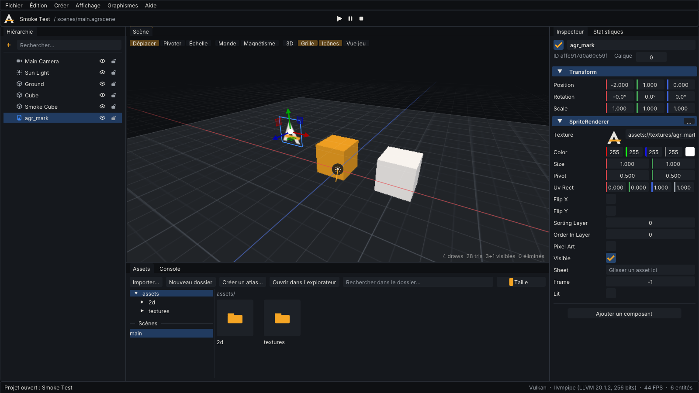
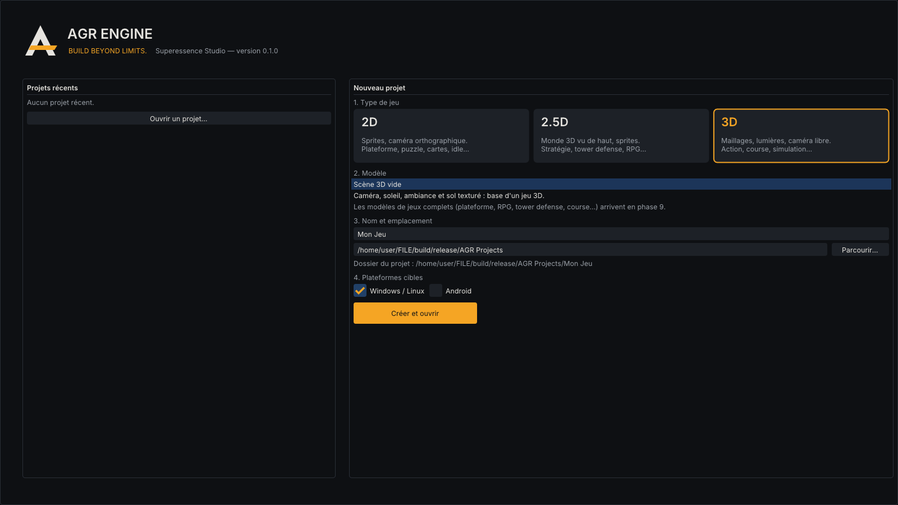

# AGR Editor



*L'éditeur en Vulkan. Capture produite automatiquement par le test de bout en bout
(`agr_editor --smoke-test`), exécuté en CI sur Vulkan, OpenGL et OpenGL ES.*

## Lancer

```bash
./build/release/bin/agr_editor                    # hub de projets
./build/release/bin/agr_editor "/chemin/Mon Jeu"  # ouvre directement un projet
./build/release/bin/agr_editor --opengl           # forcer une API (--vulkan, --gles), --validation
```

L'éditeur tourne sur PC (Windows, Linux). Les jeux qu'il produit ciblent PC et Android : la plateforme
qui **héberge** l'éditeur n'est pas celle qui **exécute** le jeu.

## Hub de projets



1. **Type de jeu** : 2D, 2.5D ou 3D.
2. **Modèle** : une scène de départ jouable pour chaque type (caméra, lumière, sol ou sprite).
   Les modèles de jeux complets (plateforme, RPG, tower defense, course...) arrivent en phase 9.
3. **Nom et emplacement** (sélecteur de dossier natif).
4. **Plateformes cibles** : Windows / Linux, Android. Le choix Android est enregistré dans le projet ;
   l'export APK / AAB arrive en phase 8.

Un projet est un dossier :

```
Mon Jeu/
  project.agrproject   nom, type, cibles, scène de démarrage, profil graphique (JSON)
  assets/              données du jeu, montées en assets:// (textures/ contient les assets du modèle)
  scenes/              scènes *.agrscene (JSON lisible et fusionnable)
```

Les projets récents sont mémorisés dans le dossier de préférences de l'utilisateur.

## Panneaux

| Panneau | Fonctions |
|---|---|
| **Hiérarchie** | Arborescence de la scène, recherche, sélection (clic, Ctrl+clic, Maj+clic), renommage en place (F2 ou double-clic), glisser-déposer pour changer de parent ou réordonner, masquer dans la vue (œil), verrouiller (cadenas), menu contextuel (créer un enfant, dupliquer, grouper, détacher, supprimer), dépôt d'une image pour créer un sprite |
| **Scène** | Rendu de la scène par le moteur (même renderer que le jeu), caméra d'édition 3D (orbite, survol, panoramique, zoom) ou 2D, gizmos déplacer / pivoter / échelle (repère local ou monde, magnétisme), sélection par clic (lancer de rayon), icônes des caméras et lumières, cadres de sélection, grille, **vue jeu** (caméra principale), dépôt d'images, statistiques de rendu |
| **Inspecteur** | Généré par la réflexion : chaque champ reçoit le bon widget (cases à cocher, champs X/Y/Z aux couleurs des axes, couleurs, listes d'énumérations, angles en degrés, chemins d'assets avec aperçu et glisser-déposer, références d'entités par glisser-déposer). « Ajouter un composant » liste tous les composants par catégorie, y compris ceux des plugins. Outils 2D : choix de frame avec aperçu et taille native (sprites), choix de clip (animateur), palette et outils de peinture (tilemaps), redémarrage (particules). 3D : état et avertissements du modèle. Un matériau `.agrmat` sélectionné dans l'explorateur s'y édite avec une sphère d'aperçu ([3D.md](3D.md)) |
| **Assets** | Dossiers, vignettes des images et des feuilles de sprites, recherche, import (sélecteur natif ou glisser-déposer de fichiers sur la fenêtre), nouveau dossier, renommer, supprimer (toujours avec confirmation), ouvrir dans l'explorateur, liste des scènes (double-clic pour ouvrir), découpe d'une image en grille, création d'atlas, nouveau matériau ; glisser un modèle 3D dans la vue l'ajoute à la scène, glisser un matériau sur un objet le lui applique |
| **Scripts et physique** | En mode Jeu seulement : scripts Lua (inspecteur : erreurs, propriétés, fonctions, *Ouvrir le fichier*), corps physiques ; bouton *Collisions* de la vue ; *Nouveau script* et glisser un `.lua` sur un objet ([SCRIPTING.md](SCRIPTING.md), [PHYSICS.md](PHYSICS.md)) |
| **Console** | Journal du moteur, filtres par niveau avec compteurs, recherche, copie d'une ligne |
| **Statistiques** | FPS, courbe des temps d'image, backend et GPU, draw calls, triangles, culling, lots de sprites, temps GPU, mémoire GPU et CPU par catégorie |

La disposition est entièrement ancrable (docking) et mémorisée ; « Affichage › Réinitialiser la disposition ».

## Jouer dans l'éditeur

**Jouer** (Ctrl+P) sauvegarde la scène en mémoire, lance la simulation (les plugins et systèmes
reçoivent un temps qui avance) et bascule la vue sur la caméra du jeu. **Pause** fige le temps.
**Arrêter** restaure exactement la scène d'avant : rien de ce qui se passe en jeu n'est enregistré.
En mode édition, le temps du jeu est à zéro : les systèmes de gameplay ne modifient pas la scène.

## Annuler / rétablir

Toute action (création, suppression, déplacement au gizmo, modification dans l'inspecteur, changement
de parent, masquage...) crée une entrée d'historique, nommée dans le menu Édition. Un geste continu
(glisser une valeur, déplacer au gizmo) ne crée qu'une seule entrée. La sélection est restaurée avec
l'état. L'indicateur `*` (titre de la fenêtre, barre d'outils) signale les modifications non enregistrées ;
ouvrir une autre scène ou quitter demande d'enregistrer.

**Implémentation :** l'historique enregistre la scène sérialisée à chaque action. C'est exact pour tous
les composants réfléchis, plugins compris, et suffisant pour des scènes d'édition (quelques milliers
d'entités). Pour des scènes de 100 000 entités, un historique par différences sera nécessaire : c'est
une limite connue.

## Raccourcis

| Raccourci | Action |
|---|---|
| Clic droit + WASD / ZQSD, E / C, Maj | Survol de la vue (Maj = plus vite, molette = vitesse) |
| Alt + clic gauche | Orbite autour du point visé |
| Clic molette | Panoramique |
| Molette | Zoom |
| W / E / R | Déplacer / pivoter / mettre à l'échelle |
| Ctrl (pendant un déplacement) | Magnétisme temporaire |
| F | Cadrer la sélection |
| Ctrl+Z / Ctrl+Y (ou Ctrl+Maj+Z) | Annuler / rétablir |
| Ctrl+D / Ctrl+G / Suppr / F2 / Ctrl+A | Dupliquer / grouper / supprimer / renommer / tout sélectionner |
| Ctrl+S / Ctrl+Maj+S | Enregistrer / enregistrer sous |
| Ctrl+P | Jouer / arrêter |
| F12 | Capture de l'éditeur (dossier `screenshots/` du projet) |
| B / E / U / G / I, Échap | Peinture de tilemap : pinceau / gomme / rectangle / remplissage / pipette, quitter ([2D.md](2D.md)) |

## Architecture

```
agr_editor (app)  ──►  agr_editor_ui   Dear ImGui (docking) + ImGuizmo, rendus par la RHI du moteur
                          │              panneaux, thème AGR, icônes vectorielles, hub, raccourcis
                          ▼
                       agr_editor_core  projets, modèles de scène, sélection (UUID), annuler/rétablir,
                                        commandes d'édition, mode jeu, picking, caméra d'édition
                          │              — sans interface : couvert par des tests unitaires
                          ▼
                       moteur (render, runtime, scene, ...)
```

- L'interface est dessinée par **le moteur lui-même** : `ImGuiRenderer` implémente le protocole de
  textures d'ImGui 1.92 sur la RHI, donc l'éditeur fonctionne en Vulkan, OpenGL et OpenGL ES.
- La vue de scène est rendue par `Renderer::renderView` dans une cible de rendu (le même code que le jeu),
  puis affichée comme une image dans l'interface.
- Toutes les opérations d'édition passent par `EditorContext`, testé sans interface (`tests/test_editor.cpp`).
- Le test de bout en bout (`--smoke-test`) pilote l'éditeur réel par des **événements SDL injectés**
  (clic de souris dans la vue, touche Suppr, Ctrl+Z, trait de peinture de tuiles à la souris), vérifie
  le résultat (en mode Jeu : le héros scripté avance avec la flèche droite et anime sa course, la barre
  d'espace lance une balle physique en 3D, *Arrêter* restaure la scène ; modèles glTF, instanciation GPU,
  aperçu de matériau) et enregistre trois captures (3D de base, 2D, vitrine 3D).

## Limites actuelles

- Une seule fenêtre : les panneaux ne se détachent pas en fenêtres système (*multi-viewports* d'ImGui
  non activés, car ils nécessitent un rendu multi-fenêtres dans la RHI).
- Pas encore d'éditeurs de shaders, de terrain, d'animation ni d'UI (phases 7 et 9) ; les particules et
  les feuilles de sprites se règlent dans l'inspecteur et l'explorateur d'assets ; pas de prefabs enregistrés en fichiers (les fragments d'entités existent déjà
  dans le sérialiseur).
- Pas de mode « 2.5D » dédié dans la vue : un projet 2.5D utilise la vue 3D.
- Importeurs : images (PNG, JPEG, TGA, BMP, PSD, GIF, HDR) et modèles (glTF / GLB, OBJ, FBX) ; les
  feuilles de sprites et les matériaux sont créés dans l'éditeur ou écrits à la main. Les modifications de
  matériaux sont enregistrées dans leur fichier et ne sont pas dans l'historique Ctrl+Z de la scène. Les autres fichiers sont copiés dans le
  projet, avec un avertissement qu'aucun importeur n'existe encore pour eux.
- L'inspecteur modifie l'entité principale ; l'édition simultanée de plusieurs entités passe par le gizmo.
