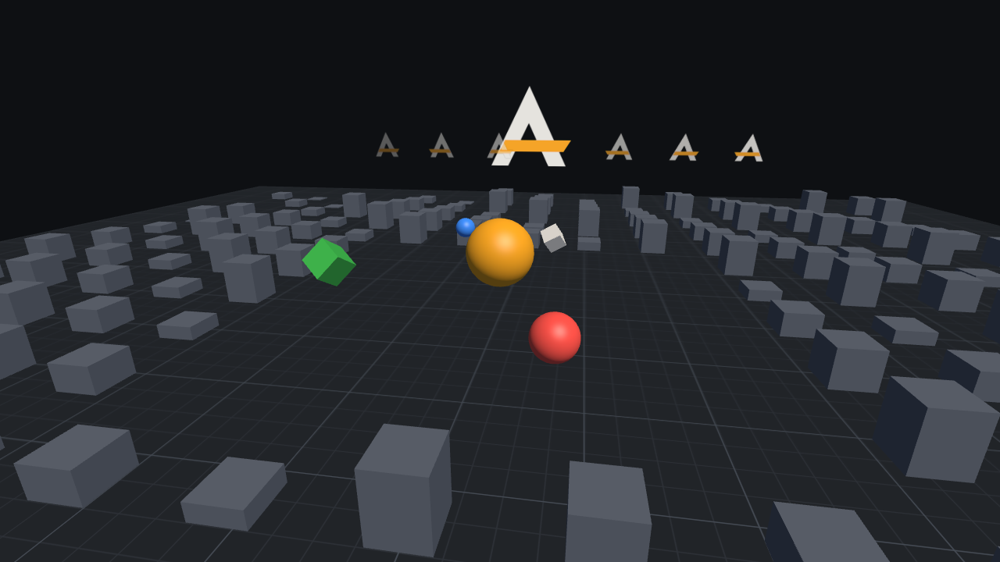

# Rendu et ressources



*La sandbox en profil « high » : maillages PBR, ombres, sol texturé, sprites alpha triés et regroupés,
hiérarchie animée par le plugin dynamique Spin. Capture produite par le moteur lui-même
(`agr_sandbox --profile high --screenshot user://shot.png`).*

## Couches

```
Renderer  (agr::render)   scène ➜ listes de rendu, culling, tri, lots, profils
   │  utilise
AssetManager (agr::assets) URI ➜ textures (cache, async, budget d'upload, rechargement à chaud)
   │  utilisent
rhi::Device (agr::rhi)    API GPU neutre : buffers, textures, pipelines, cibles, passes
   │  implémentée par
GLDevice                  OpenGL 3.3 core (desktop) / OpenGL ES 3.0 (Android)   ✅
VulkanDevice              Vulkan 1.1                                            ✅
```

`RenderPlugin` relie le tout au moteur : il crée le device sur le contexte de la plateforme,
applique le profil graphique et publie les services :

```cpp
engine.plugins().addStatic(std::make_unique<agr::RenderPlugin>());   // avant initialize()
...
auto* assets   = engine.service<agr::AssetManager>();
auto* renderer = engine.service<agr::Renderer>();
```

## RHI

- Tous les objets GPU sont des **handles générationnels** : un handle détruit est détecté au lieu de
  pointer vers un objet recyclé.
- Les uniformes vivent dans des **uniform buffers std140** liés à des *slots* numérotés, et les
  textures à des *unités* numérotées. C'est le modèle des descriptor sets Vulkan ; sur GL, les
  liaisons sont posées après l'édition des liens (`glUniformBlockBinding`, `glUniform1i`), car
  GLSL 3.30 et GLSL ES 3.00 n'ont pas `layout(binding = N)`.
- Les données par objet sont écrites une seule fois par image dans **un seul uniform buffer**
  (alignement du device respecté) puis sélectionnées par `bindUniformBuffer(slot, buffer, offset, size)`.
- Les buffers dynamiques réécrits depuis l'offset 0 sont « orphelins » : le driver fournit un nouveau
  stockage, sans attente CPU/GPU.
- `glDrawElementsBaseVertex` n'existe pas en OpenGL ES 3.0 : le *base vertex* est émulé par le
  décalage des pointeurs d'attributs.
- En fin de passe, la profondeur est invalidée (`glInvalidateFramebuffer`) : sur les GPU mobiles à
  tuiles, elle n'est jamais écrite en mémoire.
- Le chargeur OpenGL est intégré (aucune dépendance) : la liste des fonctions requises et optionnelles
  est dans `engine/rhi/src/gl/GL.hpp`.

### Dialecte de shaders

Les shaders sont écrits dans le sous-ensemble commun GLSL 3.30 / GLSL ES 3.00, **sans** ligne
`#version` : le backend ajoute l'en-tête (`#version 300 es` + précisions + `#define AGR_GLES` sur
mobile). Entrées de vertex et sorties de fragment en `layout(location = N)`, blocs d'uniformes
`std140`. Une erreur de compilation renvoie le journal complet du compilateur.

Le backend Vulkan compile les **mêmes sources** en SPIR-V (glslang, à la création du pipeline) après
une traduction automatique (`agr/rhi/ShaderDialect.hpp`) : en-tête `#version 450`, `set`/`binding`
explicites pour les blocs (slot *i* ➜ binding *i*) et les samplers (unité *i* ➜ binding 8 + *i*),
`location` des varyings attribuées dans l'ordre des sorties du vertex shader et appariées **par nom**
dans le fragment shader. Règles du dialecte qui en découlent : une déclaration par ligne, blocs écrits
`layout(std140) uniform Nom`, pas d'`uniform` hors bloc sauf `sampler2D`. Les violations sont signalées
avec le nom du symbole fautif.

### Conventions

| Sujet | Convention |
|---|---|
| Repère | Main droite, +Y en haut, la caméra regarde vers −Z |
| Faces avant | Sens antihoraire |
| Textures | Première ligne = haut de l'image ; UV (0,0) = coin haut-gauche (identique sur GL et Vulkan) |
| Profondeur | [−1, 1] en GL, [0, 1] en Vulkan : choisie par le renderer selon le backend |
| Couleur | Couleurs des composants en sRGB ; éclairage calculé en linéaire ; textures couleur en `RGBA8_sRGB` ; sortie encodée gamma dans une cible 8 bits |

## Sélection du backend

| `window.graphics` | Comportement |
|---|---|
| `auto` (défaut) | Vulkan si le chargeur Vulkan est présent et qu'un GPU Vulkan 1.1 avec présentation est trouvé ; sinon OpenGL (OpenGL ES sur Android) |
| `vulkan` | Vulkan, avec le même repli si aucun device ne peut être créé (message d'avertissement) |
| `opengl` / `gles` | Forcé (GLES sur desktop permet de valider le chemin mobile) |

Le repli a lieu à deux niveaux : la plateforme choisit OpenGL si le chargeur Vulkan est absent, et
`RenderPlugin` recrée la fenêtre en OpenGL (`PlatformLayer::setGraphicsApi`) si la création du device
Vulkan échoue. `window.graphicsValidation = true` active les *validation layers* Khronos quand elles sont
installées ; chaque erreur est journalisée et comptée (`Device::validationErrorCount`).

Sandbox : `--vulkan`, `--opengl`, `--gles`, `--validation`.

## Backend Vulkan

| Choix | Raison |
|---|---|
| Vulkan **1.1** et *render passes* classiques | Le *dynamic rendering* (1.3) est rare sur les Android visés ; les pipelines sont déclinés à la demande par signature de passe (format couleur, format de profondeur, échantillons) et mis en cache |
| **Viewport de hauteur négative** | Même espace de découpe, même sens des faces et même orientation des textures qu'en OpenGL : le renderer ne contient aucun cas particulier par backend |
| volk + VulkanMemoryAllocator | Chargement des fonctions sans édition des liens avec `libvulkan`, allocations groupées |
| Un seul *descriptor set layout* (8 uniform buffers dynamiques + 12 textures) | Correspond 1:1 au modèle de la RHI. Les sets sont réutilisés tant que les ressources liées ne changent pas ; seuls les *offsets* dynamiques varient entre objets |
| Buffers dynamiques en anneau (une copie par image en vol) | Écriture CPU sans attendre le GPU, comme l'« orphaning » OpenGL |
| Destruction différée | Une ressource n'est libérée qu'une fois terminées les images qui l'utilisaient |
| Profondeur jamais stockée (`STORE_OP_DONT_CARE`) | Économie de bande passante sur les GPU mobiles à tuiles |
| *Backbuffer* interne copié dans la swapchain en fin d'image | Captures et tests fiables, conversion de format (swapchains BGRA) gratuite. Coût : une copie plein écran par image, à supprimer quand aucune capture n'est demandée (optimisation prévue) |

**Parité vérifiée :** sur la même image figée (`agr_sandbox --freeze`), OpenGL, OpenGL ES et Vulkan donnent
des images **identiques au pixel près** sans MSAA, et diffèrent sur 0,02 % des pixels (bords) avec MSAA x4,
où l'emplacement des échantillons dépend de l'API (`tools/compare_images.py`, exécuté en CI).

## Renderer

Un renderer *forward* (détails 3D : [3D.md](3D.md), 2D : [2D.md](2D.md)) :

1. Sélection de la caméra : la première caméra `primary` active (indice d'entité le plus bas en cas d'égalité).
2. Collecte des parties de maillage visibles (frustum culling par AABB), des **projeteurs d'ombre**
   (frustum de la lumière), des lumières ponctuelles et projecteurs, des sprites, tuiles et particules.
3. Tri : maillages opaques par pipeline, matériau puis maillage, et **regroupement en draws instanciés** ;
   transparents de l'arrière vers l'avant ; sprites par calque, ordre, profondeur puis texture.
4. Passe d'ombre (profondeur seule) si la lumière directionnelle projette des ombres.
5. Passe principale : opaques, ciel procédural, transparents, sprites (test de profondeur actif,
   écriture désactivée : un sprite est caché par la géométrie 3D placée devant lui).
6. Si le profil demande du MSAA ou une échelle de rendu ≠ 1 : rendu hors écran, *resolve* MSAA, puis
   mise à l'échelle bilinéaire vers l'écran. Sinon, rendu direct dans le backbuffer, ce qui économise
   la bande passante sur mobile.

**Éclairage :** PBR métal / rugosité (GGX), une lumière directionnelle avec ombres, jusqu'à 8 lumières
ponctuelles / projecteurs par image, ambiance plate ou hémisphérique (ciel), brume, exposition et
*tone mapping* ACES. Un `Renderer` produit **une vue par image** (ses données d'image sont dans des
buffers dynamiques partagés) : une vue supplémentaire (aperçu, écran partagé) utilise un autre `Renderer`.

**Lots de sprites :** un seul vertex buffer dynamique par image et un index buffer de quads fixe.
Un lot se termine à chaque changement de texture ou de mode (normal, éclairé, additif). Avec une caméra
orthographique (jeux 2D), les sprites d'un même plan ont la même profondeur : le tri les regroupe par
texture (10 000 sprites sur 2 textures alternées = 2 draw calls). Avec une caméra perspective, l'ordre de
l'arrière vers l'avant, nécessaire à une transparence correcte, limite les regroupements ; les atlas
([2D.md](2D.md)) suppriment la plupart des changements de texture.

### Composants

| Composant | Champs principaux |
|---|---|
| `Camera` | projection (perspective / orthographique), champ de vision, taille ortho, plans proche/lointain, couleur de fond, primaire, mode d'échelle |
| `DirectionalLight` | couleur, intensité, ombres (distance, force) ; direction = axe −Z de l'entité |
| `PointLight` / `SpotLight` | couleur, intensité, portée ; angles intérieur / extérieur pour le projecteur |
| `Environment` | ambiance, ciel (couleur de fond ou dégradé procédural avec soleil), brume, exposition |
| `MeshRenderer` | maillage intégré ou modèle importé (`model`, `meshIndex`), matériau `.agrmat`, texture / métal / rugosité du matériau intégré, teinte, répétition UV, projette des ombres, visible |
| `SpriteRenderer` | texture ou feuille + frame, couleur, taille, pivot, rectangle UV, miroir X/Y, calque, ordre, pixel art, éclairé, visible |

Tous sont réfléchis : ils sont sauvegardés dans les scènes et seront éditables dans l'inspecteur.

## Ressources

```cpp
auto& assets = *engine.service<agr::AssetManager>();
agr::TextureAsset hero = assets.loadTexture("assets://sprites/hero.png", {.pixelArt = true});
rhi::TextureHandle gpu = assets.gpuTexture(hero);   // blanc pendant le chargement, damier magenta en cas d'erreur
assets.release(hero);                               // détruite au prochain update() sans référence
```

- **Formats :** PNG, JPEG, TGA, BMP, PSD (aplati), GIF (première image), HDR, via stb_image.
  **WEBP et SVG ne sont pas encore pris en charge** (libwebp et nanosvg sont prévus).
- **Asynchrone :** lecture et décodage sur les workers du `JobSystem`, envoi au GPU sur le thread
  principal dans `update()`, limité par un **budget d'octets par image** pour éviter les saccades.
- **Cache :** même URI et mêmes options = même ressource, avec comptage de références.
- **Profil :** les textures plus grandes que `maxTextureSize` sont réduites au chargement.
- **Rechargement à chaud :** `RenderPlugin::setHotReload(true)` surveille la date de modification des
  fichiers ; la texture est remplacée sans changer de handle.
- **Sans GPU** (serveur, tests) : les images sont décodées et gardées en mémoire CPU.

## Profils graphiques

| Profil | Échelle 3D | MSAA | Texture max | Limite FPS | Budget d'upload/image |
|---|---|---|---|---|---|
| ultra | 1,0 | x8 | 8192 | — | 64 Mo |
| high | 1,0 | x4 | 4096 | — | 32 Mo |
| medium | 1,0 | x2 | 2048 | — | 16 Mo |
| low | 0,75 | — | 1024 | 60 | 8 Mo |
| ultra-mobile | 0,5 | — | 512 | 30 | 4 Mo |

Valeurs plafonnées par les capacités du GPU (par exemple MSAA x8 ➜ x4 si le GPU ne fait pas mieux).
Changement à chaud : `RenderPlugin::applyProfile(engine, GraphicsTier::Low)` (touches 1 à 5 dans la sandbox).

**Sélection automatique** (`"graphicsProfile": "auto"`, valeur par défaut) :

| Situation | Profil |
|---|---|
| Rendu logiciel (llvmpipe, SwiftShader…) | low |
| Desktop avec GPU matériel | high (ultra n'est jamais choisi automatiquement) |
| Mobile / GLES, texture max ≥ 8192 et MSAA ≥ 4 | medium |
| Mobile / GLES, texture max ≥ 4096 | low |
| Autre mobile | ultra-mobile |

Cette heuristique ne s'appuie que sur les capacités déclarées par le pilote. Elle sera affinée en
phase 8 avec des mesures sur de vrais téléphones (mémoire, famille de GPU, test de performance au
premier lancement).

## Statistiques (profiler)

`Renderer::stats()` : draw calls, triangles, maillages et sprites visibles ou éliminés (les sprites
comptent aussi les tuiles et particules, détaillées dans `tilesVisible` / `particlesVisible`), lumières 2D,
lots de sprites, résolution interne, MSAA, temps CPU (collecte et soumission séparées), attente du GPU
pendant la soumission (`gpuWaitMs`) et sur toute l'image avec la présentation (`frameWaitMs`, rempli
par `render()`), **temps GPU** (requêtes `GL_TIME_ELAPSED`, ou `EXT_disjoint_timer_query` sur mobile ;
−1 si indisponible), mémoire GPU.

Rendu 2D (feuilles, tilemaps, lumières 2D, particules, parallaxe, modes d'échelle) : [2D.md](2D.md).

## Captures d'écran

`RenderPlugin::requestScreenshot("user://shot.png")` enregistre l'image suivante en PNG
(F12 dans la sandbox). `Device::readBackbuffer` est aussi utilisé par les tests GPU.

## Limites actuelles

- Shaders compilés à l'exécution par glslang : un cache SPIR-V hors ligne (temps de démarrage, taille de
  l'APK) est prévu en phase 10.
- Barrières d'images Vulkan volontairement larges (toutes étapes) : correctes, mais à affiner après
  profilage sur GPU mobiles réels.
- Pas de post-traitement plein écran (bloom, SSAO, anti-crénelage FXAA/TAA), d'IBL / sondes de réflexion,
  de LOD ni d'occlusion culling ([3D.md](3D.md)).
- Pas d'éditeur de shaders (phase 9).
- Contexte GL perdu sur Android lors d'une mise en arrière-plan : la recréation des ressources est
  prévue en phase 8.
