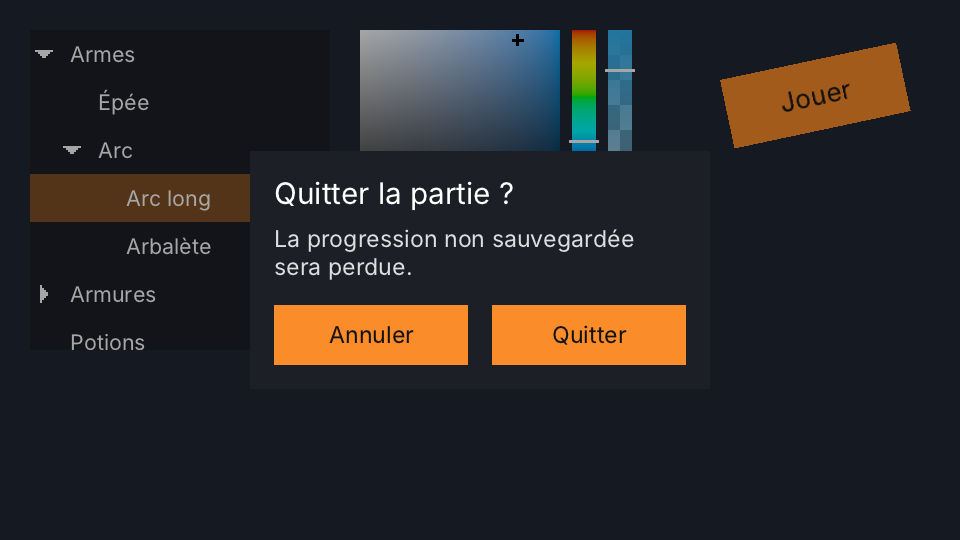

# Interface de jeu (phase 7)

Module `agr::ui`. Une interface est une hiérarchie d'entités sous un **Canvas** ; elle est dessinée
par-dessus la scène, à la résolution de l'écran, et réagit à la souris et au **multi-touch**. Tests :
`tests/test_ui.cpp`, tests GPU `tests/gpu/test_overlay.cpp` (Vulkan, OpenGL, OpenGL ES), test de jeu
des modèles et test de bout en bout de l'éditeur.

## Coordonnées et adaptation aux écrans

- Origine en **haut à gauche**, Y vers le bas, en unités du canvas.
- `UICanvas` : `ScaleWithScreen` (par défaut) adapte les unités à l'écran à partir de la résolution
  de référence (1920 × 1080) ; `match` choisit de suivre la largeur (0), la hauteur (1) ou un
  mélange — le même HUD tient sur un téléphone en portrait, en paysage et sur une tablette.
  `ConstantPixelSize` : 1 unité = `pixelScale` pixels. `sortOrder` : les canvas les plus hauts sont
  dessinés par-dessus. `respectSafeArea` (activé) place les enfants dans la **zone sûre** de l'écran
  (hors encoche, coins arrondis et barre de gestes) ; à désactiver pour un fond plein écran.
- `UIRect` : **ancres** (`anchorMin`, `anchorMax`, de (0, 0) en haut à gauche à (1, 1) en bas à
  droite du parent), **pivot**, `position`, `size`. Ancres confondues : taille fixe placée au point
  d'ancrage ; ancres écartées : l'élément s'étire avec son parent (`size` s'ajoute à la zone).

## Éléments

| Composant | Rôle |
|---|---|
| `UIImage` | Rectangle de couleur ou texture ; bordures **9-slice** (coins non déformés), `preserveAspect`, `pixelArt` ; sans texture, **boîte stylée** : `cornerRadius` (coins arrondis lissés), `outlineWidth` / `outlineColor` (contour intérieur), `shadowSize` / `shadowColor` / `shadowOffset` (ombre portée douce) |
| `UIText` | Texte UTF-8 (accents compris), police TrueType, taille, couleur, alignement horizontal / vertical, retour à la ligne, interligne |
| `UIButton` | Couleurs normal / survol / appui / désactivé (teinte de l'image) ; clic = `onClick()` du script de l'entité et `message(bouton)` du script de `target` |
| `UISlider` | Curseur horizontal ou **vertical** (`vertical` : bas = minimum) — piste, remplissage, poignée, valeurs min / max, entiers ; changement = `onValueChanged(valeur)` et `message(curseur, valeur)` sur `target` |
| `UILayout` | Range les enfants en **colonne**, **ligne**, **grille** ou **flux** (`Flow` : en ligne avec retour à la ligne quand la largeur est pleine, comme `HFlowContainer` de Godot — étiquettes, inventaires) : espacement, marges, alignement, étirement |
| `UIToggle` | Case à cocher ; même `group` = boutons radio (un seul coché) ; changement = `onValueChanged(1 ou 0)` et `message(case, valeur)` sur `target` |
| `UIInputField` | Champ de saisie (avec un `UIText` sur la même entité) : clic = focus (clavier virtuel sur téléphone), `onTextChanged(texte)`, Entrée = `onSubmit(texte)` et `message(champ, texte)` ; `placeholder`, `maxLength`, `numeric`, `password`, **`multiline`** (Entrée ajoute une ligne au lieu de valider ; mettre le `UIText` en haut avec retour à la ligne) ; curseur clignotant **placé au clic**, sélection à la souris (glisser) ou Maj + flèches, Ctrl + flèches = mot par mot, Origine / Fin (par ligne en multiligne), Haut / Bas, Suppr, Ctrl+A / C / X / V avec le presse-papiers du système, **Ctrl+Z / Ctrl+Y (ou Ctrl+Maj+Z) = annuler / rétablir** (les lettres tapées à la suite forment une seule étape, un collage aussi ; historique effacé au changement de focus) ; flèches, Suppr et Retour arrière **se répètent quand on les maintient** (0,45 s puis toutes les 35 ms) ; taper remplace la sélection |
| `UIProgressBar` | Barre de progression, de vie ou de chargement : valeur, min / max, sens de remplissage (gauche → droite, droite → gauche, bas → haut, haut → bas), couleurs, marge intérieure |
| `UIDropdown` | Liste déroulante : options séparées par `;`, `selected` ; un clic ouvre la liste **par-dessus tout** (au-dessus si la place manque en bas), survol surligné, choix = `onValueChanged(index)` et `message(liste, index)` ; un clic ailleurs la ferme sans rien toucher d'autre ; au clavier / à la manette, Entrée passe à l'option suivante |
| `UITabs` | Onglets : noms séparés par `;`, `current` ; le *i*-ème enfant est la page du *i*-ème onglet, seule la page courante est affichée sous la barre d'onglets ; clic sur un onglet = `onValueChanged(index)` et `message(onglets, index)` |
| `UITooltip` | Infobulle : texte affiché dans une boîte près du pointeur après `delay` secondes de survol |
| `UIItemList` | **Liste ou arbre** : éléments séparés par `;` ; avec `tree`, des `>` en tête donnent la profondeur (`Armes;>Épée;>Arc;>>Arc long`) et un clic sur la flèche replie / déplie (`collapsed` garde les repliés, sauvegardé) ; clic = sélection (`onValueChanged(index)`), **double clic** = `onSubmit(libellé)` ; `multiSelect` : Ctrl+clic ajoute / retire, Maj+clic sélectionne une plage, `selection` = indices (`"1,4,5"`) ; `reorderable` : glisser un élément sur une autre ligne l'y déplace
(`onValueChanged(nouvel index)`, la molette fait défiler) ; molette ou glisser pour défiler, lignes découpées au bord |
| `UIDialog` | **Boîte de dialogue modale** : `open` affiche un voile sur tout l'écran (qui bloque le reste de l'UI) et un panneau centré avec `title`, `text` et des `buttons` (`Annuler;Quitter`) ; le panneau grandit pour contenir le texte ; un bouton la ferme (`open = false`, `result` = son index) et appelle `onValueChanged(index)` / `message(dialogue, index)` |
| `UIColorPicker` | **Sélecteur de couleur** : carré saturation / luminosité, barre de teinte, barre d'opacité (`alpha`) ; appuyer ou glisser change `color` (`onValueChanged(alpha)`) ; la teinte est gardée sur les gris |
| `UIScrollView` | Zone défilante : ses enfants sont le contenu, déplacés par `scroll` et **découpés** au bord ; molette, glisser du doigt ou de la souris (un glisser annule le clic du bouton touché), barre de défilement ; limites calculées d'après le contenu |



**Échelle et rotation** : `UIRect.scale` agrandit ou réduit l'élément autour de son pivot, enfants
compris (ils sont placés dans le rectangle mis à l'échelle, leurs tailles multipliées par la moyenne
des deux axes) ; `UIRect.rotation` le tourne autour du pivot, enfants et textes compris, et les clics
suivent la rotation. Avec `agr.tween(e, {["UIRect.scale"] = {1.2, 1.2}}, 0.15)`, un bouton « rebondit ».

**Navigation au clavier / à la manette** : un canevas avec `keyboardNavigation` permet de passer
d'un contrôle à l'autre avec les flèches, la croix directionnelle ou le stick (le plus proche dans la
direction), de l'activer avec Entrée, Espace ou A, et de régler un curseur avec gauche / droite ; le
contrôle choisi est encadré. Un pointeur reprend la main. `agr.ui.focus(entité)` choisit le contrôle
(ou donne le clavier à un champ), `agr.ui.isTyping()` dit au jeu d'ignorer les touches pendant la
saisie. Menu Créer › UI : case à cocher, champ de saisie, zone défilante.

Une image transparente (alpha 0) ne bloque pas le pointeur : utile pour les conteneurs. Une image
avec `blocksPointer` désactivé laisse aussi passer les clics et les doigts (voiles d'écran, décors
par-dessus des boutons : c'est le cas du voile de `agr.fx.flash` / `agr.fx.fade`).

## Thèmes

`UICanvas.theme` désigne un fichier `.agrtheme` : il donne l'apparence de **tous les contrôles** du
canevas — teintes des boutons (normal, survol, appui, désactivé), pistes / remplissages / poignées des
curseurs, cases à cocher, barres, listes déroulantes, onglets, infobulles —, la police de tous les
textes et la couleur des textes laissés blancs. Changer de thème change tout le menu d'un coup ; le
fichier est relu quand il change. Les projets reçoivent `assets/themes/sombre.agrtheme` et
`assets/themes/cartoon.agrtheme` (couleurs vives, boutons dorés, accent vert).

```json
{ "version": 1, "font": "", "text": [1, 1, 1, 1], "panel": [0.2, 0.15, 0.38, 0.97],
  "button": [1, 0.72, 0.15, 1], "buttonHover": [1, 0.82, 0.35, 1], "buttonPressed": [0.85, 0.52, 0.08, 1],
  "buttonDisabled": [0.55, 0.5, 0.6, 0.6], "accent": [0.35, 0.86, 0.3, 1], "track": [0.13, 0.1, 0.27, 1],
  "handle": [1, 1, 1, 1], "field": [0.29, 0.22, 0.52, 1] }
```


## Pointeurs

- Souris et **plusieurs doigts à la fois** : survol, appui, clic (relâché sur le même bouton),
  annulation (relâché ailleurs), glisser des curseurs, plusieurs boutons maintenus simultanément
  (commandes tactiles : gauche + saut).
- Les événements souris que SDL fabrique à partir des touchers sont ignorés (un doigt n'agit pas deux
  fois).
- `agr.ui.pointerOverUI()` dit au gameplay d'ignorer un clic qui touche l'interface ;
  `agr.ui.isPressed(bouton)` lit un bouton maintenu.

## Texte

Polices TrueType rasterisées à la demande (stb_truetype) dans un atlas de glyphes de 1024 × 1024,
à la taille exacte affichée (texte net à toutes les tailles). Crénage, `\n`, retour à la ligne aux
espaces (et dans les mots trop longs). Les modèles de projet fournissent Inter
(`assets/fonts/Inter-Regular.ttf`, licence OFL).

**Texte enrichi** (`UIText.richText`) : `[color=#ff8800]...[/color]` (ou un nom : `red`, `green`,
`blue`, `yellow`, `orange`, `purple`, `cyan`, `gray`, `white`, `black`, couleurs imbriquables),
`[b]...[/b]` (gras), effets animés `[wave]...[/wave]` (vague), `[shake]...[/shake]` (tremblement), `[rainbow]...[/rainbow]` (arc-en-ciel), `[i]...[/i]` (italique, glyphes inclinés), `[u]...[/u]` (souligné, espaces
compris), `[s]...[/s]` (barré), `[url=id]...[/url]` (**lien** : bleu souligné ; un clic appelle
`onLinkClicked(id)` du script du texte ou de son parent le plus proche qui a un script),
`[img=assets://piece.png]` (**image en ligne** de la taille d'un caractère, posée sur la ligne de base :
icônes de monnaie, de touches ; `[img=assets://logo.png scale=2 aspect=3]` : hauteur en caractères et
rapport largeur / hauteur, le texte qui suit est décalé d'autant, une image plus haute qu'un caractère
est centrée sur la ligne) ; `[[` pour
écrire un crochet ; une balise inconnue reste affichée telle quelle.

## Depuis Lua

```lua
local HUD = {}
function HUD:onStart() self.score = agr.find("Score") end
function HUD:addPoint() self.points = (self.points or 0) + 1; self.score:setText("Score : " .. self.points) end
function HUD:pause(button) agr.find("Pause Menu"):setActive(true) end   -- message d'un UIButton
function HUD:volume(slider, v) agr.audio.setBusVolume("Music", v) end   -- message d'un UISlider
return HUD
```

## UI Builder (éditeur)

- *Créer › Interface (UI)* : Canvas, Panneau, Texte, Bouton (avec son texte), Curseur, Colonne. Un
  élément créé hors d'un canvas est placé sous le premier canvas (créé si besoin).
- La **vue Jeu** affiche l'interface à la taille de la vue : **cliquer** sélectionne l'élément le plus
  haut, **glisser** le déplace, les **poignées** le redimensionnent (en tenant compte du pivot) ;
  chaque geste est une entrée d'annulation. Ctrl (ou *Magnétisme*) : pas de 10 unités. Les ancres
  de l'élément sélectionné sont marquées dans le parent.
- **Guides d'alignement** : en déplaçant un élément, ses bords et son centre s'aimantent (à 6 pixels
  près) à ceux des éléments voisins et du parent, et des lignes bleues montrent l'alignement ; Maj
  désactive l'aimantation.
- **Sélection multiple** : Ctrl+clic ajoute un élément ; glisser l'un d'eux déplace tout le groupe (un
  seul geste d'annulation). Avec deux éléments ou plus, une barre en haut de la vue **aligne** (bords
  gauche / droit / haut / bas, centres) ou **répartit** (écarts égaux, 3 éléments ou plus).
- Inspecteur de `UIRect` : grille de **préréglages d'ancres** (gauche / centre / droite / étirer ×
  haut / milieu / bas / étirer) et taille à l'écran.
- En mode Jeu, la vue Jeu reçoit la souris comme un écran : les boutons du HUD se cliquent.

## Performances

Mise en page + géométrie de 501 éléments (100 boutons avec texte) : ~0,1 ms par image sur la machine
de test ([BENCHMARKS.md](BENCHMARKS.md)).

## Limites actuelles

- Texte enrichi : une image plus haute qu'un caractère n'agrandit pas la ligne (elle peut chevaucher les
  lignes voisines) ; l'italique est une inclinaison des glyphes (pas de police italique).
- Boîtes stylées : le contour est dessiné sous le remplissage (un remplissage transparent laisse voir
  le contour) ; rayon par coin : `cornerRadii` (haut-gauche, haut-droit, bas-droit, bas-gauche ; négatif =
  `cornerRadius`), pour des onglets arrondis en haut ou des bulles.
- Champs de texte : un champ d'une ligne trop long **défile horizontalement** pour garder le curseur
  visible (son texte reste découpé dans le champ) ; arbres : glisser-déposer d'un
  élément avec ses enfants (quart haut = avant, milieu = dedans, quart bas = après ; replis conservés) ; listes : sélection multiple sans glisser (Ctrl / Maj + clic).
- Rotation : les zones défilantes contenues dans un élément tourné découpent selon le rectangle non
  tourné ; le curseur et la sélection d'un champ tourné ne suivent pas la rotation.
- Atlas de glyphes unique : beaucoup de tailles et d'alphabets différents à la fois le remplissent
  (il est alors vidé et reconstruit, avec un avertissement si cela ne suffit pas).
- UI Builder : une sélection multiple se déplace et se **redimensionne d'un bloc** (cadre bleu et ses
  poignées ; Maj sur un coin garde les proportions ; chaque élément garde sa place et sa taille relatives
  dans le cadre) ; les textes ne changent pas de taille de police. Le calcul est testé
  (`scaleRectsInBox`) ; le geste à la souris lui-même n'a pas de test automatique.
