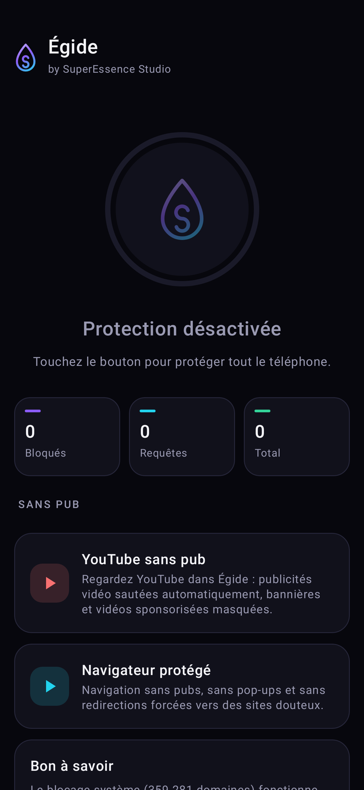
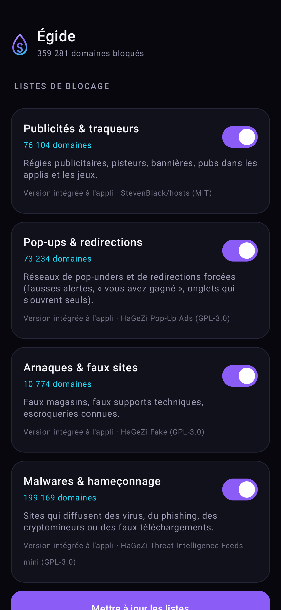

# Égide — by SuperEssence Studio

Bloqueur de publicités, pop-ups, redirections et sites dangereux pour **tout le téléphone** Android.

- **APK** : [`release/Egide-SuperEssence-Studio.apk`](release/Egide-SuperEssence-Studio.apk) (Android 8.0+, signé, ~3,7 Mo)

  

## Fonctionnement
- **Écran d'ouverture** : le logo SuperEssence Studio (une goutte tracée d'un seul trait dont le cœur forme un S) se dessine, s'illumine, puis « SUPERESSENCE · STUDIO » apparaît. Toucher pour passer.
- **Protection système** : VPN *local* (aucun serveur distant). Seules les requêtes DNS passent par lui ; les domaines listés reçoivent `0.0.0.0`. Fonctionne dans toutes les applis, jeux et navigateurs, sans ralentir le débit.
- **Listes intégrées (~359 000 domaines)**, mises à jour depuis l'appli : publicités et traqueurs (StevenBlack, MIT), pop-ups et redirections (HaGeZi Pop-Up Ads), arnaques (HaGeZi Fake), malwares et phishing (HaGeZi TIF mini) — HaGeZi sous GPL-3.0.
- **YouTube sans pub** : YouTube s'ouvre dans le navigateur Égide ; un script retire les pubs des réponses du lecteur, saute les pubs restantes et masque les vidéos sponsorisées.
- **Navigateur protégé** : filtrage de chaque requête, pop-ups sans clic bloquées, redirections vers des domaines listés bloquées, ouverture automatique d'applis (intent:, market:) bloquée.
- Journal en direct (autoriser / bloquer un domaine d'un toucher), liste blanche, blocages personnels, choix du DNS (Quad9, Cloudflare, AdGuard, Google), démarrage automatique, tuile des réglages rapides.

## Limites (honnêtement)
- L'**appli officielle YouTube** envoie ses pubs par les mêmes serveurs que les vidéos : aucun bloqueur sans root ne peut les retirer sans casser YouTube. D'où le mode « YouTube sans pub » intégré.
- Si le **DNS privé** d'Android est forcé sur un serveur (Réglages › Réseau › DNS privé), le filtrage est contourné : l'appli le détecte et l'indique.
- Un seul VPN peut être actif à la fois sur Android.

## Compiler
`./gradlew assembleRelease` (SDK Android 35, JDK 17+). Clé de signature dans `keystore/` : à remplacer avant toute publication.
