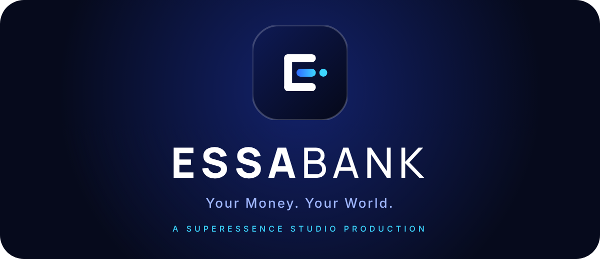
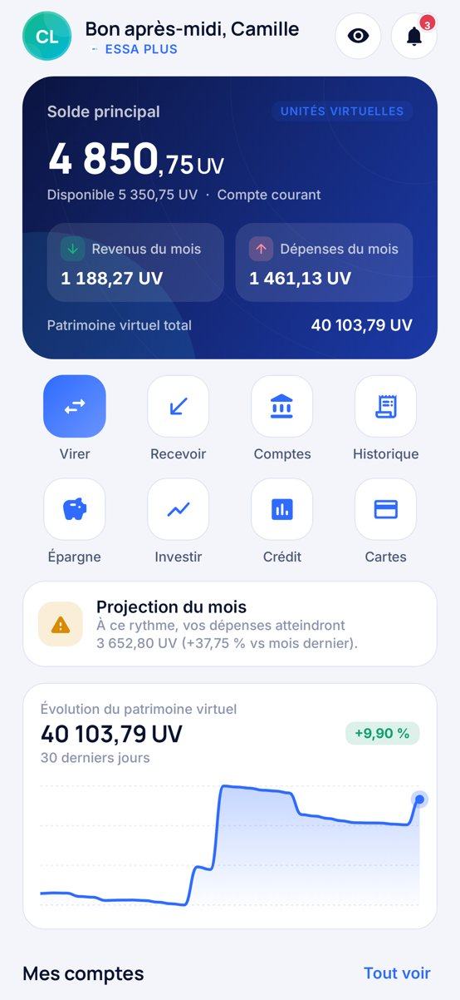
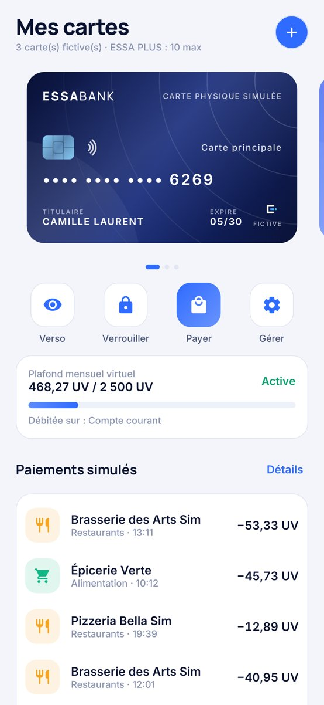
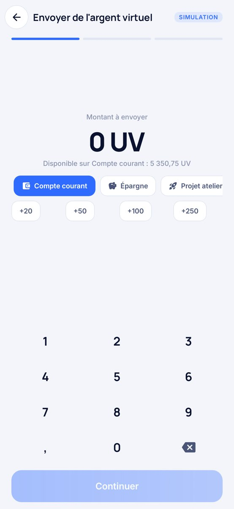
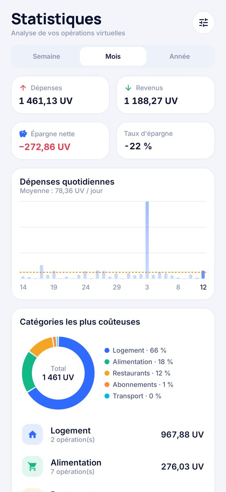
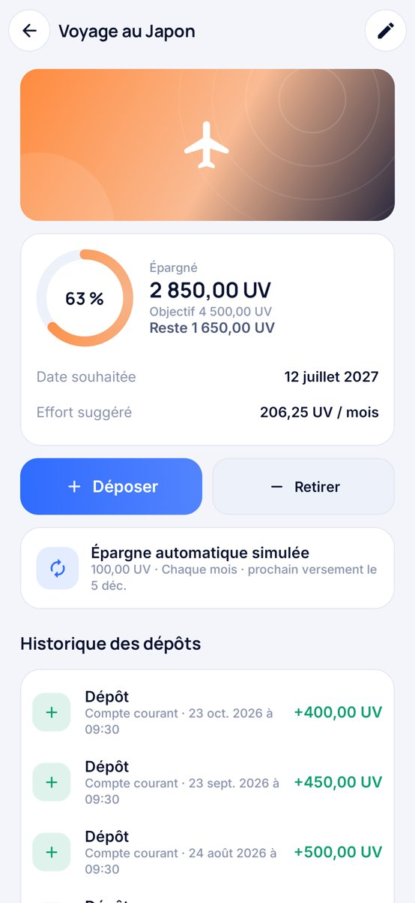
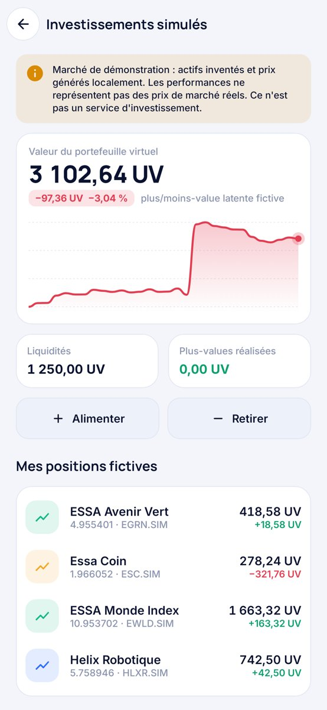

# ESSABANK — Your Money. Your World.

**Application bancaire de simulation pour Android — A SUPERESSENCE STUDIO PRODUCTION**

<p align="center"></p>

> **ESSABANK est une banque entièrement fictive**, destinée à la simulation et au divertissement.
> Ce n'est pas un établissement bancaire : elle ne détient aucun fonds, n'effectue aucun virement réel et ne délivre aucune carte de paiement.
> Toutes les opérations utilisent des **unités virtuelles (UV) sans valeur monétaire**. Les numéros de carte sont inventés et volontairement inutilisables (préfixe « 0 » non attribué, clé de Luhn fausse).
> Aucune connexion Internet : toutes les données restent sur le téléphone.

---

## Télécharger

**APK : [`release/ESSABANK-SUPERESSENCE.apk`](release/ESSABANK-SUPERESSENCE.apk)** — Android 8.0+, version release minifiée (R8), signée (certificat « ESSABANK, Superessence Studio »), environ 2,6 Mo, aucune permission Internet.

<p align="center">
  
  
</p>

## Vérifications effectuées

| Vérification | Résultat |
|---|---|
| Moteur financier, base SQLite, sécurité, PDF (`core`) | 50 tests, **tous verts** |
| Tests Android Robolectric (`app`) | 35 tests, **tous verts** : persistance sur SQLite Android après fermeture, PIN haché et délai après échecs, **parcours complet dans la vraie activité** (introduction → profil de démonstration → création du PIN → accueil → virement → recréation de l'activité, données conservées), rendu sans plantage des 32 écrans avec captures |
| APK release | Compilé, minifié, signé et vérifié (`apksigner`, `aapt2`), classes de sérialisation et polices présentes après R8 |
| **Non vérifié** | Aucun téléphone ni émulateur n'était disponible (pas de virtualisation matérielle) : l'APK n'a pas été installé sur un appareil réel. La biométrie et l'export de fichiers (sélecteur système) restent à confirmer sur téléphone. Les tests d'interface tournent sur la version debug ; la version release minifiée n'a été vérifiée que de façon statique. |

Bugs trouvés et corrigés grâce à ces tests : le compteur d'échecs du PIN était enregistré dans le mauvais type (plantage au premier code erroné) ; après la création du PIN, « Plus tard » sur l'écran de biométrie ne menait pas à l'accueil.

## Compiler

```bash
echo "sdk.dir=/chemin/vers/android-sdk" > local.properties   # plateforme 35 + build-tools 35
./gradlew essabankApk                       # → release/ESSABANK-SUPERESSENCE.apk (release, R8, signé)
./gradlew test                              # moteur (50) + tests Android Robolectric (35)
./gradlew :app:testDebugUnitTest -Pscreenshots=true   # captures PNG des écrans dans app/build/screenshots
./gradlew -PcoreOnly :core:test             # moteur seul, sans SDK Android
```

## Fonctionnalités

| Domaine | Contenu |
|---|---|
| Lancement | Animation « SUPERESSENCE STUDIO présente » (lettre par lettre), apparition du logo ESSABANK, toucher pour passer. |
| Bienvenue | Choix FR/EN, profil de démonstration prérempli **ou** création d'un profil fictif (prénom, nom, capital virtuel de départ). Aucun identifiant bancaire demandé. |
| Sécurité | Code PIN local 4 à 6 chiffres (haché PBKDF2-SHA256, sel aléatoire, codes triviaux refusés), délai croissant après 5 échecs, biométrie Android (BiometricPrompt), verrouillage automatique en arrière-plan (immédiat, 30 s, 1 min, 5 min), protection d'écran (FLAG_SECURE), changement de PIN, verrouillage manuel. Données exclues des sauvegardes cloud Android. |
| Accueil | Logo, titulaire, **solde principal animé** (décompte), solde disponible (découvert virtuel), revenus et dépenses du mois, patrimoine virtuel total, courbe d'évolution 30 jours (lecture au doigt), projection du mois ou alerte de budget, accès rapides (virer, recevoir, comptes, historique, épargne, investir, crédit, cartes), carrousel des comptes, carte, budget, coffres, dernières transactions. Bouton pour **masquer les montants**. |
| Comptes | Courant, épargne (intérêts fictifs mensuels), projet, vacances, professionnel, investissement fictif. Nom, couleur, icône, statistiques (solde 60 j, flux mensuels), historique, relevé PDF, inclusion dans le total, arrondi automatique vers l'épargne, suppression (compte vide). Transferts entre comptes. |
| Cartes | Virtuelle, physique simulée, premium, éphémère (usage unique), secondaire. Carrousel 3D, **inclinaison au doigt et retournement animé** (verso avec CVV fictif), détails masqués par défaut, activer/désactiver, verrouiller/déverrouiller, design (6 standards + 4 premium), plafond mensuel virtuel (curseur), paiements en ligne et sans contact, renommer, supprimer, créer. **Simulateur de paiement** chez des commerçants fictifs, historique des paiements de chaque carte. |
| Virements | Envoi vers un bénéficiaire fictif, entre ses comptes, réception simulée. Parcours en 3 étapes (montant au clavier, détails, vérification), motif, description, **programmation** (une fois, hebdomadaire, mensuelle), animation de transfert, écran de réussite, **reçu « SIMULATION — AUCUN TRANSFERT RÉEL »** et reçu PDF. Gestion des bénéficiaires (références fictives `ESSA-SIM-…`, favoris, notes) et des virements programmés (activer, suspendre, supprimer, compteur d'exécutions et d'échecs). |
| Historique | Recherche (libellé, montant, référence, sans accents), filtres (type, période, compte, 11 catégories), tri (date, montant), regroupement par jour, détail complet (date, heure, catégorie, compte, statut simulé, solde après opération, référence, écriture liée), **export PDF marqué simulation**, suppression des données de démonstration. |
| Statistiques | Semaine / mois / année, dépenses quotidiennes, catégories (anneau interactif), comparaison mensuelle revenus/dépenses, épargne nette, taux d'épargne ; statistiques avancées (tendance hebdomadaire, principales dépenses, projection) avec ESSA PLUS. |
| Budgets | Budget mensuel global, budgets par catégorie, alertes simulées à 80 % et 100 % (une fois par mois), plafonds des cartes, objectifs d'épargne. |
| Épargne | Objectifs (voiture, maison, vacances, téléphone, projet, libre), coffres virtuels, montant cible, date souhaitée et effort mensuel suggéré, anneau de progression, illustrations vectorielles, dépôts et retraits, historique, **épargne automatique** hebdomadaire ou mensuelle, arrondi des paiements. |
| Investissements | Marché de démonstration généré localement (8 actions, 4 cryptos, 4 ETF, symboles `.SIM` inventés), prix « en direct » au pas de 5 min, graphiques 1J/1S/1M/1A, achat et vente virtuels fractionnés, plus/moins-values latentes et réalisées (coût moyen pondéré), historique. Avertissement permanent : prix non réels. |
| Crédits | Personnel, automobile, immobilier, étudiant (taux fictifs) : capital, durée, taux, assurance, mensualité, coût total, tableau d'amortissement mensuel ou annuel, simulations enregistrées. Aucun crédit accordé. |
| Notifications | Centre de notifications : paiements, virements reçus/envoyés, objectif atteint, budget dépassé, nouvelle transaction, résumé mensuel, carte créée, échec de virement programmé, investissement, sécurité. Filtres, lu/non lu, suppression, navigation vers l'élément concerné. Réglage par type. |
| Profil | Nom fictif, photo (stockée localement) ou avatar, informations du compte, langue (FR/EN), devise d'affichage (UV, €v, $v, £v, CHFv à taux fictifs), thème clair/sombre/système/Onyx, couleur d'accent, animations, notifications, sécurité, données. |
| Données | Sauvegarde **chiffrée AES-256-GCM** protégée par mot de passe (fichier `.essabk`), restauration, suppression des transactions de démonstration (soldes conservés), réinitialisation de la démonstration, effacement complet. |
| Formules | ESSA STANDARD, ESSA PLUS, ESSA BLACK : **gratuites, aucun paiement demandé**. PLUS : 10 cartes, cartes premium, statistiques avancées, couleurs, objectifs illimités. BLACK : interface Onyx, designs premium, thèmes avancés, **tableau de bord personnalisable** (choix et ordre des blocs). |

Interface entièrement bilingue (français / anglais), aucune émoji, icônes vectorielles Material, polices Manrope (titres) et Inter (texte, chiffres tabulaires).

## Données de démonstration

Profil « Camille Laurent » (fictif) : compte courant **4 850,75 UV**, épargne **12 400,00 UV**, compte projet **2 150,00 UV**, vacances 1 320,00 UV, freelance 6 780,40 UV, investissement 1 250,00 UV + positions ; environ 150 jours d'historique réaliste (salaire, loyer, courses, restaurants, transports, abonnements, loisirs, santé, virements), 3 cartes, 4 bénéficiaires, 2 virements programmés, 3 coffres (dont un atteint), budgets et notifications. Toutes les enseignes et personnes sont inventées. Chaque transaction de démonstration est marquée comme telle.

## Architecture

```
essabank/
├── core/   Kotlin pur (aucune dépendance Android), testé sur JVM
│   ├── money/     Money (centièmes en Long), saisie, formats FR/EN, devises d'affichage
│   ├── model/     Comptes, cartes, transactions, bénéficiaires, budgets, coffres, positions, notifications
│   ├── engine/    BankEngine (opérations), Analytics, textes des notifications, identifiants fictifs
│   ├── market/    Marché de démonstration déterministe (marche aléatoire log-normale + pont brownien intrajournalier)
│   ├── loan/      Calcul d'annuités et tableau d'amortissement (BigDecimal)
│   ├── data/      BankDatabase (schéma SQLite, écritures différentielles), BankRepository (verrou + persistance)
│   ├── security/  PIN (PBKDF2), anti-force brute, sauvegardes chiffrées (AES-GCM)
│   ├── pdf/       Générateur PDF sans dépendance, relevés et reçus marqués SIMULATION
│   └── demo/      Profil de démonstration et profil vierge
└── app/    Android : Kotlin, Jetpack Compose, Material 3, MVVM
    ├── data/      Pilote SQLite Android, réglages de sécurité (SharedPreferences privées)
    ├── security/  Biométrie Android
    └── ui/        Thème et design system, composants (graphiques, carte 3D, clavier…), navigation, 33 écrans
```

### Moteur financier

Chaque opération est une **fonction pure** : état → nouvel état complet, ou erreur sans aucune modification. Le dépôt exécute l'opération sous un verrou (aucun entrelacement possible), enregistre la différence dans **une seule transaction SQLite**, puis publie l'état. Si l'écriture échoue, rien n'est publié : l'opération est atomique.

Règles garanties et testées : un débit diminue le solde, un crédit l'augmente ; un virement interne produit deux écritures liées qui se compensent ; montants nuls, négatifs, à plus de deux décimales ou au-delà du plafond refusés ; solde disponible (avec découvert virtuel) vérifié ; anti-doublon par identifiant de requête (double appui) ; solde après opération sur chaque écriture ; montants en centièmes entiers et arrondi bancaire au centième pour les calculs (intérêts, conversions, crédits, investissements). Un test de propriété enchaîne 1 500 opérations aléatoires sans qu'aucune unité n'apparaisse ou ne disparaisse.

### Base de données

SQLite locale : une table par entité (`accounts`, `cards`, `transactions`, `beneficiaries`, `scheduled`, `goals`, `goal_movements`, `holdings`, `trades`, `loans`, `notifications`, `kv`), colonnes indexées pour les requêtes (compte, date, catégorie, montant signé, numéro d'ordre) et détail en JSON. Seules les lignes modifiées sont réécrites.

## Tests

`core` (exécutés, 50/50) :
- **Money** : saisies FR/EN, refus des saisies invalides, arithmétique exacte, débordement, arrondi bancaire, formats.
- **Moteur** : soldes de démonstration exacts, déterminisme, numéros de carte toujours invalides, virements internes, solde insuffisant et découvert, anti-doublon, bénéficiaires, virements programmés (rattrapage, échec, unique), cycle de vie d'une carte (verrouillage, désactivation, paiement en ligne, plafond), carte éphémère, limites des formules, arrondi vers l'épargne, alertes de budget uniques, coffres et épargne automatique, achat/vente et plus-value réalisée, comptes, suppression des données de démonstration, résumé mensuel et intérêts, préférences de notifications, textes anglais, **invariants sous 1 500 opérations aléatoires**.
- **Persistance (vraie SQLite)** : aller-retour complet, **données conservées après fermeture et réouverture**, **panne d'écriture au milieu d'un virement : rien n'est enregistré**, 60 virements concurrents, sauvegarde chiffrée (mauvais mot de passe, fichier invalide), effacement.
- **Crédit, marché, sécurité, analyses, PDF** (structure du fichier, table xref, mentions SIMULATION).

`app` (exécutés, 35/35) : persistance sur SQLite Android après fermeture, PIN haché et délai, parcours complet dans l'activité (intro → démonstration → PIN → accueil → virement → recréation de l'activité), rendu des 32 écrans avec captures optionnelles.

## Signature

`keystore/essabank-release.jks` est une clé de projet fournie pour des builds reproductibles. **Avant toute publication, créez votre propre clé** et passez-la par `ESSABANK_KEYSTORE`, `ESSABANK_KEYSTORE_PASSWORD`, `ESSABANK_KEY_ALIAS`, `ESSABANK_KEY_PASSWORD`.

## Licences

Code : Superessence Studio. Polices Inter et Manrope : SIL Open Font License 1.1 (`FONTS_LICENSE_OFL.txt`). Icônes Material (Apache 2.0). Aucun logo ni élément d'identité d'une banque existante n'est utilisé.

---

*ESSABANK n'est pas un établissement bancaire. Unités virtuelles sans valeur monétaire réelle.*

**A SUPERESSENCE STUDIO PRODUCTION**
