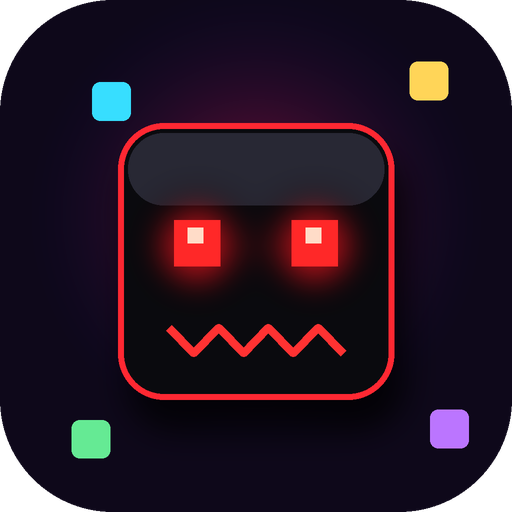

# THE LAST BLOCK — by SuperEssence Studio

**Un jeu de blocs 3D cartoon qui devient un cauchemar.**

<p align="center"></p>

- **APK installable** : [`release/TheLastBlock-SuperEssence.apk`](release/TheLastBlock-SuperEssence.apk) (Android 8.0+, signé, hors connexion)
- Au lancement : écran animé **SuperEssence Studio** (lettres qui rebondissent, le point final est un petit bloc jaune qui tombe et rebondit, reflet lumineux, « STUDIO »), puis avertissement (première fois) et menu.

> Nom : le jeu s'appelle **THE LAST BLOCK** et non « Tetris » : *Tetris* est une marque déposée. Le genre (pièces de 4 blocs qui tombent, lignes à compléter) est libre, le nom ne l'est pas. Toute la musique est originale.

## Contenu

| Domaine | Ce qui est implémenté |
|---|---|
| Jeu de blocs | 7 pièces, sac de 7, rotations avec kicks (SRS), déplacement avec répétition (DAS/ARR), chute douce, chute instantanée, réserve, 3 prochaines pièces, pièce fantôme, verrouillage différé, lignes, combos, enchaînements, score, niveaux et vitesse, records, pause. |
| Rendu 3D | three.js (WebGL 2) : blocs arrondis en volume, matériaux glossy/clearcoat avec reflets d'environnement, ombres douces, bloom, borne d'arcade avec vitre, néons, rayons lumineux, décor de pièces flottantes, caméra en légère plongée. Effacement de ligne : flash, explosion en particules, chute animée des lignes. |
| Post-traitement | Passe maison : aberration chromatique, glitch, flash, vignette, grain, flou radial (poursuites), déformation de l'image, profondeur de champ par bandes, teinte rouge, tremblements de caméra. |
| Monstre | 4 formes procédurales en blocs noirs brillants à liseré rouge : **THE BLOCK**, **THE CRAWLER**, **THE GLITCH**, **THE KING**. Yeux émissifs, bouche géométrique, animations saccadées (respiration, observation, colère, attaque, course, rampement, cri, transformation, décomposition/reconstruction, morceaux qui se détachent). |
| Chapitres | 1 THE GAME (anomalies progressives) · 2 THE CRACK (il écrit dans la grille, puzzle de l'œil, question, faux chargement) · 3 BREAK THE SCREEN (le bloc géant, 3 frappes, fissures, l'écran explose, il sort, cri, noir, le bloc vivant, jumpscare) · 4 RUN (2 poursuites) · 5 THE CORRUPTION (pièces vivantes, mécanismes dorés, corruption qui se propage, faux écran de défaite, faux menu, poursuite du Crawler) · 6 THE KING (boss) · 7 THE LAST BLOCK (révélation et 3 fins). |
| Poursuites | Couloirs compacts scénarisés (pas de monde ouvert) : salle d'arcade qui se déforme, plateau géant, grille qui s'effondre. 3 voies, sauts, glissades, murs, barres, trous, blocs qui tombent (ombre d'alerte), portes qui se ferment, cachette (il passe à côté de toi), serrure-énigme. Le monstre accélère, disparaît et réapparaît en embuscade, rampe sur les murs, saute par-dessus les obstacles ou les détruit. Points de passage. |
| Boss | Les lignes effacées blessent le Roi (il perd des morceaux). Il ajoute des lignes, frappe des colonnes (alerte rouge), glisse sa main dans la grille (complète la ligne pour la piéger). Pièces dorées en phase 2, enragé en phase 3. |
| Audio | 100 % procédural (Web Audio) : 5 musiques originales séquencées, musique qui ralentit/se désaccorde selon la corruption, couches adaptatives (drone, murmures, parasites, battements de cœur, vent), réverbération, ~40 effets (cris, verre, coups…). |
| Collection | 7 palettes, 5 matériaux, 5 effets de destruction, 3 traînées, 4 grilles, 4 thèmes, 3 packs sonores, débloqués par score, lignes, chapitres et secrets. 5 secrets (« yeux ») à trouver, statistiques. |
| Paramètres | Volumes musique/effets, qualité (Performance / Auto / Qualité), pièce fantôme, contrôles boutons ou gestes, mode gaucher, taille des boutons, sensibilité, vibrations, touches clavier personnalisables, réduction des flashs, des mouvements de caméra, limitation des jumpscares, effacement de la progression. |
| Sauvegarde | Progression, chapitres, fins, records, collection, secrets, réglages (stockage local). « Continuer » reprend au chapitre en cours. Le menu se corrompt avec la progression. |

## Architecture

```
web/                       le jeu (HTML/JS modules, servi depuis l'APK)
├── index.html, css/style.css, fonts/ (Fredoka, OFL)
└── js/
    ├── main.js            boucle, écrans, pause, chapitres, jumpscares, écran SuperEssence
    ├── core/              fx.js (rendu + post-traitement), audio.js, input.js, save.js, util.js (ordonnanceur annulable)
    ├── game/              tetris.js (moteur pur), tetrisMode.js, runner.js (poursuites), story.js (7 chapitres)
    ├── world/             board3d.js, monster.js, materials.js (shaders), particles.js, menuScene.js
    ├── ui/ui.js           menus, panneaux, HUD, modales
    └── lib/               three.js r170 (MIT) + addons
android/                   MainActivity.java (WebView plein écran, origine https locale, vibrations, retour)
tools/make_icons.py        génération des icônes
build.sh                   compilation de l'APK sans Gradle
```

## Compiler

```bash
sudo apt install aapt apksigner zipalign dalvik-exchange   # + JDK 17+
ANDROID_JAR=/chemin/vers/android-33/android.jar ./build.sh
```

Pour jouer dans un navigateur : `cd web && python3 -m http.server`, puis ouvrir `http://localhost:8000`. `web/dev/monster.html?form=king&state=idle` affiche une forme du monstre seule.

La clé `keystore/lastblock-release.jks` (mot de passe `lastblock-superessence`) sert aux mises à jour par-dessus. Créez votre propre clé avant une publication (variables `LASTBLOCK_KEYSTORE`, `LASTBLOCK_KEYSTORE_PASSWORD`, `LASTBLOCK_KEY_ALIAS`).

## Vérifications faites

- Moteur de blocs testé en Node (rotations, kicks, chute, lignes, score, partie aléatoire jusqu'à la défaite).
- Chaque chapitre joué de bout en bout dans Chromium (rendu WebGL logiciel) avec captures : chapitres 1 à 7, les 3 fins, cachette, serrure, capture puis reprise, boss vaincu, secrets, déblocages, menus, paramètres, mode gestes, pause, record Arcade. Aucune erreur JavaScript.
- APK vérifié avec `apksigner verify` et `aapt dump badging`.

## Limites connues

- **Pas testé sur un vrai téléphone** : l'environnement de compilation n'a ni émulateur ni appareil. Les performances réelles dépendent du GPU ; la qualité « Auto » passe en mode Performance si l'image descend sous 40 i/s.
- L'occlusion ambiante est simulée (ombres de contact, éclairage), pas calculée en écran (SSAO trop lourd sur mobile). La profondeur de champ est un flou par bandes, pas un vrai bokeh.
- Les modèles 3D sont procéduraux (blocs assemblés par le code), pas sculptés dans un logiciel 3D.
