# LOST KINGDOM

*A world waiting to be discovered.* Created by **SUPERESSENCE STUDIO**, powered by **AGR ENGINE**.

<p align="center">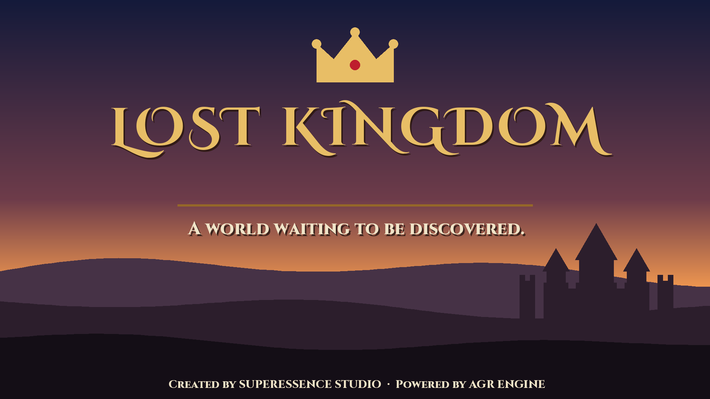</p>

LOST KINGDOM est un action-RPG en monde ouvert continu, en 2.5D (caméra 3D orbitale au-dessus du héros), pour smartphones Android. Il est écrit entièrement en **C++17 sur OpenGL ES 3.0** avec un moteur maison, l'AGR Engine. Il n'utilise ni Unity, ni Unreal, ni Godot, ni Java/Kotlin : l'application est une `NativeActivity` pure.

- **APK** : `release/LOST-KINGDOM-SUPERESSENCE.apk`, à la racine du dépôt. Signé en v2/v3, aligné à 16 Ko, ABIs arm64-v8a, armeabi-v7a et x86_64, Android 8.0 (API 26) ou plus, OpenGL ES 3.0 requis. Version 1.6.1 (versionCode 8). Taille : environ 23 Mo. SHA-256 : `72abc879ab730a13cebfbf543fcadc4f7a5e9e6c50683e7027811986afd94375`.
  - La 1.6.1 est signée avec la même clé locale que la 1.6.0 : elle s'installe directement par-dessus.
  - **Depuis la 1.5.0 : désinstallez d'abord l'ancienne version.** La clé de signature locale de la 1.5.0 n'est pas versionnée (dossier `keystore/` ignoré par git) et n'était plus disponible : la 1.6.0 est signée avec une nouvelle clé locale, et Android refuse d'installer par-dessus une application signée avec une autre clé. Les sauvegardes sont dans les données internes de l'application : elles sont perdues à la désinstallation, sauf si la sauvegarde automatique d'Android les restaure (non vérifié).
- **Langue du jeu** : français.

> **Honnêteté avant tout.** Ce document distingue ce qui est implémenté et vérifié, ce qui est implémenté mais non vérifié sur un appareil réel, et ce qui manque. Lisez la section *Limites connues* avant tout.

### Nouveautés 1.6.2 (démarche et combat plus fluides)

- **Démarche refaite.**
  - **Cause principale** : la longueur de pas n'était pas adaptée aux vitesses du héros. Il faisait environ 280 pas/min en trottinant et 350 en sprintant (un coureur réel : environ 170 à 180), et la posture de course se mélangeait à la marche. D'où l'allure accroupie et « trottinante ».
  - Pas accordés à ses vitesses : environ 155 pas/min en marchant, environ 195 en courant, longues foulées en sprint.
  - Course moins accroupie : bassin plus haut, genou plus droit quand le pied est au sol, penchée vers l'avant plus modérée.
  - Posture plus héroïque : poitrine ouverte, tête droite.
  - Au repos, le héros se tient sur une jambe puis sur l'autre (déhanché naturel).
  - Quand un ennemi est proche, il passe en **garde** : pieds écartés, pied gauche devant, buste de profil, main libre levée.
  - Les autres humanoïdes ont aussi des pas plus longs à la course.
- **Attaques avec tout le corps** (toutes les armes) :
  - préparation : poids sur la jambe arrière, torse armé dans le sens opposé au coup ;
  - frappe : fente sur la jambe avant, bassin qui descend, hanches qui tournent dans le sens de la lame, main libre en contrepoids ;
  - retour en garde.

  Le sens de rotation est déduit de chaque animation, et l'amplitude du déplacement prévu par le coup.
- **Banc d'essai d'animation** : nouveau scénario `--autoplay=anim`. Il filme le héros de profil sur un « tapis roulant » (repos, marche, trot, sprint, puis attaque légère et lourde), 8 images par allure.
- **Modèles importés** :
  - jusqu'à 3 variantes par sexe pour les villageois (`villager_m`, `villager_m2`, `villager_m3`, et de même pour `villager_f`), tirées au hasard pour chaque villageois ;
  - guide des prompts Tripo : `docs/TRIPO_PROMPTS.md`.
- **Limites.**
  - Les animations restent écrites en code (procédurales), pas en capture de mouvement.
  - Le jeu ne sait pas encore importer les animations fournies par Tripo.
  - Tout est vérifié sur ordinateur, **pas sur un téléphone**.

### Nouveautés 1.6.1 (corrections après le premier essai sur téléphone)

- **Boutons des dialogues et des menus réparés.** Ce défaut existait depuis la 1.0.0 :
  - les choix de dialogue, la pause, l'écran de mort, la boutique et tout le journal (onglets, croix de fermeture, réglages) ne réagissaient pas sur téléphone ;
  - **cause 1** : ces écrans « consommaient » tous les doigts *avant* de dessiner leurs boutons. Sur téléphone, un appui dure plusieurs images : le doigt était marqué dès qu'il touchait l'écran et le bouton ne voyait jamais le relâchement. Le robot de test appuyait en une seule image, ce qui masquait le problème ;
  - **cause 2** : les icônes du coin haut-droit du HUD (menu, carte, sac) captaient aussi les appuis, alors que la croix de fermeture du journal est posée dessus ;
  - **vérification** : nouveau scénario `--autoplay=ui`, qui appuie sur les boutons comme un vrai doigt (posé, tenu 0,2 s, relevé) et affiche `UI TEST PASSED`. Il couvre le dialogue (avancer, choisir), « Reprendre », un onglet du journal, la croix de fermeture, un interrupteur des Réglages, un appui bref, et vérifie que la caméra ne bouge pas pendant les menus.
- **Caméra plus stable** (elle « divaguait »).
  - Un glisser tourne **ou** incline la caméra, selon sa direction de départ : tourner ne fait plus varier l'inclinaison, et inversement. Levez le doigt pour changer d'axe.
  - La caméra ne tourne plus d'elle-même pendant un verrouillage de cible.
  - Les corrections de hauteur liées au terrain (bosses, hauteur minimale) et la distance imposée par les murs sont lissées : la caméra monte vite si nécessaire et redescend doucement. Elle ne passe jamais sous le sol.
  - Le regard vers l'avant ne s'active plus qu'au sprint.
  - Le retour automatique de l'inclinaison ne s'applique plus qu'aux angles extrêmes (vue du ciel ou de dessus), après 6 s.
- **Herbe plus dense et animée.**
  - Couche de base plus dense ; près du héros (< 30 m), une couche de touffes plus hautes s'ajoute en Ultra, Élevé et Moyen.
  - L'herbe se couche sous le héros et reste couchée derrière lui environ 0,7 s, puis se relève avec un léger rebond. Le chemin foulé est un peu plus sombre.
  - Les ennemis, les animaux, les villageois et la monture couchent aussi l'herbe.
  - Bruit de froissement en marchant dans l'herbe, et quelques brins soulevés en courant.
  - Vérifié par le scénario `--autoplay=grass` (`GRASS TEST PASSED`).
- **Relief.**
  - Montagnes de Frostheim et des High Crowns redessinées : crêtes plus vives, vallées plus larges, ravines sur les pentes, formes déformées pour casser l'aspect « bruit régulier ».
  - Collines plus marquées à Greenhaven et Elderwood.
  - **Relief d'horizon** : une maille simplifiée de toute l'île (17 689 sommets, une seule passe de rendu) est dessinée au-delà des zones détaillées. Les montagnes se voient maintenant au loin, au lieu d'un horizon vide.
- **Villageois et PNJ plus soignés** (modèles procéduraux) : yeux plus petits avec iris sombre et paupières, nez et pommettes plus discrets, menton, lèvres, cheveux avec volume (frange, mèches, cheveux longs sur les épaules), col, épaules arrondies, poignets, tuniques plus longues, tablier de travail, et chapeaux (paille, bonnet, foulard).
- **Limites.**
  - Tout est vérifié sur ordinateur (rendu logiciel Mesa), **pas sur un téléphone**.
  - Les villageois restent des modèles construits en code, au style simple : ils n'atteignent pas la qualité du héros importé. Pour de vrais beaux PNJ, il faut des modèles 3D (par exemple générés avec Tripo comme le héros). Le jeu les prend en charge sans code : `villager_m`, `villager_f`, ou `npc_<id>` pour un PNJ nommé (voir `tools/import_character.py`).
  - **Coût GPU.** Mesuré dans la vue par défaut, sur la même scène que pour la 1.6.0 (`LK_GPU_PROFILE`, ms par image sur le rasteriseur logiciel, en valeurs relatives) : Élevé 151 (152 en 1.6.0), Moyen 100 (98), Faible 53 (59), Économie 33 (34). C'est inchangé aux variations de mesure près. Mais cette scène a peu d'herbe : dans une prairie dense, l'herbe supplémentaire coûte plus. Ce cas n'a pas été mesuré séparément.

### Nouveautés 1.6.0 (caméra libre)

- **Inclinaison au doigt.** Glisser verticalement dans la zone caméra (moitié droite de l'écran) incline la caméra :
  - vers le haut : caméra basse qui regarde le ciel (inclinaison -0,35) ;
  - vers le bas : vue presque du dessus, la carte (inclinaison 1,35) ;
  - nouvelle option **Réglages → Inverser l'axe vertical** (l'ancienne option devient « Inverser la caméra (horizontal) »).
- **Regarder le ciel sans traverser le sol.** Quand la caméra est basse :
  - elle se rapproche du héros (× 0,6, entre 4,5 et 18 m) ;
  - elle vise au-dessus de sa tête, mais seulement tant que ses pieds restent dans l'image ;
  - l'œil reste au moins à 0,6 m au-dessus du terrain (3 m dans la vue habituelle, un peu plus quand la caméra est loin).

  Le héros reste entier à l'image, dans le tiers bas, et le ciel occupe le reste.
- **Zoom de 4 à 40 m** (pincement), multiplicatif et lissé. Le zoom choisi est conservé ; il ne revient plus tout seul à la distance par défaut.
  - Vers 40 m, c'est la vue « carte » : brouillard repoussé et effet maquette (tilt-shift) plus marqué.
  - Vers 4 m, gros plan sur le héros, sa cape et son arme, sans flou.
- **Retour automatique.**
  - Après 4 s sans toucher la caméra, en se déplaçant, l'inclinaison revient doucement à la valeur par défaut.
  - Un **double appui** dans la zone caméra remet inclinaison et zoom par défaut.
  - Pendant un verrouillage de cible, la caméra s'éloigne pour cadrer le héros et la cible, et se place doucement derrière le héros, face à la cible (sauf si vous la tournez vous-même).
- **Regard vers l'avant.** En courant, la caméra vise 1,5 m plus loin dans la direction de la course.
- **Collision avec les bâtiments.** Si une maison ou un mur se trouve entre la caméra et le héros, la caméra se place devant et recadre le héros. Les arbres et petits décors ne la bloquent pas : ils restent rendus transparents comme avant.
- **Cinématiques de boss.** Le dernier plan de l'introduction suit l'inclinaison choisie par le joueur, puis la caméra glisse en 0,7 s vers la vue de jeu au lieu de couper net (aussi après la mort d'un boss).
- **Vérification.**
  - Le calcul de la caméra est une fonction pure (`game/CameraRig.cpp`), testée sur 480 configurations synthétiques et 1 920 positions du vrai terrain : œil au-dessus du sol, héros entier dans l'image.
  - Nouveau scénario `--autoplay=camera` : 12 captures (inclinaisons -0,35, 0, 0,66 et 1,3 × zooms 4, 15 et 40), puis de vrais gestes tactiles injectés (glisser vertical, axe inversé, pincement dans les deux sens, double appui), le retour automatique, le regard vers l'avant, le verrouillage et la collision avec une maison. Il affiche `CAMERA TEST PASSED`.
- **Limites.**
  - Tout est vérifié sur ordinateur (rasteriseur logiciel Mesa), **pas sur un téléphone** : le ressenti du glisser et du pincement sur un vrai écran n'est pas vérifié.
  - **Dans les donjons**, la caméra reste au-dessus des murs comme en 1.5 : distance limitée à 16 m, inclinaison au moins 0,35 (pas de vue vers le ciel) et pas de collision avec les murs, qui sont rendus transparents. Les couloirs font 4 m de large : une caméra basse ou bloquée par les murs y collait au héros (défaut trouvé et corrigé pendant les tests de cette version).
  - **Coût GPU du zoom arrière.** Dans la vue par défaut (15,5 m), le cadrage est identique à la 1.5 (vérifié par un test), donc le coût ne change pas. À 40 m, l'image contient beaucoup plus de terrain, et le coût augmente. Mesures sur la même scène (`LK_GPU_PROFILE`, ms par image sur le rasteriseur logiciel, en valeurs relatives) :

    | Profil | Vue par défaut (15 m) | Zoom 40 m |
    |---|---|---|
    | Élevé | 152 | 191 (+26 %) |
    | Moyen | 98 | 125 (+28 %) |
    | Faible | 59 | 82 (+39 %) |
    | Économie | 34 | 52 (+52 %) |

    Sur un téléphone lent, la résolution dynamique devrait compenser en baissant la résolution interne pendant le zoom arrière ; ce n'est pas vérifié sur un appareil.

### Nouveautés 1.5.0 (monde plus vivant, nouveaux shaders)

- **11 nouveaux décors procéduraux** : fleurs sauvages (marguerites, lavande, coquelicots), herbes hautes en graines, cailloux, branches mortes et feuilles, clôtures, panneaux indicateurs, charrettes, lanternes sur poteau (allumées la nuit), pierres levées (certaines avec rune), feux de camp, tentes.
- **Placement automatique dans tout le monde.**
  - Champs de fleurs en taches de couleur, herbes hautes et petits détails entre les arbres. Seulement près du joueur, et désactivé en Économie d'énergie.
  - Le long des routes : clôtures autour des champs, lanternes près des villages, charrettes et panneaux.
  - Petites scènes à découvrir hors des routes : camps abandonnés, cercles de pierres (d'obsidienne dans les Ashen Lands), anneaux de champignons lumineux dans l'Elderwood, tombes oubliées dans le Royaume des Ombres, ruines.
- **Nouveaux effets.**
  - Rafales de vent qui traversent les prairies en vagues, avec un reflet doré sur l'herbe.
  - Netteté adaptative : l'image, calculée sous la résolution native, est rendue plus nette.
  - Virage de couleurs cinéma : ombres légèrement froides, hautes lumières chaudes.
- **Coût.** Le coût GPU par profil reste proche de la 1.4.0 (mesuré).

### Nouveautés 1.4.0 (optimisation mobile)

- **Profil automatique.** Au premier lancement, le profil graphique est choisi d'après le GPU du téléphone :
  - Adreno 740 et plus → Ultra ; Adreno 640 à 730 → Élevé ;
  - Mali-G710 et suivants, Xclipse, Immortalis → Élevé ;
  - Mali-G76/G78, G610 → Moyen ;
  - Mali-G52/G57, PowerVR → Faible ;
  - GPU plus anciens → Économie d'énergie.

  Le choix reste modifiable dans les Réglages et il est couvert par des tests.
- **Résolution dynamique.** Si le jeu n'atteint pas sa cadence cible, la résolution interne baisse par paliers de 10 %, jusqu'à 50 %. Elle remonte après une période stable, et cette période double à chaque remontée ratée, pour éviter le va-et-vient.
- **Mesures.** Un profileur CPU et GPU par passe de rendu a été ajouté pour les tests sur ordinateur. Il montre que la logique du jeu coûte moins de 0,5 ms par image et que le terrain représente environ 85 % du coût de la scène opaque.
- **Optimisations.**
  - Le terrain ne lit que les couches de texture présentes au pixel, avec des gradients explicites (sans artefacts sur GPU mobile).
  - La végétation et les décors lointains ne projettent plus d'ombre au-delà de la zone visible : environ −30 % sur les ombres en forêt.
  - En Moyen et Faible, la carte d'ombres est mise à jour une image sur deux et le bloom démarre au quart de la résolution.
  - Le shader d'eau est simplifié en Moyen et en dessous, et les normales du terrain sont désactivées en Moyen.

  Coût GPU relatif mesuré sur la même scène : Élevé ≈ 95, Moyen ≈ 61, Faible ≈ 44, Économie ≈ 31.
- **Registre de modèles importés.**
  - Tout fichier `assets/models/<id>.lkm` produit par `tools/import_character.py` remplace automatiquement le modèle procédural du personnage correspondant, avec toutes ses animations.
  - Identifiants pris en charge : `hero`, l'identifiant d'un ennemi humanoïde (`bandit`, `skeleton`, `draugr`…), `npc_<id>` pour un PNJ nommé, et `villager_m` / `villager_f` pour les villageois.

### Nouveautés 1.3.0

- **Plus de « plaques » sous les personnages en marchant.**
  - Cause : l'outil d'import attachait une partie des semelles au bassin, car les pieds écartés du modèle tombaient dans la zone réservée aux bras. La cape et le tabard étaient aussi en partie attachés aux jambes. Ces faces s'étiraient entre les hanches et le sol.
  - Correction : l'attribution des os suit désormais la surface du maillage (distance géodésique). La cape part des épaules et le tabard de la ceinture, jamais des jambes.
  - Un test automatique le vérifie.
- **Mouvements refaits.**
  - Les jambes suivent des courbes de marche et de course réalistes : attaque du talon, amorti du genou, poussée sur les orteils, genou haut à la course.
  - Le bassin descend quand les jambes sont écartées et se balance au-dessus de la jambe d'appui ; les épaules tournent en sens inverse et la tête reste stable.
  - Les bras se balancent en opposition aux jambes.
  - Hors combat, l'épée est portée basse, avec un angle stable. La garde se lève toute seule quand un ennemi approche, pour le héros comme pour les ennemis.
- **Nouveaux effets de rendu.**
  - Occlusion ambiante (SSAO) : ombres de contact au pied des murs, dans l'herbe, sous les personnages et dans les recoins. Active en Ultra, Élevé et Moyen.
  - Armure métallique : sur le héros importé, l'acier et le bronze reflètent le ciel et le soleil ; le tissu (cape, tabard) reste mat.

### Nouveautés 1.2.0

- **Nouveau héros 3D.** Le modèle a été généré avec Tripo (texturé, environ 10 000 triangles), puis importé par `tools/import_character.py`. Comme il n'avait pas de squelette, l'outil :
  - trouve automatiquement les articulations dans le maillage ;
  - calcule les poids de peau sur le squelette humanoïde du jeu ;
  - fait passer les bras de la pose en T à la pose de repos.

  Toutes les animations existantes (marche, course, attaques, roulade, monture) s'appliquent donc au modèle. L'arme reste tenue en main.
- **Limites du modèle importé.**
  - L'armure ne change plus visuellement avec l'équipement, car elle est peinte dans la texture.
  - La cape fait partie du maillage et suit le torse, sans physique de tissu.
  - Le réglage **Réglages → Héros 3D détaillé** permet de revenir au héros procédural, dont l'armure change avec l'équipement.

### Nouveautés 1.1.0 (suite aux retours du premier test sur téléphone)

- **Commandes tactiles réparées.**
  - Les appuis (attaque, esquive, saut, sorts, potion, interaction, monture), la rotation de caméra et le pincement pour zoomer étaient produits *après* la mise à jour du héros, puis effacés en fin d'image : ils étaient perdus. Ils sont maintenant traités avant la simulation.
  - Un appui très bref sur Attaque, Esquive ou Parade (doigt posé puis levé pendant la même image) est désormais pris en compte.
  - Un appui pendant une animation est mémorisé environ 0,4 s (attaque, combo) ou 0,3 s (esquive), puis exécuté dès que possible.
  - Un doigt n'active qu'un seul bouton, le plus proche. La zone tactile est légèrement plus grande que le bouton.
- **Boutons replacés.**
  - Nouvelle disposition en arcs autour de l'attaque, sans chevauchement (Saut et Interagir se superposaient) et à l'écart des bords de l'écran.
  - La disposition est vérifiée par des tests pour 5 formats d'écran, de 4:3 à 21:9.
  - Les dispositions enregistrées par la version 1.0.0 sont remplacées automatiquement.
  - Les boutons sans effet (emplacement de sort vide, pas de monture, rien avec quoi interagir) sont masqués au lieu d'être affichés sans réagir.
- **Taille de l'écran suivie à chaque image.** Avant, si la fenêtre changeait de taille après le démarrage (masquage de la barre de navigation par le mode immersif, rotation), l'interface gardait l'ancienne échelle et les appuis tombaient à côté des boutons.
- **Flèches de la carte corrigées.**
  - Sur la minimap, la flèche du joueur pointait à l'envers et les repères tournaient dans le mauvais sens par rapport à l'image.
  - La flèche de direction de la quête était inversée.
  - Un repère « N » indique maintenant le nord. Tout cela est vérifié par des tests.
- **Rendu plus réaliste.**
  - Arbres : volumes de feuillage doux, couronne de feuilles qui casse la silhouette.
  - Couleurs : prairies naturelles (vert profond, olive, paille), forêt d'Elderwood moins fluorescente.
  - Terrain : texture sans répétition visible.
  - Eau : plus claire, avec des stries de courant dans les rivières.
  - Caméra : plus basse, champ de vision plus large.
  - Ajustement de l'étalonnage.

---

## Sommaire
1. [Captures](#captures)
2. [Contenu du jeu](#contenu-du-jeu)
3. [État des fonctionnalités](#état-des-fonctionnalités)
4. [Comment le jeu a été vérifié](#comment-le-jeu-a-été-vérifié)
5. [Limites connues](#limites-connues)
6. [Compiler](#compiler)
7. [Architecture](#architecture)
8. [Contrôles](#contrôles)

---

## Captures

Ces images sont prises dans le harnais de bureau : c'est le code réel du jeu, rendu par le rasteriseur logiciel Mesa, pas sur un téléphone.

| | |
|---|---|
| 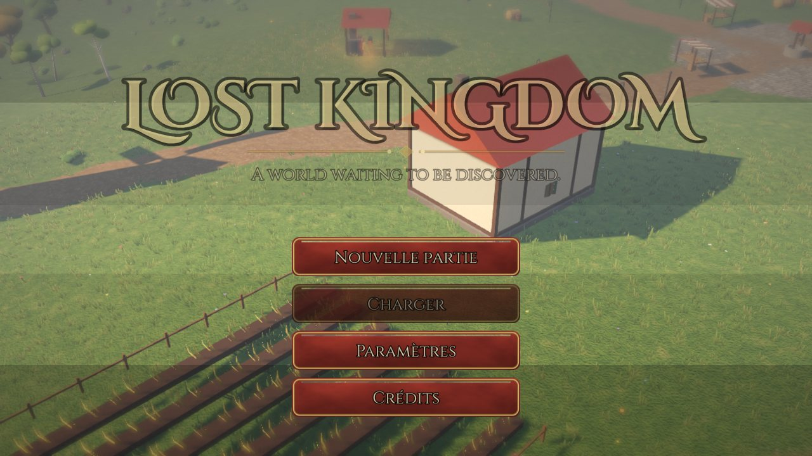 | 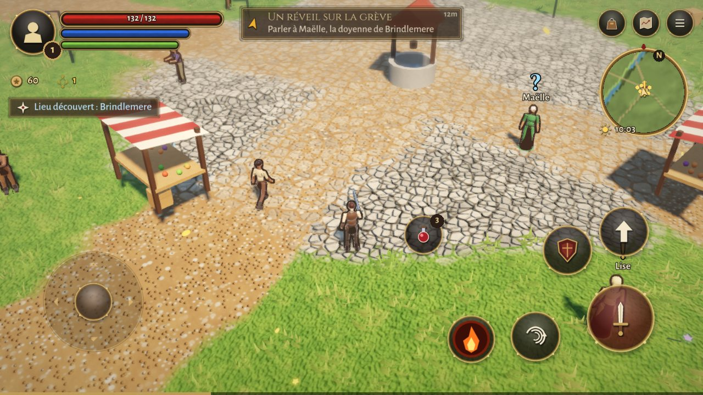 |
| 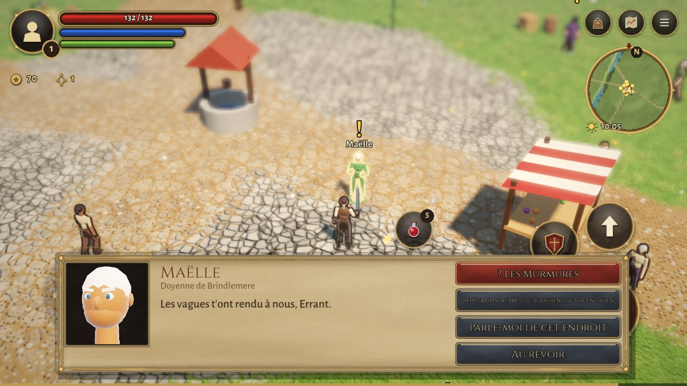 | 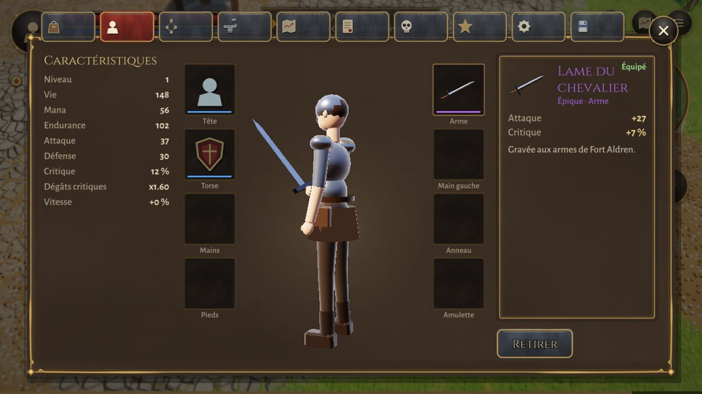 |
| 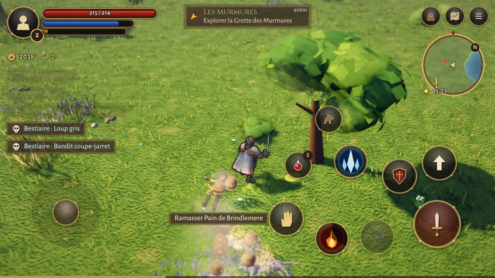 | 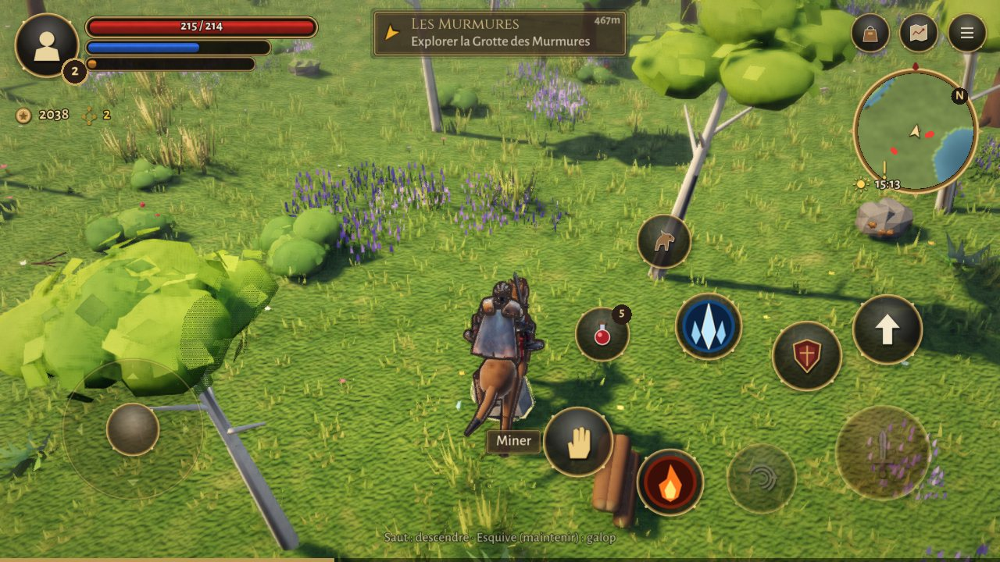 |
| 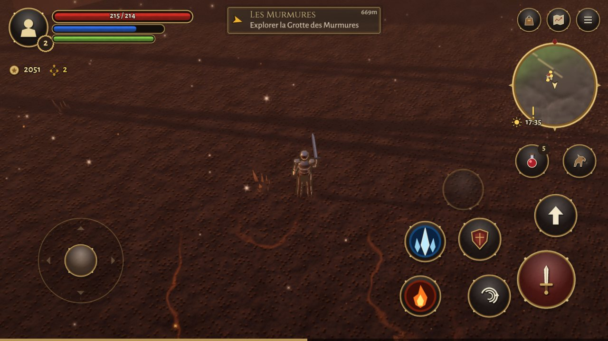 | 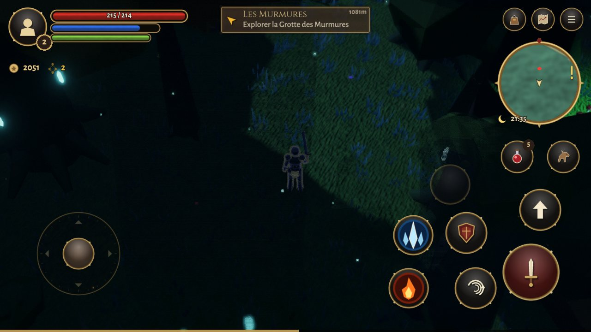 |
| 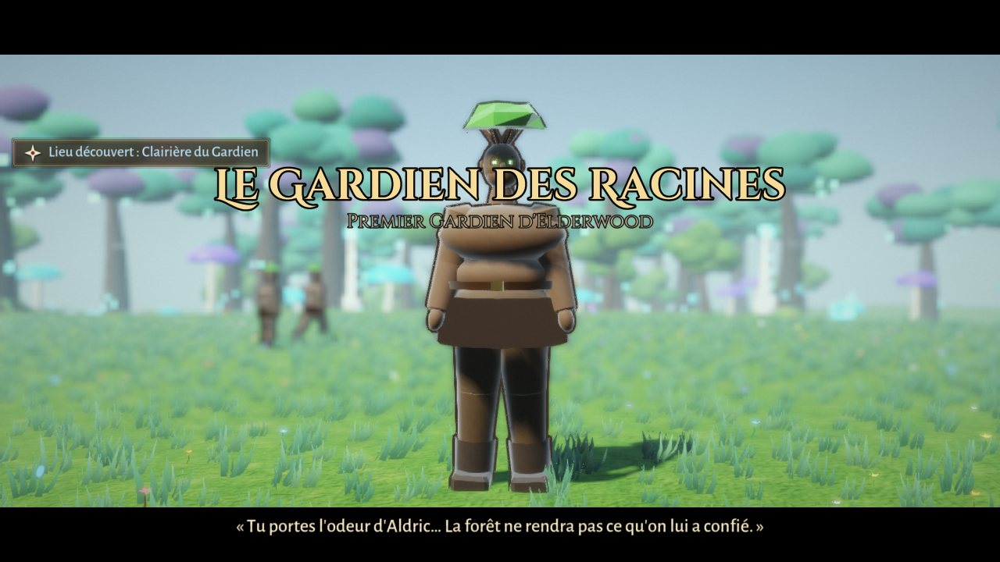 | 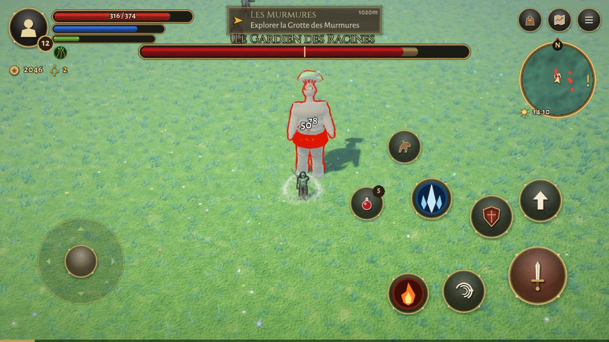 |
| 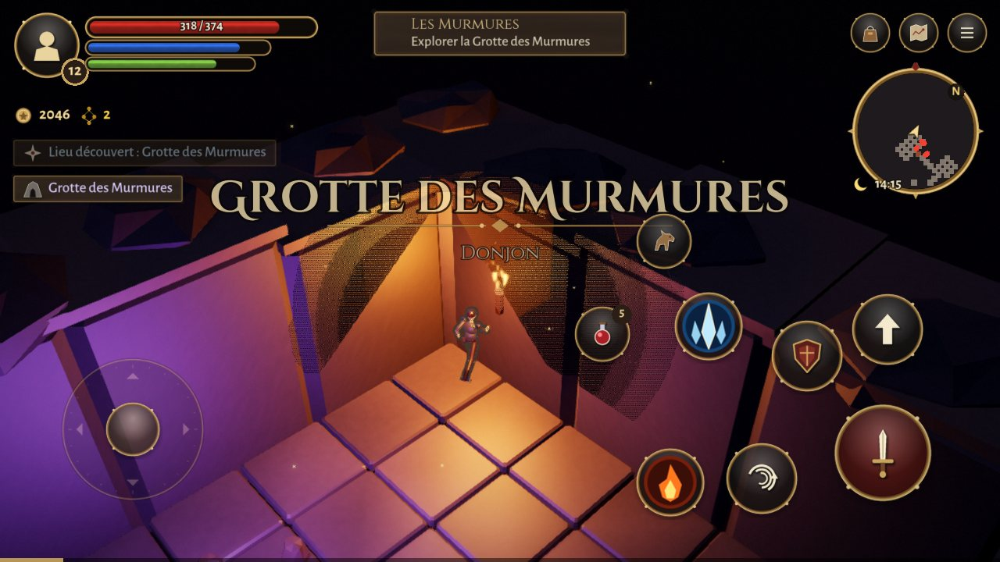 | 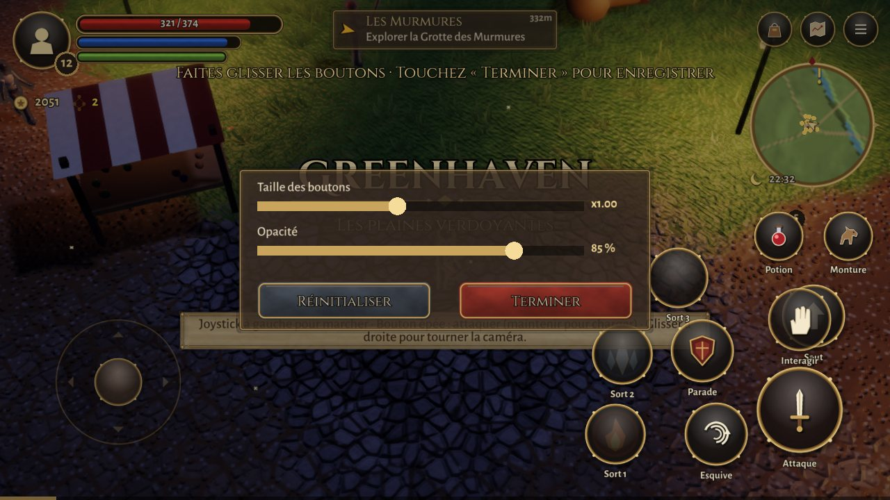 |
| 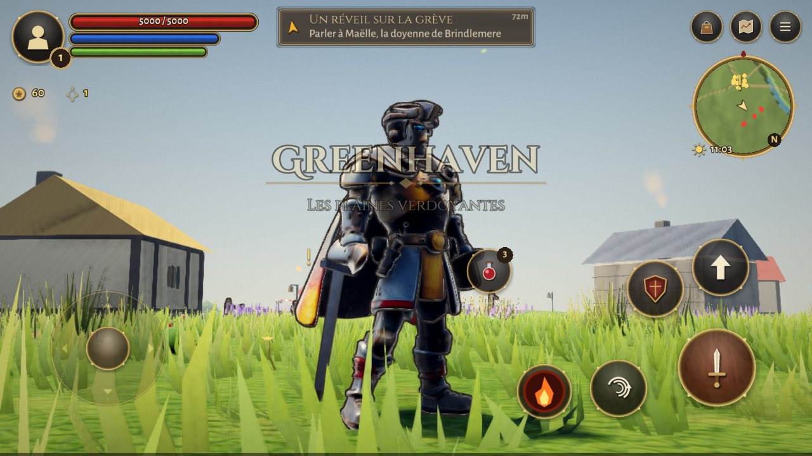 | 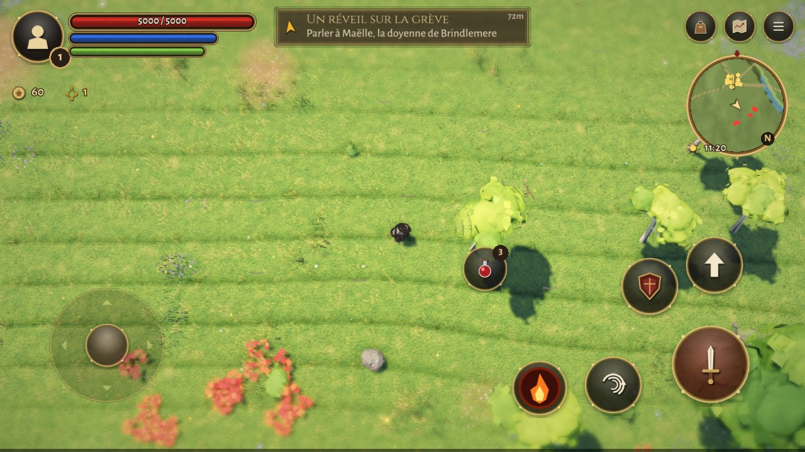 |
| 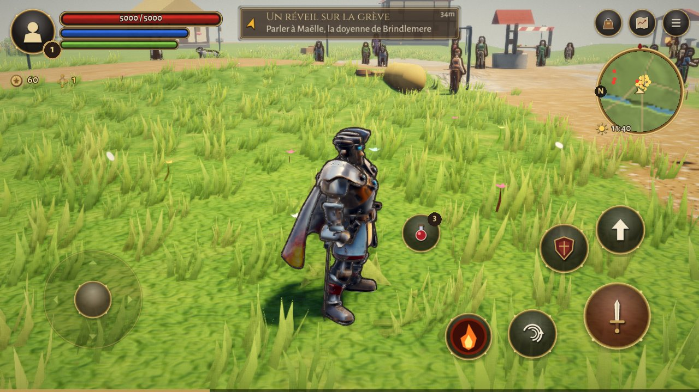 | 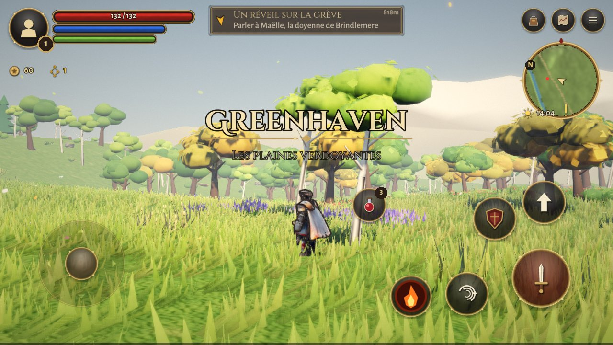 |
| 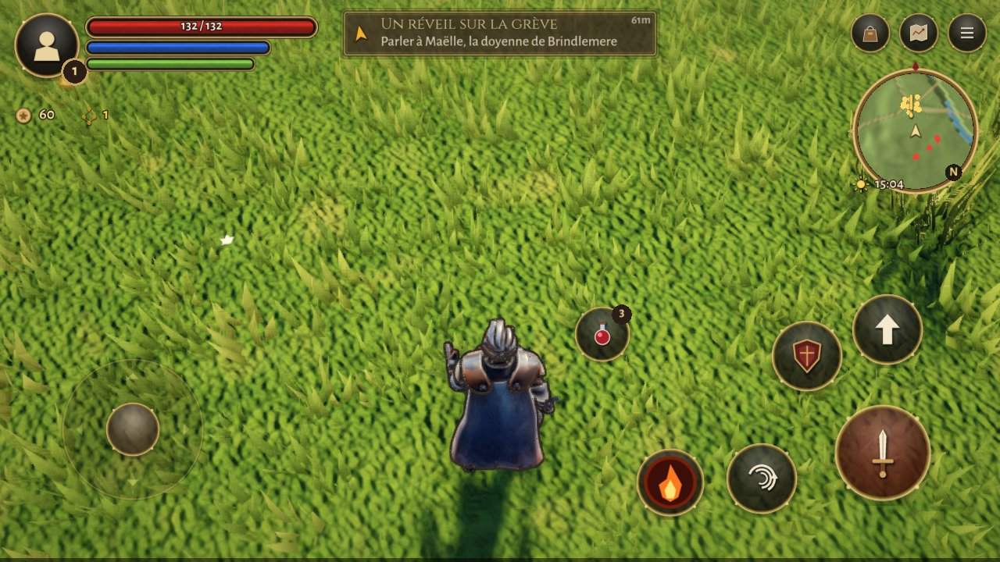 | 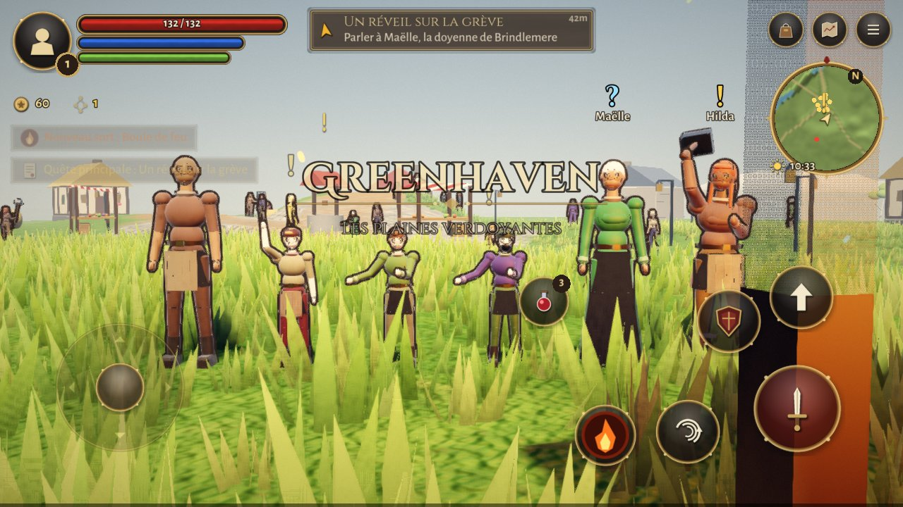 |

---

## Contenu du jeu

| Domaine | Contenu |
|---|---|
| **Monde** | Une carte continue de 3 072 m × 3 072 m, sans écran de chargement entre les régions. Six régions : **Greenhaven**, **Frostheim**, **Ashen Lands**, **Elderwood**, **Kingdom of Shadows** et **High Crowns**. Le terrain est façonné par région, avec rivières, lacs, glace et lave, routes, villages, châteaux, ruines, grottes, tours, sanctuaires, camps, mines, fermes et pierres de passage. Le monde est streamé en chunks de 32 m avec 3 niveaux de détail, générés sur des threads de travail. |
| **Héros** | Squelette animé, blend de locomotion, machine à états, transitions, masques haut et bas du corps, IK des pieds sur le terrain, look-at, cape et cheveux simulés (Verlet). L'équipement change l'apparence : casques, armures, épaulières, gantelets, jambières, capes, armes. |
| **Combat** | Types d'armes : épée, épée longue, dague, hache, marteau, lance, arc, arbalète, bâton, bouclier (plus pioche, hache de bûcheron, canne à pêche, torche), combos, attaque lourde, parade avec fenêtre de timing, esquive avec invulnérabilité, éléments (feu, glace, foudre, nature, ombre, lumière, arcane), faiblesses et résistances, traînées d'armes, particules, hit-stop, vibrations. |
| **Ennemis** | **27 types d'ennemis** avec IA (patrouille, alerte, poursuite, encerclement, attaques télégraphiées, fuite, meutes, tireurs, lanceurs de sorts, chargeurs, embusqués, volants, essaims). |
| **Boss** | **8 boss multi-phases**, chacun avec arène, cinématique d'introduction (caméra et titre), changements de phase et récompenses (fragments de couronne). |
| **Histoire et quêtes** | Quête principale « La Chute des Couronnes » (m1 à m7). Quêtes secondaires, cachées, de chasse, de trésor et de faction : **33 quêtes** au total. Dialogues avec portraits, choix et réputation de faction. |
| **PNJ** | **29 PNJ nommés** avec rôles (marchand, forgeron, aubergiste, garde, alchimiste, maître d'écurie, ancien, chasseur, prêtre, fermier, enfant, érudit, barde), emplois du temps jour/nuit et boutiques. |
| **Objets** | **125 objets**, en raretés Commun, Rare, Épique, Légendaire, Mythique et Ancestral, avec **7 panoplies** (bonus 2/4 pièces), consommables, matériaux, reliques et cosmétiques. |
| **Artisanat** | **49 recettes** sur 4 stations (forge, alchimie, feu de camp, établi). Récolte de bois, pierre, minerais, herbes et cristaux, plus pêche. |
| **Magie et compétences** | **14 sorts** répartis dans **7 écoles**. Arbre de **30 compétences** en **6 classes** : Guerrier, Archer, Assassin, Mage, Paladin, Chasseur. |
| **Montures** | **5 montures** : appel au sifflet, galop, endurance. |
| **Donjons** | **6 donjons** générés par graine : salles, couloirs, énigme à leviers, pièges, coffres et boss. |
| **Monde vivant** | Cycle jour/nuit, météo dynamique (pluie, neige, cendres, brouillard, orage), faune, vent dans la végétation, lucioles, fumées de cheminée. |
| **Rendu** | Shaders maison : PBR GGX, ombres douces (Poisson ou PCF), ombres des nuages, brouillard de hauteur, eau (profondeur, écume, reflets), lave, terrain multicouche, herbe instanciée, dissolve, contour, vision à travers les obstacles. Post-traitement : bloom, profondeur de champ, tonemapping ACES, étalonnage par région, vignette, grain, FXAA. Système de particules. |
| **Audio** | Mixeur logiciel, musiques en fondu enchaîné selon la région, l'heure, le combat et le boss, ambiances superposées, réverbération, panoramique spatial. Sortie AAudio sur Android. **14 musiques, 9 ambiances et 65 effets sonores** au format OGG Vorbis 48 kHz. |
| **Interface** | HUD (vie, mana, endurance, XP, raccourcis, boussole, minimap), carte du monde, inventaire, équipement, compétences, quêtes, artisanat, collection, bestiaire, réglages, sauvegardes, éditeur de disposition des commandes tactiles. |
| **Android** | Commandes tactiles personnalisables (position et taille), vibrations, mode immersif, cinq profils graphiques (Ultra, Élevé, Moyen, Faible, Économie d'énergie), contexte EGL conservé lors de la mise en arrière-plan. |
| **Sauvegarde** | 3 emplacements manuels et une sauvegarde automatique toutes les 3 minutes, avec écriture atomique (fichier temporaire puis renommage). |
| **Identité visuelle** | Splash SUPERESSENCE STUDIO, mention « Powered by AGR ENGINE », écran titre « LOST KINGDOM / A world waiting to be discovered. / Created by SUPERESSENCE STUDIO. », générique, icône du lanceur à toutes les densités. |

---

## État des fonctionnalités

Légende :
- ✅ implémenté et vérifié dans le harnais de bureau (exécution réelle du code du jeu, captures d'écran).
- 🟡 implémenté, mais vérifié seulement partiellement.
- ❌ absent.

| Fonctionnalité | État | Remarque |
|---|---|---|
| Monde ouvert continu, 6 régions, streaming | ✅ | Les traversées de régions sont parcourues par le bot de test. |
| Héros animé, IK des pieds, cape | ✅ | |
| Combat, parade, esquive, éléments | ✅ | |
| 27 ennemis et IA | ✅ | Le combat est joué par le bot ; la cohérence des données est vérifiée par les tests unitaires. |
| 8 boss multi-phases et intro | 🟡 | Intro et combat d'un boss capturés. Les 8 n'ont pas tous été battus de bout en bout par le bot. |
| Quêtes, dialogues, choix, réputation | 🟡 | Les références des 33 quêtes (PNJ, objets, ennemis, boss, donjons) sont validées par les tests. La quête principale n'a pas été terminée de bout en bout automatiquement. |
| Inventaire, équipement, panoplies, raretés | ✅ | |
| Artisanat, récolte, pêche | ✅ | |
| Magie (7 écoles), arbre de compétences (6 classes) | ✅ | |
| Montures | ✅ | |
| Donjons (énigme, pièges, coffres, boss) | ✅ | Entrée, énigme et sortie jouées par le bot. |
| Jour/nuit, météo | ✅ | |
| Shaders et post-traitement | ✅ | Vérifiés sur le rasteriseur logiciel Mesa (llvmpipe), pas sur un GPU mobile. |
| Audio (musique, ambiances, SFX) | 🟡 | Le chargement et le mixage sont vérifiés (capture WAV du mixage). La sortie AAudio n'a pas été écoutée sur un appareil. |
| Commandes tactiles et vibrations | 🟡 | Code écrit et éditeur de disposition capturé. Aucun test sur un écran tactile réel. |
| Profils graphiques | 🟡 | Les réglages s'appliquent. Les performances réelles sur un téléphone ne sont pas mesurées. |
| Sauvegarde et chargement | ✅ | Test aller-retour automatique dans le scénario du bot. |
| APK compilé, signé, aligné | ✅ | `apksigner verify`, `zipalign -c` et `aapt2 dump badging` sont vérifiés. |
| Installation et exécution sur un appareil Android | ❌ **non testé** | Aucun émulateur ni appareil n'est disponible dans l'environnement de construction (pas de KVM). |
| Doublage vocal | ❌ | Les dialogues sont uniquement textuels. |
| Modèles 3D d'artistes, motion capture | ❌ | Tout est procédural (voir *Limites*). |

---

## Comment le jeu a été vérifié

1. **Harnais de bureau** (`lk_desktop`). Il exécute *exactement le même code de jeu* que l'APK, sur Linux, dans un contexte EGL OpenGL ES 3.x sans fenêtre (Mesa), avec un pas de temps fixe.
   - L'option `--autoplay=full` lance un bot qui joue un scénario de 71 étapes : splash, titre, nouvelle partie, village, dialogue, tous les menus, combat, monture, traversée des six régions, météo, boss, donjon et énigme, test sauvegarde/chargement, éditeur de commandes, générique.
   - Le bot prend des captures d'écran (`build/shots/`) et peut enregistrer le mixage audio (`--wav`).
2. **AddressSanitizer**. Le même scénario a été exécuté sous ASan. Il a permis de corriger un accès hors limites dans l'IA ennemie et une invalidation de références dans l'ECS.
3. **Tests unitaires** (`lk_tests`), soit 1 858 vérifications :
   - l'ECS ;
   - les mathématiques ;
   - l'intégrité des données (chaque référence d'une quête, d'un butin, d'une recette ou d'une boutique pointe vers un objet existant) ;
   - le déterminisme du monde, la présence des 6 régions et l'absence de NaN ;
   - la génération de chunks aux 3 LOD ;
   - le décodage des fichiers audio ;
   - l'orientation de la minimap, de la flèche du joueur et de la flèche de quête ;
   - la géométrie de la disposition tactile (aucun chevauchement, marges, minimap dégagée) pour 5 formats d'écran.
   - la caméra libre (`CameraRig::compute`) : 480 configurations synthétiques et 1 920 positions sur le vrai terrain (œil au-dessus du sol, héros entier dans l'image), collision avec un mur, cadrage en vue basse et en vue carte.
4. **Test tactile automatique** (`--autoplay=touch`). Il injecte de vrais événements tactiles, appuis brefs dans la même image compris, et vérifie l'effet sur le héros : attaque, esquive, saut sans déclencher la parade, attaque chargée, combo mémorisé, doigt glissé depuis l'extérieur ignoré.
5. **Test des boutons** (`--autoplay=ui`, depuis la 1.6.1). Il appuie sur les boutons des dialogues, de la pause, du journal et des réglages avec de vrais appuis tenus sur plusieurs images, et affiche `UI TEST PASSED`.
6. **Test de l'herbe** (`--autoplay=grass`). Il vérifie que l'herbe est couchée en marchant, que le sillage se relève et que la couche dense proche existe, et affiche `GRASS TEST PASSED`.
7. **Test de la caméra** (`--autoplay=camera`). 12 captures d'inclinaison et de zoom, avec vérification par le code de la hauteur de l'œil et de la position du héros à l'écran, puis des gestes tactiles injectés et les comportements automatiques. Il affiche `CAMERA TEST PASSED`.
8. **APK**. Il est vérifié par `apksigner verify`, `zipalign -c -P 16` et `aapt2 dump badging`. Pour chaque ABI, `readelf` confirme :
   - que `ANativeActivity_onCreate` est exporté ;
   - que les segments sont alignés sur 16 Ko ;
   - que la bibliothèque ne dépend que de bibliothèques système (libandroid, liblog, libEGL, libGLESv3, libaaudio, libm, libdl, libc) ;
   - qu'elle contient bien le code du jeu complet et non le test de rendu « smoke ».

---

## Limites connues

- **Aucun test sur un appareil réel.** L'APK est construit et vérifié statiquement, mais il n'a jamais été installé sur un téléphone ou un émulateur : l'environnement de construction n'en possède pas. Des problèmes propres aux pilotes GPU mobiles, aux performances ou au tactile sont possibles.
- **Graphismes procéduraux.** Aucun modèle 3D d'artiste, aucune texture photographique, aucune motion capture. Personnages, créatures, bâtiments et végétation sont construits en code, et les animations sont des images-clés et du procédural. Le style est stylisé ; il n'atteint pas la fidélité d'une production AAA disposant d'une équipe artistique.
- **Audio synthétisé.** Musiques, ambiances et effets sont générés par `tools/make_audio.py` (synthèse additive et soustractive, Karplus-Strong, FM, formants, réverbération par convolution). Ce n'est pas un orchestre enregistré.
- **Performance non mesurée sur mobile.** Le harnais de bureau tourne sur un rasteriseur logiciel, à environ 120 ms par image : ce chiffre ne dit rien d'un GPU mobile. Les profils Faible et Économie d'énergie réduisent la distance de vue, les ombres, l'herbe et le post-traitement.
- **Signature locale.** L'APK est signé avec une clé locale générée au moment de la construction, qui n'est pas versionnée. Pour une publication sur le Play Store, il faut le re-signer avec votre propre clé (voir ci-dessous) et produire un AAB.
- **Langue.** L'interface et les dialogues sont en français uniquement.

---

## Compiler

### APK Android

Prérequis :
- Android SDK avec build-tools 35, platforms/android-35 et cmake ;
- NDK r26 ou plus récent ;
- Python 3.

```bash
cd lostkingdom
ANDROID_SDK=/chemin/vers/android-sdk ./build_apk.sh
# -> build/apk/LOST-KINGDOM-SUPERESSENCE.apk
```

- Le script n'utilise **pas Gradle**. Il enchaîne : CMake et NDK pour chaque ABI, `aapt2 compile/link`, ajout des bibliothèques stockées, `zipalign -P 16`, puis `apksigner`.
- **Signature** : définissez `LK_KEYSTORE`, `LK_KEYSTORE_PASSWORD` et `LK_KEY_ALIAS` pour utiliser votre clé. Sinon, une clé locale est générée dans `keystore/`, qui est ignoré par git. Les clés ne doivent jamais être commitées.
- **ABIs** : par défaut `ABIS="arm64-v8a armeabi-v7a x86_64"`.
- **Installation** : `adb install -r build/apk/LOST-KINGDOM-SUPERESSENCE.apk`.

### Harnais de bureau et tests (Linux, Mesa EGL)

```bash
cmake -S . -B build/desk -DCMAKE_BUILD_TYPE=Release && cmake --build build/desk -j
./build/desk/lk_tests assets                     # tests unitaires
./build/desk/lk_desktop --assets assets --frames 3600 --dt 0.0333 --autoplay=full --wav build/autoplay.wav
./build/desk/lk_desktop --assets assets --frames 1900 --dt 0.0333 --autoplay=camera   # caméra libre : doit afficher CAMERA TEST PASSED
./build/desk/lk_desktop --assets assets --frames 520 --dt 0.0333 --autoplay=ui        # boutons des menus : UI TEST PASSED
./build/desk/lk_desktop --assets assets --frames 260 --dt 0.0333 --autoplay=grass     # herbe : GRASS TEST PASSED
#   autres scénarios visuels : npcs (villageois alignés), vista (montagnes et horizon)
```

### Régénérer les assets

```bash
python3 tools/make_font.py       # atlas SDF (polices OFL : Cinzel, Cinzel Decorative, Alegreya Sans)
python3 tools/make_ui.py         # kit d'interface et icônes
python3 tools/make_audio.py      # musiques, ambiances, effets (numpy, scipy, ffmpeg)
python3 tools/make_branding.py   # icônes du lanceur, logos, key art
python3 tools/import_character.py modele.glb hero --preview apercu.png   # importe un personnage GLB (pose en T, sans squelette)
```

---

## Architecture

```
lostkingdom/
  engine/            AGR Engine (C++17, OpenGL ES 3.0)
    core/            ECS (sparse sets), maths, bruit, interface plateforme
    gfx/             renderer, shaders (variantes uber-shader), post-traitement, particules, textures, UI SDF
    anim/            squelettes, clips, animator multicouche, IK, Verlet
    audio/           décodeur Vorbis, mixeur, musiques et ambiances, réverbération
    platform/        Android (NativeActivity, EGL, AAudio, JNI vibreur) et bureau (EGL pbuffer)
  game/              LOST KINGDOM
    World.*          plan du monde, terrain, rivières, streaming, collisions
    Props.*          bâtiments et décor procéduraux
    Characters.*     héros, ennemis, créatures, armes (maillages skinnés)
    Animations.cpp   bibliothèque de clips
    Player / Combat / AI / Spawn
    Rpg.cpp          inventaire, artisanat, quêtes, dialogues, sauvegardes, réglages
    Dungeon.cpp      génération des donjons, énigmes, pièges
    Hud / Menus      interface
    Data.*           contenu : objets, ennemis, boss, PNJ, quêtes, sorts, compétences, montures, donjons
    AutoPlay.cpp     bot de test
  tests/             tests unitaires et prévisualisations
  tools/             génération des polices, de l'UI, de l'audio et de l'identité visuelle
  android/           manifeste et ressources
  assets/            polices, UI, audio (empaquetés dans l'APK)
  branding/          logos, icônes, key art
```

---

## Contrôles

| Commande | Action |
|---|---|
| Joystick gauche | Déplacement (pousser fort pour courir) |
| Glisser à droite | Horizontal : rotation de la caméra. Vertical : inclinaison (du ciel à la vue de dessus). Un glisser suit un seul axe, choisi par sa direction de départ. Pincer : zoom de 4 à 40 m. Double appui : caméra par défaut |
| Attaque / Lourde | Combo léger ou attaque chargée |
| Parade | Bloque ; une parade au bon moment déséquilibre l'ennemi |
| Esquive | Roulade avec invulnérabilité |
| Sorts 1 à 3 | Sorts équipés |
| Interagir | Parler, récolter, ouvrir, pêcher |
| Monture | Siffler la monture, puis monter ou descendre |

La disposition se modifie en jeu dans **Réglages → Commandes → Personnaliser les commandes**.

---

© SUPERESSENCE STUDIO. Polices sous licence SIL Open Font License (voir `tools/fonts/OFL.txt`).
