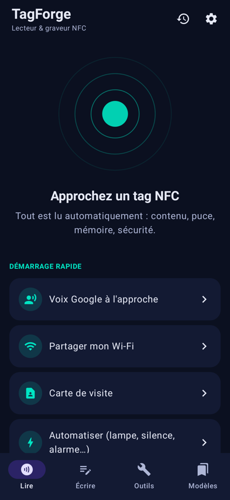
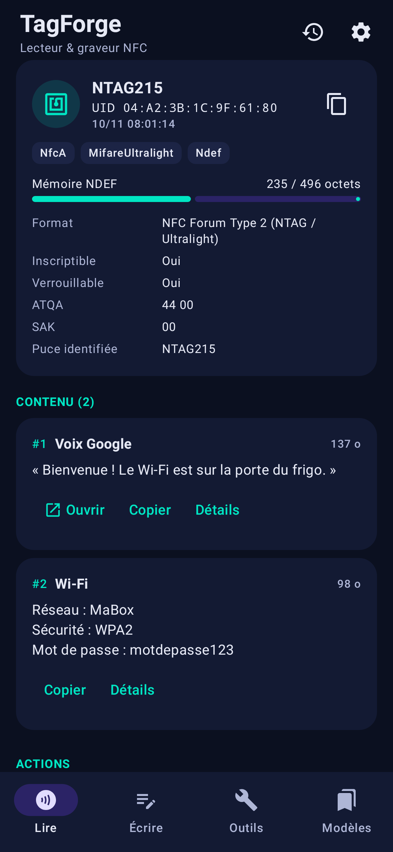
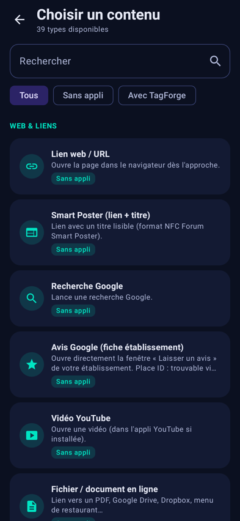
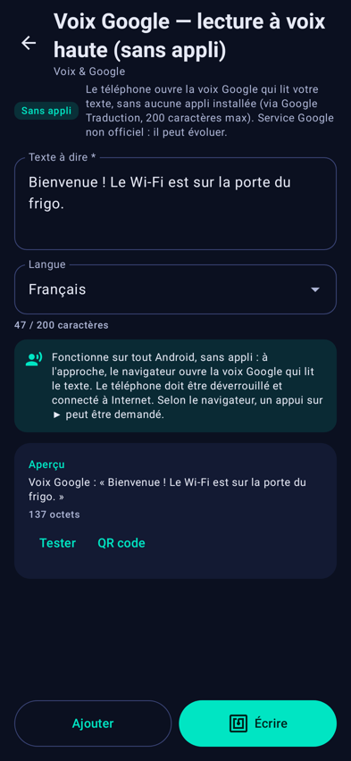
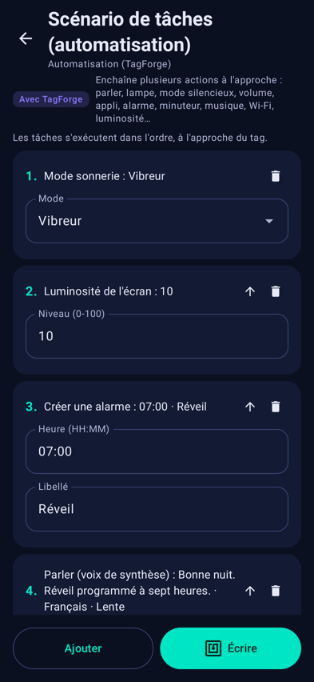
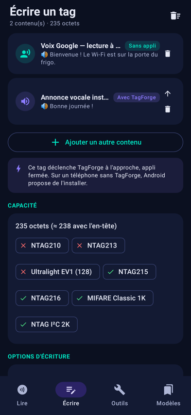
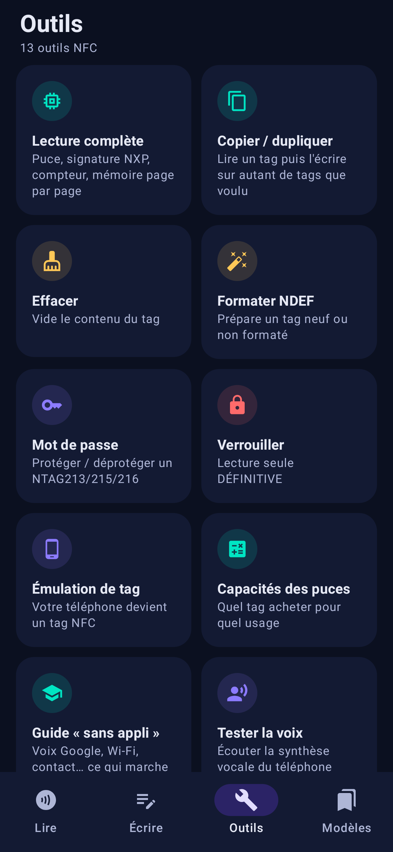
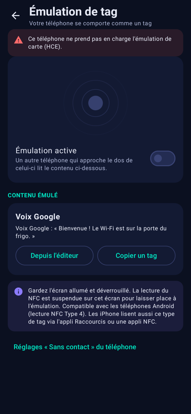

# 📡 TagForge NFC — by Superessence Studio

Lecteur, graveur et automatiseur de tags NFC pour Android (Kotlin + Jetpack Compose).

**APK installable :** [`release/TagForge-NFC.apk`](../release/TagForge-NFC.apk) (Android 8.0+, signé, 1,3 Mo, aucune connexion requise, aucune donnée envoyée)

<p>
   
   
</p>

## La voix Google à l'approche du téléphone, sans appli

| Contenu | Sur un téléphone **sans** appli | Avec TagForge installé |
|---|---|---|
| **Voix Google — lecture à voix haute** | ✅ Le navigateur ouvre la voix Google (Google Traduction TTS) qui lit le texte. 200 caractères, Internet requis. Service Google non officiel, il peut changer. | ✅ |
| **Google Traduction** | ✅ Texte traduit, un appui sur 🔊 pour l'écouter | ✅ |
| **Annonce vocale instantanée** | ❌ (Android le bloque) → propose d'installer l'appli | ✅ Parle tout de suite, appli fermée, hors connexion, sans limite de longueur |
| **Assistant Google / Gemini** | ❌ (Android ne permet à aucun tag de le lancer) | ✅ Lancé à l'approche |

## 39 types de contenu

- **Web** : URL, Smart Poster, recherche Google, avis Google, vidéo YouTube, fichier en ligne
- **Communication** : appel, SMS, e-mail, WhatsApp, Telegram, carte de visite vCard
- **Voix & Google** : voix Google sans appli, Google Traduction, annonce vocale, Assistant
- **Lieux** : GPS, adresse Google Maps, itinéraire Google Maps, Waze
- **Réseau** : connexion Wi-Fi (WPA/WPA2/WPA3, ouvert, réseau masqué), appairage Bluetooth
- **Social** : 19 réseaux (Instagram, TikTok, YouTube, X, Facebook, LinkedIn, Snapchat, Threads, Twitch, GitHub, Discord, Spotify…), liens musique
- **Pro** : événement Google Agenda, PayPal.me avec montant, Revolut/Lydia/Wero, menu ou catalogue
- **Applis** : ouvrir n'importe quelle appli (AAR natif, avec sélecteur d'applis installées), page Play Store
- **Automatisation (TagForge)** : scénarios de 24 tâches enchaînables : parler, Assistant, recherche, lampe torche, sonnerie/vibreur/silencieux, Ne pas déranger, volume (4 flux), contrôle de la musique, ouvrir une appli, un lien ou un réglage (11 panneaux), itinéraire, appel, SMS, alarme, minuteur, luminosité, appareil photo, vibration, presse-papiers, notification, message, pause. Plus des raccourcis : lampe, silencieux, alarme, minuteur
- **Avancé** : texte, URI personnalisé, MIME, type externe NFC Forum

Plusieurs contenus par tag, aperçu en direct, test avant écriture, QR code équivalent, calcul de la capacité pour chaque puce.

## Outils

Lecture complète (UID, technologies, ATQA/SAK, puce exacte via GET_VERSION, signature NXP, compteur NFC, dump mémoire page par page, MIFARE Classic avec les clés par défaut), copie d'un tag vers un nombre illimité d'autres, écriture en série avec numéros automatiques (`{n}`, `{n3}`, `{date}`, `{time}`), effacement, formatage NDEF, **mot de passe NTAG213/215/216 et Ultralight EV1** (protection en écriture ou en lecture, retrait, écriture sur un tag protégé), verrouillage définitif, **émulation de tag** (le téléphone se comporte comme un tag Type 4 via HCE), 10 modèles prêts à l'emploi, modèles personnels, export/import JSON, historique, rapport partageable, guide intégré, réglage du son et de la vibration.

## Compiler

```bash
cd nfc-app
echo "sdk.dir=/chemin/vers/android-sdk" > local.properties
./gradlew assembleRelease                          # → app/build/outputs/apk/release/app-release.apk
./gradlew testDebugUnitTest                        # 20 tests (encodeurs + rendu des 14 écrans)
./gradlew testDebugUnitTest -Pscreenshots=true     # captures dans app/build/screenshots
```

Clé de signature : `keystore/tagforge-release.jks` (mot de passe dans `app/build.gradle.kts`, remplaçable par les variables `TAGFORGE_*`). **Utilisez votre propre clé avant une publication sur le Play Store.**

## Limites

- Android lit les tags seulement quand l'écran est allumé et déverrouillé, et n'ouvre automatiquement que le premier contenu d'un tag.
- Les actions « Avec TagForge » demandent TagForge sur le téléphone qui lit. Silencieux et Ne pas déranger demandent l'accès « Ne pas déranger », et la luminosité « Modifier les paramètres système ». Ces autorisations se règlent dans Réglages.
- Si TagForge lance plusieurs applis d'affilée, Android peut bloquer les suivantes une fois TagForge passé en arrière-plan.
- Les fonctions mot de passe et mémoire concernent les puces NXP NTAG/Ultralight. MIFARE Classic ne se lit que sur les téléphones équipés d'un contrôleur NXP.
- L'appli n'a pas encore été testée sur un vrai téléphone avec de vrais tags : elle est vérifiée par compilation, par des tests unitaires et par le rendu des écrans sous Robolectric.
