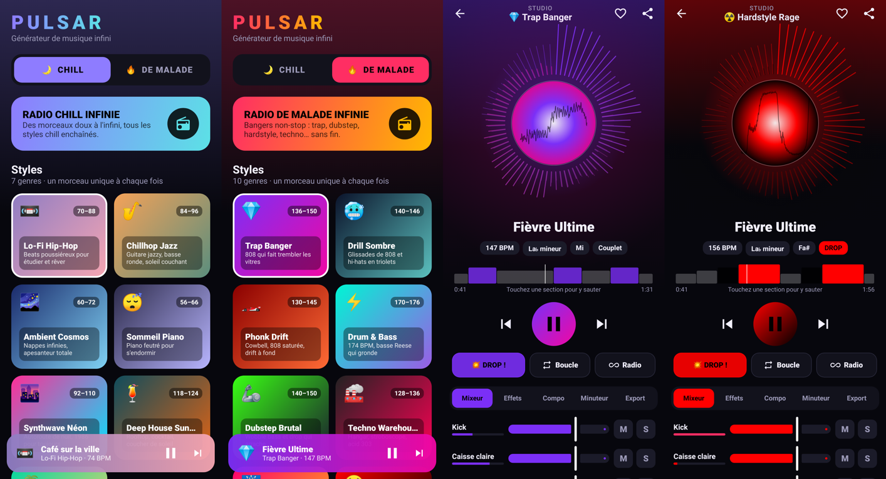

# 🎧 PULSAR — générateur de musique infini

Application Android native (Kotlin + Jetpack Compose). Elle **compose et synthétise la musique en temps réel sur le téléphone** : aucun fichier audio, aucune connexion, aucun compte. Chaque morceau est unique et retrouvable par son code (ex. `TRAP-1A2B3C`).

**APK** : [`release/PULSAR-Generateur-Musique.apk`](../release/PULSAR-Generateur-Musique.apk) (Android 8.0+, 1,2 Mo, signé)
**Aperçus audio** (rendus par le moteur de l'appli) : [`release/previews-pulsar/`](../release/previews-pulsar/)

## 17 styles

| 🌙 Chill | 🔥 De malade |
|---|---|
| Lo-Fi Hip-Hop · Chillhop Jazz · Ambient Cosmos · Sommeil Piano · Synthwave Néon · Deep House Sunset · Chill Tropical | Trap Banger · Drill Sombre · Phonk Drift · Drum & Bass · Dubstep Brutal · Techno Warehouse · EDM Festival · Hardstyle Rage · Hardcore Gabber · Reggaeton Fuego |

## Fonctions
- **Radio infinie** Chill ou De malade : enchaîne sans fin des morceaux de tous les styles de la famille, ou du style en cours.
- **Studio** : visualiseur (spectre circulaire + oscilloscope qui pulse sur le kick), structure du morceau (intro, couplet, montée, **drop**, pause, outro) avec saut direct en touchant une section, bouton **DROP !**, boucle de section.
- **Mixeur 10 pistes** : kick, caisse claire, charleston, percus, basse, accords, mélodie, arpège, effets, ambiance. Volume, Mute, Solo, vumètres.
- **Effets en direct** : filtre DJ (passe-bas/passe-haut), réverb, écho, saturation, pompe sidechain, couleur lo-fi (bande, bitcrush), craquements vinyle, pluie, largeur stéréo.
- **Compo** : tempo en direct, tonalité, gamme (8 modes), énergie, complexité, swing, longueur, mélodie on/off ; « même morceau » ou « nouveau morceau ».
- **Minuteur de sommeil** intégré (5 min à 2 h, ou fin du morceau) avec fondu.
- **Export WAV** du morceau complet (44,1 kHz, ton mixage inclus) dans Musique/Pulsar, **partage** du code.
- Favoris, historique, précédent/suivant, lecture **écran éteint**, notification et commandes écran verrouillé / Bluetooth.

## Moteur
`engine/` est du Kotlin pur (testé sur JVM) :
- `Composer` : structure, progressions d'accords avec conduite des voix, grooves par genre (boom-bap, four-on-the-floor, trap avec rolls de charleston, drill en triolets, dembow, breakbeat DnB, demi-temps dubstep, kick hardstyle accordé…), basses (808 avec glissés, acid 303, Reese, wobble synchronisé, basse inversée hardstyle, walking bass), mélodies motif/réponse, arpèges, risers / impacts, automations de filtre.
- `Instruments` : kick/snare/clap/hat 808 métallique/percus synthétisés, synthé polyvalent (supersaw 7 voix, FM Rhodes, cloches FM, Karplus-Strong, orgue, piano additif, marimba, cowbell phonk, 808, Reese, acid, wobble, screech).
- `Engine` : séquenceur à l'échantillon près avec swing, voix préallouées (zéro allocation en lecture), bus, sidechain, réverb Freeverb, délai ping-pong, limiteur.

## Tests
`./gradlew :pulsar:testDebugUnitTest` compose et rend les 17 styles (2 graines chacun) : aucun NaN, aucune saturation numérique, niveau correct ; rendu 20 à 90× plus rapide que le temps réel sur la machine de build. Captures d'écran : `-Pscreenshots=true`.
**Non vérifié ici** : pas d'émulateur ni de téléphone dans l'environnement de build. La fluidité réelle sur un téléphone d'entrée de gamme reste à confirmer.
