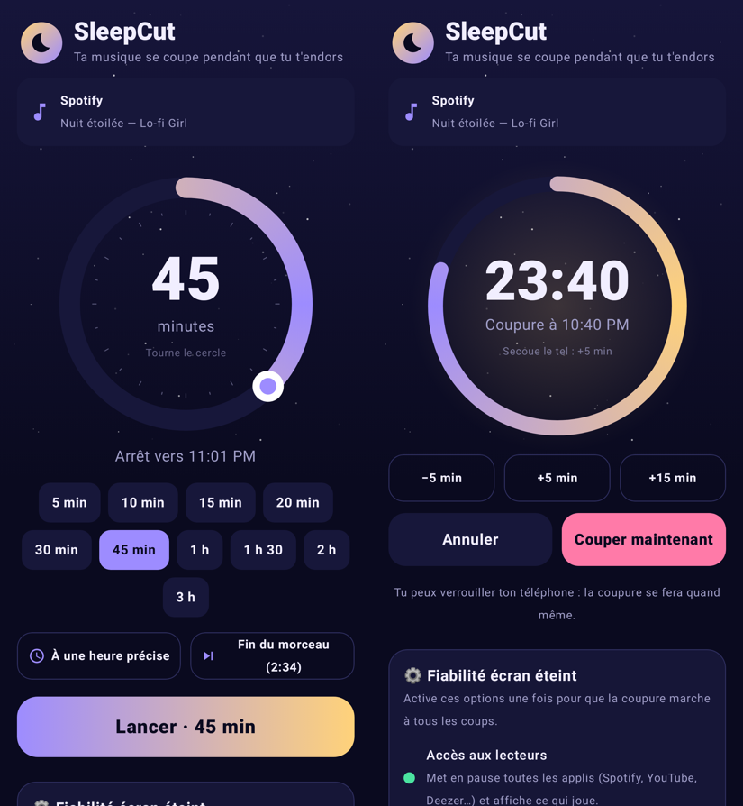

# 🌙 SleepCut — le minuteur qui coupe ta musique

Tu t'endors avec Spotify, YouTube, Deezer, un podcast… SleepCut baisse le son en douceur puis **met en pause n'importe quelle application**, **même téléphone verrouillé et en veille**.

**APK** : [`release/SleepCut-Minuteur.apk`](../release/SleepCut-Minuteur.apk) (Android 8.0+, 0,9 Mo, signé)

## Fonctions
- **Cadran** à tourner (1 min à 4 h) + raccourcis 5 / 10 / 15 / 20 / 30 / 45 min, 1 h, 1 h 30, 2 h, 3 h.
- **À une heure précise** (ex. 23 h 30) et **Fin du morceau en cours** (lit la durée restante du titre qui joue).
- **Fondu de volume** réglable (0 à 120 s) puis coupure ; le volume est **remis à son niveau** ensuite pour le lendemain.
- **Encore réveillé ?** Secoue le téléphone, ou remonte le volume pendant le fondu : +5 min.
- Notification avec compte à rebours en direct et boutons **+5 min / +15 min / Annuler** ; « Relancer 15 min » après la coupure.
- **Tuile des réglages rapides** et **raccourcis d'icône** (15 / 30 / 60 min).
- Options : vibration à la coupure, mode **Ne pas déranger** après la coupure.
- Affiche ce qui joue en ce moment.

## Comment la musique est coupée (3 méthodes combinées)
1. **Pause directe** de chaque lecteur actif via les sessions multimédias (avec l'autorisation « Accès aux notifications »).
2. **Prise du focus audio** : les applis multimédias se mettent en pause d'elles-mêmes.
3. **Touche média Pause**, comme un casque Bluetooth.

Si une application ignore tout, le volume est laissé à zéro et la notification le signale.

## Écran éteint / veille profonde
- Service de premier plan pendant le compte à rebours.
- **Alarme exacte** (`setExactAndAllowWhileIdle`) qui réveille le téléphone au début du fondu, même en mode Doze ; verrou de réveil tenu pendant le fondu et la coupure.
- Sans alarme exacte, le processeur est gardé éveillé jusqu'à la coupure.
- L'écran « Fiabilité écran éteint » vérifie et ouvre les 3 réglages utiles : accès aux lecteurs, batterie sans restriction (indispensable sur Samsung, Xiaomi, Huawei, Oppo…), alarmes exactes.

## Tests
`./gradlew :sleepcut:testDebugUnitTest` (Robolectric) : démarrage, prolongation, annulation, alarme de réveil programmée au bon moment, fondu (volume 12 → 4 à 10 s de la fin d'un fondu de 30 s), coupure et restauration du volume.
**Non vérifié ici** : aucun téléphone réel dans l'environnement de build. Le comportement exact dépend des applis (une appli qui ignore les commandes de pause verra seulement son volume coupé).
