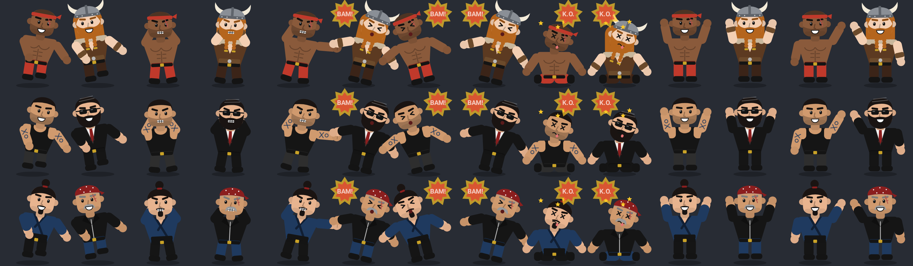
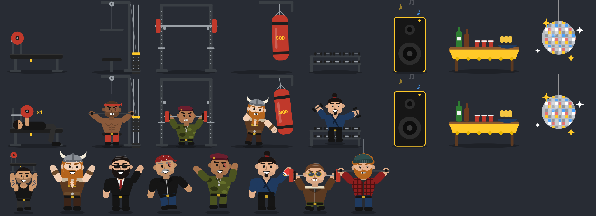
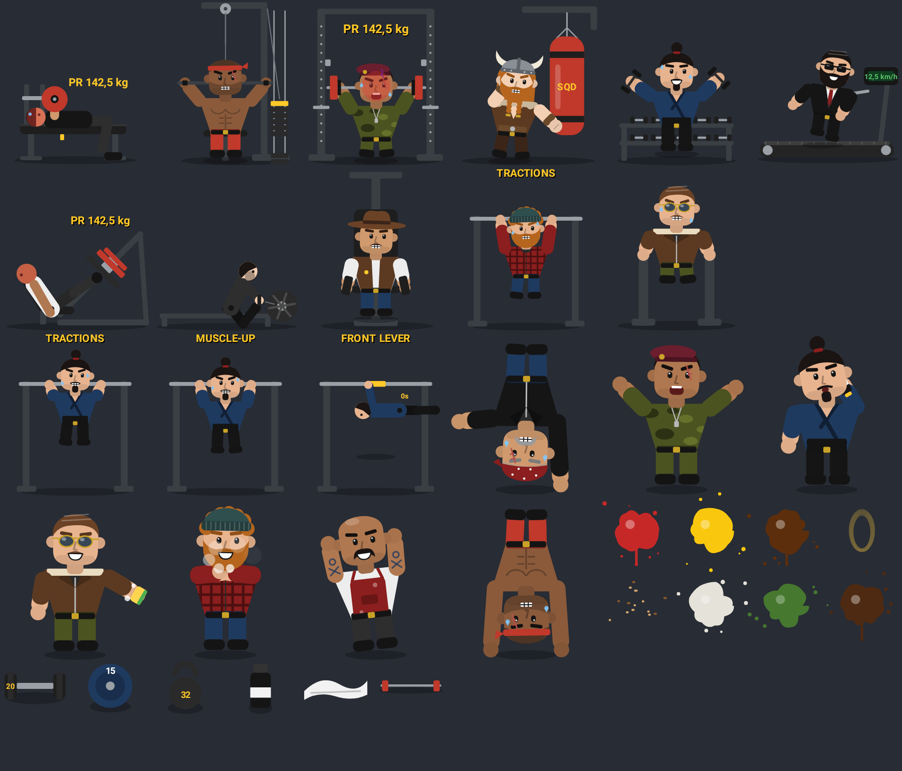

# SQUAD. — by SuperEssence Studio

Des mascottes viriles qui vivent sur ton écran, même appli fermée.

- **APK** : [`release/SQUAD-SuperEssence-Studio.apk`](release/SQUAD-SuperEssence-Studio.apk) (Android 8.0+, signé, ~1,3 Mo)






## Ce que fait l'appli
- **Ouverture animée SuperEssence Studio** : hexagone jaune avec monogramme S, nom lettre par lettre, reflet. Toucher pour passer.
- **12 personnalités** : Tank (bodybuilder), Ragnar (viking), Vincent (le boss), Rex (biker), Sergent Kowal (militaire), Kenji (samouraï), Ace (pilote), Big Jo (bûcheron), Marco (roi du grill), Rocco (boxeur), Zéro (hacker), Duke (cowboy). Chacun a sa bio, ses traits, ses plats, son surnom pour toi et ses propres répliques.
- **Une vie** : ventre, énergie, moral, forme physique, niveau/XP, journal. Il respire (lentement en dormant), cligne des yeux, marche, mange, fait de la muscu, des pompes, prend son café, regarde son tel, baille, dort avec des « z ».
- **Calé sur tes horaires** (Mon rythme) : réveil semaine/week-end, coucher, petit-déj, déjeuner, dîner, séance de sport. Ils dorment quand tu dors et mangent quand tu manges.
- **Sur l'écran, appli fermée** : jusqu'à 8 gars en même temps se baladent partout, se parlent quand ils se croisent.
  - toucher : il parle ; double toucher : « check » ; appui long : ouvre sa fiche ;
  - glisser : tu l'emmènes où tu veux ; lâcher sur la croix en bas : il est rangé ;
  - notification : « Tout rappeler » / « Arrêter ».
- **Ils interagissent entre eux** à l'écran :
  - **bastons** : ils s'approchent, se provoquent, se mettent en garde, échangent des coups (POW!, BAM!), esquivent, jusqu'au K.O. (étoiles qui tournent). Le gagnant fait la danse de la victoire. L'issue dépend du talent de chaque perso, de sa forme physique, de son niveau et de son énergie ;
  - **discussions** (vraies répliques à tour de rôle), **checks**, **jeu du chat** (l'un court après l'autre), **muscu à deux** ;
  - les bagarreurs (Ragnar, Rocco, Rex, Tank) cherchent plus souvent la baston, les calmes discutent ; les rivaux se battent plus, les potes se font des checks ;
  - **lâche un gars sur un autre** : ça part en baston ; bouton **« Défier »** dans sa fiche ;
  - palmarès (victoires/défaites) et **relations** : meilleur pote, pote, rival, ennemi juré.
- **Séances de muscu collectives** : à ton heure de sport (et parfois au hasard), les sportifs vont chercher le matos au bord de l'écran, le portent au-dessus de la tête et le posent : banc de développé couché, poulie haute (la pile de poids monte), rack à squat, sac de frappe (il balance sous les coups), haltères. Ils tournent sur les postes ; s'il n'y a plus de poste libre, ils coachent un pote. À la fin ils rangent tout (+forme, +XP, +amitié). Le matos se déplace au doigt.
- **Salle encore plus complète** : tapis de course, presse à cuisses, rameur, pec deck, barre de traction, barres parallèles en plus. Magnésie avant les séries, shaker et étirements entre deux, sueur à l'effort.
- **Spot et PR** : au banc et au squat, un gars tente un record, un pote vient le parer et hurle « TOUT TOI ! ». Le lifter force (visage rouge, veine, sueur, il tremble). Soit « NEW PR ! » et toute la salle crie, soit le pareur rattrape la barre. Records gardés dans la fiche.
- **Street workout** : tractions, muscle-up, front lever, dips, ATR et ATR sur un bras (aussi dans leur temps libre).
- **Le bordel** : haltères, disques, kettlebells, barres, shakers, serviettes restent par terre après la séance (on les déplace, on tape dedans, ou on les lâche sur la croix).
- **Écran dégueulasse** : quand ils mangent, ketchup, sauce BBQ, moutarde, miettes, traces de gras, éclaboussures de shaker… et des rots. Bouton « Nettoyer l'écran » (ou notification) : le Sergent passe l'éponge et ramasse tout ; il le fait aussi tout seul quand c'est trop sale.
- **Fêtes** : surtout le vendredi et le samedi soir. La boule à facettes descend du haut, la sono pulse et envoie des notes, le buffet a ses bouteilles, gobelets et chips. Ils dansent (4 styles, dont le robot), trinquent, puis rangent. Toucher la sono = tout le monde danse.
- Boutons « Séance muscu » / « Faire la fête » dans l'appli pour les lancer tout de suite.
- **Style** : coupe, barbe, tenue, accessoire, couleurs de peau/cheveux/tenue/pantalon, tatouages, cicatrice.
- Réglages : taille, vitesse, bavardage, fréquence des rencontres, bastons, séances muscu, street workout, saleté et fêtes on/off, visibles ou non pendant leur sommeil, vibrations.

## Compiler
```bash
echo "sdk.dir=/chemin/vers/android-sdk" > local.properties
./gradlew assembleRelease
./gradlew testDebugUnitTest   # rendus dans app/build/renders
```
La clé `keystore/squad-release.jks` sert aux mises à jour par-dessus ; remplace-la avant une publication Play Store.
