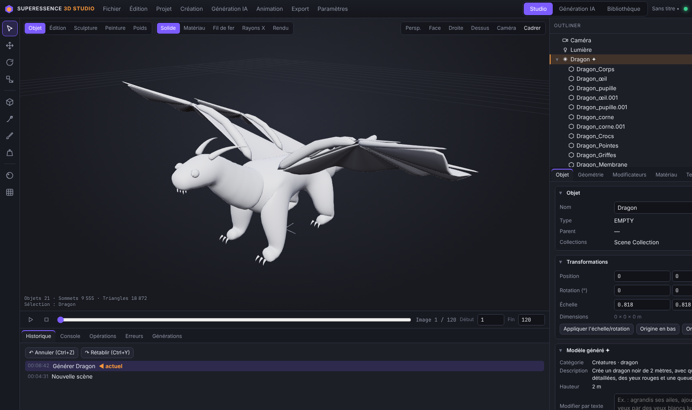
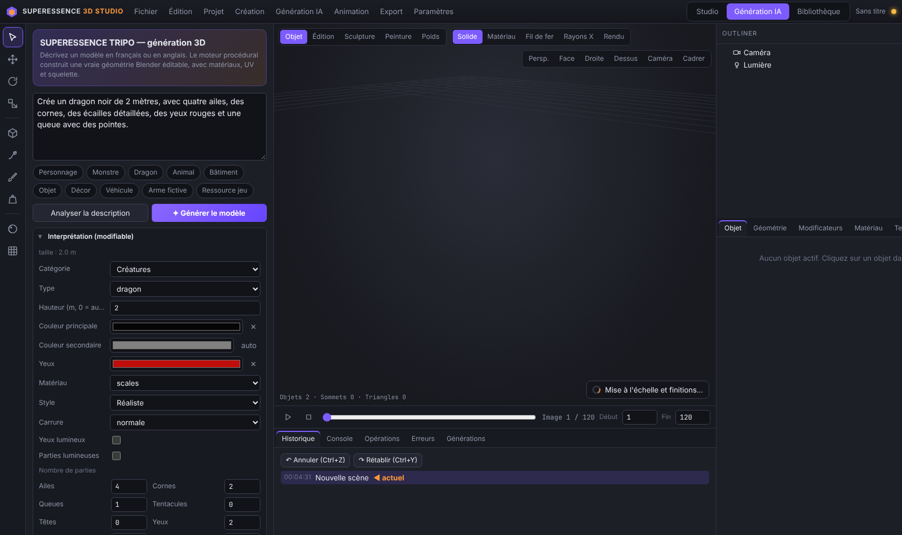
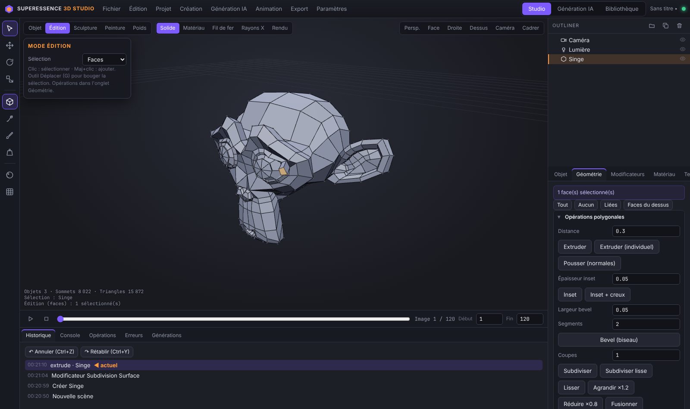
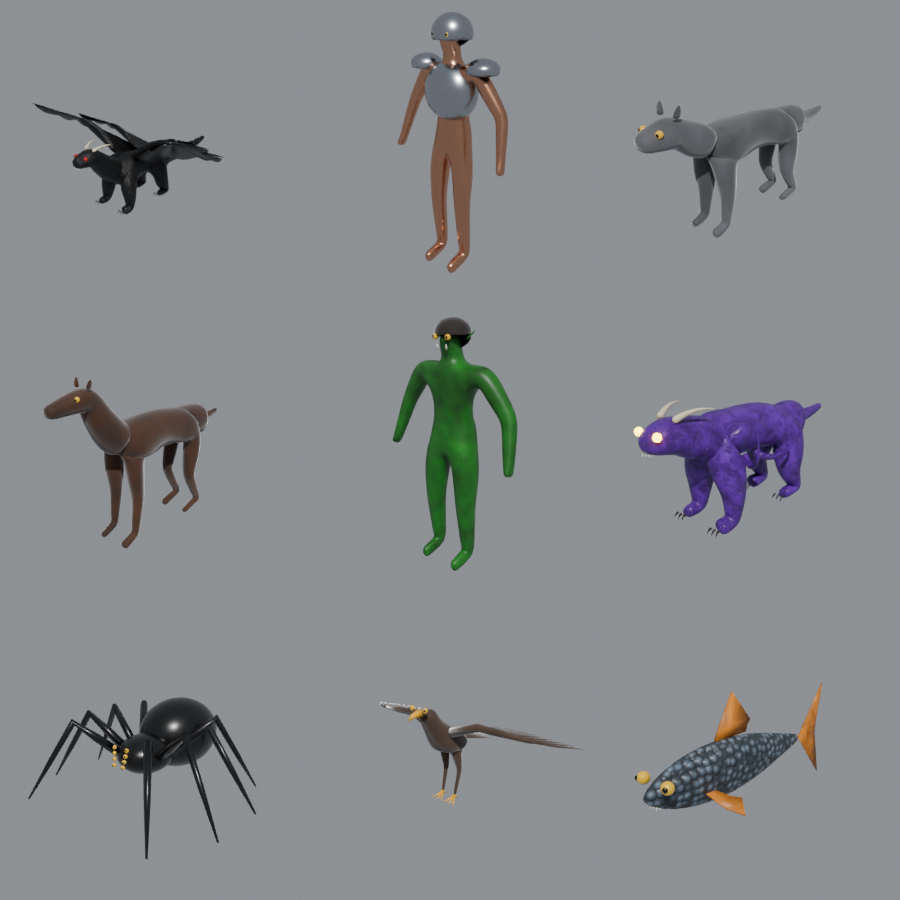

# SUPERESSENCE 3D STUDIO

Studio 3D local et gratuit qui réunit dans une seule application :

- **Mode Studio** : un environnement de modélisation dont le moteur est **le vrai Blender 5.3** (module `bpy`). Blender est la source de vérité de la scène, et chaque action de l'interface est une vraie opération Blender.
- **Mode Génération** : une génération 3D par description (français ou anglais) avec un **moteur procédural** qui construit une vraie géométrie Blender éditable, avec matériaux, UV et squelette.
- **Serveur MCP local** : Claude Desktop peut piloter le studio avec 45 outils réels (créer, modifier, sculpter, texturer, animer, rendre et exporter).

> **Transparence.** La génération incluse est **procédurale** : la géométrie est construite par algorithmes (graphes de squelette, révolutions, lofts, membranes, booléens, textures procédurales). **Ce n'est pas un réseau neuronal** comme Tripo AI. Les modèles obtenus sont des modèles stylisés de qualité « prototype ou asset de jeu stylisé », pas des sculptures photoréalistes. Un moteur neuronal open source peut être branché en option (voir « Moteurs IA facultatifs »).

<p align="center"></p>

| Génération | Mode édition | Exemples générés |
|---|---|---|
|  |  |  |

---

## 1. Installation

Il faut une connexion Internet pour l'installation seulement, puis tout fonctionne hors ligne. Espace nécessaire : environ 1,5 Go.

### Windows 10/11
1. Téléchargez le dossier `superessence3d`.
2. Double-cliquez sur **`install_windows.bat`**. Le script :
   - installe `uv`, un gestionnaire Python gratuit d'Astral ;
   - crée un Python 3.13 isolé dans `superessence3d\.venv` ;
   - installe Blender sous forme de module (`bpy` 5.3.0, environ 400 Mo) et les composants ;
   - ajoute SUPERESSENCE à Claude Desktop, après une sauvegarde de votre configuration.
3. Lancez **`start_windows.bat`**. Le studio s'ouvre dans votre navigateur à l'adresse `http://127.0.0.1:8765/`.

### macOS (Apple Silicon) / Linux (x86-64)
```bash
./install_linux_mac.sh
./start.sh
```

### Remarques
- Le studio n'écoute que sur votre ordinateur (`127.0.0.1`) et chaque requête exige un jeton secret.
- Le dossier de travail est `~/SuperEssence3D` : projets, exports, rendus, textures, bibliothèque, réglages.
- Option `--lan` : accès depuis une tablette ou un téléphone du même réseau Wi-Fi, avec le jeton affiché au démarrage.

### 1 bis. Application Android (APK)
`release/SUPERESSENCE3D-Mobile.apk` (version 0.2.0, environ 360 Ko, signée). Android 7 ou plus recommandé, avec « Android System WebView » à jour via le Play Store.

**Mode autonome (par défaut) : fonctionne seul sur le téléphone, hors ligne, sans ordinateur.** L'application embarque son propre moteur 3D (three.js) et un portage mobile des générateurs procéduraux :
- **Créer** : description en français ou en anglais (ou exemples en un toucher), interprétation modifiable (catégorie, hauteur, couleurs, ailes, cornes, tentacules, yeux…), qualité de Brouillon à Ultra. Toutes les catégories sont disponibles : créatures, personnages, animaux, bâtiments, véhicules, armes fictives, objets, décors. Aussi : photo vers 3D (silhouette gonflée et texturée, méthode géométrique) et formes de base.
- **Corps organiques** : surfaces lisses construites autour d'un vrai squelette d'os (champ de distance et marching cubes). Ils sont donc **animables** et s'exportent avec leur squelette.
- **Objet** : déplacer, tourner, mettre à l'échelle avec le gizmo tactile. **Sculpter** (dessiner, gonfler, lisser, aplatir, pincer, pli, avec symétrie) et **peindre** au doigt. Modification par texte (« agrandis ses ailes, ajoute six tentacules… »), variantes, matériaux (22 préréglages ou description texte), **animations** combinables (repos, respiration, marche, course, saut, attaque, vol, battement d'ailes, queue, regard, tentacules, reptation), duplication.
- **Scène** : liste des objets, éclairages (studio, extérieur, dramatique, nuit), fond, grille.
- **Biblio** : modèles enregistrés avec miniature, à réutiliser dans n'importe quel projet.
- **Export** : **GLB** (géométrie, couleurs, matériaux, squelette, animations ; vérifié dans Blender), **OBJ**, **STL** (Z vers le haut, pour l'impression). Chaque fichier est vérifié puis enregistré où vous voulez sur le téléphone. Projets : nouveau, enregistrer, ouvrir, import GLB, sauvegarde automatique de la session.
- Annuler et rétablir (20 étapes).

Ce que le mode autonome **n'a pas** par rapport au studio PC : le moteur Blender (modificateurs Blender, rendu Cycles, cuisson PBR, mode édition polygonal, FBX, profils moteurs de jeu) et Claude via MCP (l'application Claude mobile ne permet pas de brancher un serveur MCP local). La qualité des modèles est comparable à la génération procédurale du PC : stylisée, pas photoréaliste.

**Mode studio PC (facultatif)**, depuis le menu ⋮ › « Se connecter au studio PC » :
1. Sur l'ordinateur, lancez `start_mobile_windows.bat` (ou `./start_mobile.sh`), et autorisez Python dans le pare-feu.
2. Dans le studio : **Paramètres › Connexion mobile (APK)**. Un code à 6 chiffres s'affiche.
3. Dans l'application : **Rechercher le studio sur le Wi-Fi**, entrez le code. Vous obtenez le studio Blender complet sur le téléphone.

Reconstruire l'APK : `android/build_apk.sh`. Il embarque `mobile/web` et utilise le SDK Android de Debian/Ubuntu : `android-sdk android-sdk-platform-23 dalvik-exchange apksigner zipalign`. Pour tester l'application dans un navigateur : `cd mobile/web && python3 -m http.server`, puis ouvrez `http://127.0.0.1:8000/`.

---

## 2. Connexion à Claude

**Claude Desktop** (Windows, macOS) lance les serveurs MCP locaux par le transport **stdio**, déclarés dans `claude_desktop_config.json`. Le script d'installation fait cette étape automatiquement. Pour le faire à la main :

1. Claude Desktop › Paramètres › Développeur › **Modifier la configuration**.
2. Ajoutez le bloc présent dans `superessence3d/claude_desktop_config.json` (créé par `scripts/make_claude_config.py`) :
```json
{
  "mcpServers": {
    "superessence": {
      "command": "C:\\...\\superessence3d\\.venv\\Scripts\\python.exe",
      "args": ["-m", "superessence.mcp_server"],
      "env": { "PYTHONPATH": "C:\\...\\superessence3d" }
    }
  }
}
```
3. Redémarrez complètement Claude Desktop. Les outils « superessence » apparaissent.

**Claude Code** (terminal) :
```bash
claude mcp add superessence -- /chemin/superessence3d/.venv/bin/python -m superessence.mcp_server
```

Fonctionnement :
- Si le studio est fermé, le serveur MCP le démarre en arrière-plan.
- L'interface ouverte voit en direct ce que fait Claude.
- Les opérations destructrices (suppression, ouverture d'un projet non enregistré, effacement d'animation, suppression en bibliothèque) renvoient `confirmation_required`. Claude doit alors vous demander votre accord puis relancer avec `confirm=true`.
- `render_scene` renvoie l'image à Claude, qui peut donc vérifier visuellement son travail et le corriger.
- L'exécution de code Python arbitraire (`run_python`) est **désactivée par défaut** (Paramètres › Préférences).

### Claude sur téléphone (connecteur MCP distant)
L'application Claude mobile ne lance pas de serveur MCP local. Elle utilise des **connecteurs** distants, appelés en HTTPS par les serveurs d'Anthropic. Le studio tourne donc sur l'ordinateur et devient joignable par une adresse HTTPS secrète :

1. Sur l'ordinateur, lancez **`start_claude_mobile_windows.bat`** (ou `./start_claude_mobile.sh`). Le script installe `cloudflared` si besoin (tunnel HTTPS gratuit de Cloudflare, sans compte), démarre le studio et affiche une **URL de connecteur** du type `https://xxxx.trycloudflare.com/<secret>/mcp`. Une copie est enregistrée dans `~/SuperEssence3D/claude_mobile_connecteur.txt`.
2. Sur claude.ai (ou dans l'app) : **Paramètres › Connecteurs › Ajouter un connecteur personnalisé**. Collez l'URL et donnez-lui le nom « SUPERESSENCE ». Selon votre offre Claude, le nombre de connecteurs personnalisés peut être limité.
3. Dans l'app Claude du téléphone, activez le connecteur dans une conversation, puis demandez : « Crée un dragon noir… et montre-moi un rendu ».
4. Pour **voir le résultat en direct sur le même téléphone**, ouvrez l'APK SUPERESSENCE 3D › menu ⋮ › « Se connecter au studio PC » (même Wi-Fi), puis passez d'une application à l'autre.

Remarques :
- L'ordinateur et cette fenêtre doivent rester ouverts.
- L'adresse du tunnel gratuit change à chaque lancement : mettez à jour le connecteur, ou utilisez un tunnel Cloudflare nommé si vous avez un compte.
- Ne partagez pas l'URL, qui contient le secret d'accès. Pour en générer une nouvelle : `--renew`.
- Le mode autonome de l'APK (sans ordinateur) ne peut pas être piloté par Claude : les serveurs d'Anthropic ne peuvent pas joindre un téléphone directement.

### Exemples de demandes à Claude
- « Crée un dragon noir de 2 mètres, avec quatre ailes, des cornes, des écailles détaillées, des yeux rouges et une queue avec des pointes. »
- « Agrandis ses ailes, ajoute six tentacules et remplace les yeux par des yeux blancs lumineux. »
- « Fais battre les ailes de ce dragon, bouger sa queue et respirer son torse. »
- « Crée une peau de monstre noire, humide, avec des veines violettes et des reliefs organiques, et cuis-la en 2048. »
- « Prépare-le pour Godot et exporte-le. »

### Outils MCP (45)
| Domaine | Outils |
|---|---|
| Scène | `get_scene_info`, `list_objects`, `get_object_details`, `inspect_model` |
| Création | `create_mesh`, `generate_from_prompt`, `create_creature`, `create_character`, `create_animal`, `create_building`, `create_vehicle`, `create_weapon`, `create_prop`, `create_scenery`, `create_organic_model`, `image_to_model` |
| Modification | `modify_model`, `modify_geometry`, `sculpt_object`, `transform_object`, `add_modifier`, `apply_modifier`, `optimize_mesh`, `duplicate_object`, `delete_object`, `set_parent` |
| Matériaux | `create_material`, `set_material`, `create_texture`, `bake_textures`, `create_uv_map` |
| Animation | `create_rig`, `create_animation` |
| Rendu | `create_camera`, `create_lighting`, `render_scene` |
| Fichiers | `export_model`, `import_model`, `save_project`, `load_project`, `library_save`, `undo`, `redo` |
| Avancé | `execute_command` (accès aux 90+ commandes du moteur), `run_python` (désactivé par défaut) |

Ressources MCP : `superessence://project`, `superessence://scene`, `superessence://objects`, `superessence://object/{nom}`, `superessence://files/{exports|renders|projects|imports|textures}`, `superessence://library`, `superessence://generation-options`.

---

## 3. Utilisation de l'interface

| Zone | Contenu |
|---|---|
| Barre supérieure | Fichier, Édition, Projet, Création, Génération IA, Animation, Export, Paramètres · espaces Studio / Génération IA / Bibliothèque |
| Barre gauche | Sélection, Déplacer, Rotation, Échelle, Modélisation (mode édition), Sculpture, Peinture de sommets, Poids, Matériaux, Textures |
| Centre | Viewport 3D (géométrie évaluée par Blender), gizmos, grille, modes Solide / Matériau / Fil de fer / Rayons X, **Rendu** (vrai rendu Cycles), vues, timeline |
| Droite | Outliner hiérarchique (visibilité, collections, renommage, menu contextuel) · Propriétés : Objet, Géométrie, Modificateurs, Matériau, Texture, Rig & Anim, Scène, Export |
| Bas | Historique (cliquer pour revenir à une étape), Console (exécute des commandes moteur), Opérations, Erreurs, Générations précédentes |

**Raccourcis** : Q/G/R/S outils · Tab mode édition · E extruder · I inset · F cadrer · Suppr supprimer · Maj+D dupliquer · Ctrl+Z / Ctrl+Y · Ctrl+S · 1/3/7/0 vues · Espace lire l'animation · Alt+clic sélectionne le modèle entier.

---

## 4. Ce qui est réellement implémenté (et vérifié par les tests)

| Fonction | Implémentation |
|---|---|
| Objets, transformations, parentage, collections, scènes | API Blender `bpy` |
| Mode édition | Sélection de faces et de sommets par indices Blender ; extrusion, inset, bevel, subdivision, coupe en boucle, pont, spin, miroir, fusion, suppression, normales, trous, triangulation (`bmesh`) |
| Modificateurs | **Tous** les modificateurs de maillage Blender, réglages générés automatiquement par introspection RNA (Subdivision, Booléen, Miroir, Array, Bevel, Solidify, Decimate, Remesh…) |
| Sculpture | 10 pinceaux (dessiner, argile, gonfler, lisser, aplatir, racler, pincer, pli, bruit, saisir) qui déplacent réellement les sommets, avec symétrie X et remaillage voxel |
| Peinture | Couleurs de sommets (reliées au matériau pour le rendu) et poids d'os |
| UV | Projection intelligente, dépliage, cube, cylindre, sphère, lightmap |
| Matériaux | 22 préréglages procéduraux en vrais nœuds Blender (métal, or, rouille, bois, écorce, pierre, briques, peau, écailles, tissu, cuir, organique, plastique, verre, glace, cristal, lave, émission, sol, fourrure, œil) ; édition Principled et de chaque nœud ; matériau décrit par texte |
| Cuisson PBR | Base Color, Roughness, Metallic, Normal, Height, AO, Émission en 512 à 4096 px (Cycles), PNG enregistrés et matériau image exportable |
| Rigging | Armature issue de la structure exacte du modèle généré, ou gabarits (humanoïde, quadrupède, quadrupède ailé, serpent, chaîne) ; poids automatiques Blender avec repli robuste |
| Animation | 14 cycles combinables (marche, course, saut, attaque, vol, battement d'ailes, queue, respiration, repos, regard, tentacules, nage, reptation, rugissement), animations d'objets, clés personnalisées, timeline, aperçu en lecture |
| Rendu | Cycles (partout), EEVEE (carte graphique requise), Workbench, dans un processus séparé |
| Export | GLB, glTF, OBJ, FBX, STL, PLY, BLEND ; profils Unity, Unreal, Godot, mobile, impression 3D, haute qualité ; **chaque fichier est relu et vérifié** |
| Annuler / rétablir | Historique par instantanés `.blend` complets (fiable aussi sans interface Blender) |
| Bibliothèque | SQLite, versions, catégories, tags, recherche, duplication, export, miniatures rendues par Blender, aperçu 3D animé |

### Génération procédurale : catégories
- **Créatures et monstres** : dragon, hydre, kraken, démon, golem, griffon, slime, alien, bête. Ailes membraneuses ou à plumes, cornes, queues, tentacules, têtes multiples, yeux (lumineux ou non), pointes, griffes, crocs, écailles avec relief géométrique.
- **Personnages** : chevalier, guerrier, mage, orc, troll, gobelin, elfe, nain, zombie, squelette, viking, robot, golem…
- **Animaux** : loup, chat, cheval, ours, cerf, vache, lapin, lézard, tortue, oiseau, poisson, requin, serpent, araignée, insecte, crabe.
- **Bâtiments** : maison (vraies fenêtres en retrait), tour, château, temple, immeuble, boutique.
- **Véhicules** : voiture, camion, vaisseau spatial, bateau à voile, avion, tank, moto.
- **Armes fictives** : épée, dague, hache, lance, marteau, arc, bâton de mage, bouclier, faux, blaster.
- **Objets** : tonneau, caisse, coffre, table, chaise, lanterne, potion, vase, rocher, arbre, sapin, buisson, champignon, cristal, puits, clôture, couronne.
- **Décors** : terrain, montagne, désert, forêt, ruines, donjon éclairé, village.

Tous les paramètres du panneau (qualité, subdivision, remaillage, triangles cibles, lissage, symétrie, résolution de texture, cartes PBR, matériaux, UV, optimisation, nettoyage, normales, trous, échelle, collisions `UCX_`, préparation moteur de jeu, LOD) déclenchent une vraie opération Blender (`engine/generators/postprocess.py`).

### Image(s) vers 3D
- **1 image** : la silhouette est gonflée en volume fermé puis texturée par l'image. La profondeur réelle n'est pas devinée.
- **2 ou 3 images** (face, profil, dessus) : reconstruction par enveloppe visuelle (voxels sculptés par les silhouettes), puis remaillage.
- Ces deux méthodes sont **géométriques, pas neuronales**, et sont indiquées comme telles dans l'interface.

---

## 5. Moteurs IA facultatifs

Aucun modèle neuronal n'est inclus ni nécessaire. Si vous en installez un localement (par exemple **TripoSR**, licence MIT, image vers 3D), déclarez-le dans `~/SuperEssence3D/settings.json` :
```json
"ai_backends": [
  { "name": "TripoSR", "license": "MIT",
    "command": "python C:/IA/TripoSR/run.py {image} --output-dir {output_dir} --model-save-format glb",
    "output_glob": "{output_dir}/0/mesh.glb" }
]
```
Le studio exécute la commande en arrière-plan, vérifie le fichier produit et l'importe. **Vérifiez toujours la licence** d'un modèle avant un usage commercial : certains l'interdisent ou excluent des territoires.

---

## 6. Limites connues (honnêtes)

- **Qualité** : les générateurs produisent des modèles stylisés et cohérents (bons pour du prototypage, des assets de jeux stylisés et une base à retravailler), pas des sculptures détaillées comparables à une IA neuronale ou à un artiste.
- **Android** : Blender n'existe pas sur Android. L'APK fonctionne donc seule avec un moteur 3D mobile plus léger (voir section 1 bis), et peut aussi se connecter au studio PC pour disposer de Blender.
- **Viewport** : il affiche la géométrie exacte de Blender, avec des matériaux simplifiés en mode Matériau. L'aspect final est donné par le bouton **Rendu** (Cycles).
- **Undo** : chaque étape enregistre la scène entière. Sur des scènes très lourdes, chaque opération prend un peu plus de temps.
- **Sculpture** : elle agit sur le maillage de base. Pour des détails fins, densifiez d'abord avec « Densifier le maillage ». Ce n'est pas le Dyntopo de Blender.
- **EEVEE** nécessite une carte graphique. Sans carte graphique, utilisez Cycles.
- **Draco** (compression glTF) n'est pas disponible dans le module `bpy` : les GLB ne sont pas compressés.
- Pas de rendu de poils (particules) : la fourrure est un matériau.

---

## 7. Développement

```bash
.venv/bin/python -m pytest tests -q   # 89 tests avec le vrai Blender
```

Architecture :
```
superessence/
├── __main__.py          lancement (moteur Blender sur le thread principal + serveur web)
├── config.py            dossiers, réglages, jeton secret
├── mcp_server.py        serveur MCP (stdio) → API locale du studio
├── server/              FastAPI (API, fichiers, WebSocket), file d'exécution thread principal
├── engine/              toutes les opérations Blender (commandes @command, validation, historique)
│   ├── scene_ops.py modeling.py sculpt.py uv.py materials.py rigging.py animation.py
│   ├── io_ops.py render.py project.py library.py ai_backends.py mesh_data.py
│   └── generators/      prompt (analyse FR/EN), builder, organic, hard_surface, postprocess, image3d
└── web/                 interface (HTML/CSS/JS + three.js local, aucune ressource en ligne)
```

Licences : voir [LICENSES.md](LICENSES.md).
